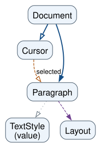

# Chapter 0 — The Compiler We Will Build

**Working orientation draft.** This chapter explains your construction assignment and how to use the book and its graders. Executable chapters and their verified commands are still being developed.

## TL;DR

We will construct a Lyric compiler whose implementation can be reproduced and understood from this book. The [Preface](preface.md) explains Bill's motivation, the two-edition plan, and the proposed connection to model training. This chapter establishes the technical construction contract.

This is a development-driven codebook. Its authors pair-program each working increment with independent graders, then write the teaching and exercises from that experience. Your task as the student is to reproduce the behavior and architecture from the chapter, not copy their solution. The book preserves the reasons as well as the requirements.

### Designed for LLM development, readable by humans

Lyric is intended to evolve with the LLMs that write and develop its programs. Our priority is reliable LLM construction, testing, and revision, while keeping the resulting code understandable to humans. Human readability is a requirement; human typing convenience is not an equal design goal.

This changes the collaboration, not the importance of expertise. A human need not type the implementation to contribute decisive judgment. Reading data structures, module boundaries, APIs, and consequential algorithms lets the human challenge assumptions, recognize missing relationships, and teach what the model has not understood. As the student building this compiler, make that participation possible: use clear names, explicit contracts, readable structure, and comments that explain reasons. LLM-friendly code must not become code that only the model can follow.

For each proposed language feature, ask: **Does it improve reliable LLM development or human understanding enough to justify its complexity?** Familiarity and convenience for manual editing are not sufficient reasons by themselves. Nor does shorter source automatically mean easier development or better understanding. We will evolve the language from experience rather than assume that every simplification improves model performance.

Block comments illustrate this choice. Lyric keeps line comments and omits block comments. An LLM can use either form, but block comments chiefly add authoring convenience, such as wrapping a region of existing text. Line comments already support both brief explanations and readable paragraphs. A second form adds delimiter, nesting, and unterminated-comment rules without adding explanatory power we need. We therefore omit it—not because comments are unimportant, but because one form serves both LLM authorship and human reading. This is a design judgment, not a measured claim about model accuracy.

### Designed for memory safety

**Lyric is designed to be memory-safe without a tracing garbage collector.** Its design combines explicit object lifetimes, counted value-class holders, checked storage borrows, maintained relationships, and compiler-generated cleanup. The intended benefit is direct control over representation and lifetime without leaving ordinary application code to balance reference counts or discover dangling accesses at runtime.

The safety claim has an explicit boundary: **safe Lyric programs should not access invalid memory, assuming a correct compiler and runtime, correct trusted relationship implementations, and no violations introduced through unsafe or foreign code.** This is the completed language's design goal. Individual construction chapters establish their supported subsets. Chapter 13 is implementing the relationship machinery described below; its full safety and debug-detection requirements are not yet verified.

#### Ownership accounting is not list correctness

An intrusive doubly linked list makes the distinction concrete. A parent holds first/last links; each child holds parent/previous/next links. `owns` accepts ordinary children only and cascades their destruction. `refs` does not own an ordinary child's lifetime, but an attachment to a counted child contributes one reference:

> Each attached `refs` membership to a counted child contributes exactly one owning reference to that child.

Here, a membership means one child attached to one parent through one particular relationship binding, not a separately allocated membership object. Two independently labeled attachments contribute two references. The parent backlink does not retain the parent, and first/last/previous/next structural links do not each retain their targets. Counting every field assignment would give the representation an ownership meaning it does not have and manufacture cycles merely by maintaining links.

For `refs` with counted children, the compiler therefore controls ownership at declared attachment and removal boundaries, rather than exposing source-level count-manipulation operations. Attachment checks that the child is detached, establishes the membership's owning reference before publishing the child, and completes the link updates. Removal checks membership, reconnects neighbors and parent endpoints, clears the child's membership links, and only then releases the membership's owning reference. That release can immediately finalize the child; subsequent access requires another independently valid holder. Invariant violations panic before mutation rather than leave half a relationship.

These boundaries give the compiler concrete control-flow obligations: a successful attachment contributes one owner, a successful removal releases it, refusal changes neither links nor counts, and no path releases the same contribution twice. Internal retain/release operations remain explicit in IR. Within the trusted relationship implementation, parent/child references used by the structural algorithm are borrowed, rather than automatically acquiring temporary owners. The algorithm must not use one after removal or a cascade ends its lifetime. Other counted types retain ordinary accounting, and an interface boundary that supplies an owning value to application code must establish that ownership. This is not a blanket exemption from typing, initialization, or effect analysis. The Chapter 13 implementation must complete this agreed distinction; its current partial support is not proof of the whole contract.

But those checks do **not** prove an arbitrary list implementation correct. Suppose removal forgets to clear the child's parent link. The compiler might generate exactly one release for that call, yet a second removal could pass a stale parent-membership check and release again. Or append could set the child's parent without connecting it into the parent's list: the count increases, but parent teardown cannot find the child. Balanced generated instructions are not proof of correct membership.

For the initial relationship design, the implementation is therefore trusted to maintain reciprocal links, unique membership within each binding, and traversal correctness. Ordinary code cannot rewrite relationship-managed links; it uses the declared operations. Proving arbitrary implementations would require stronger machinery, such as a restricted implementation language, verified built-in representations, or verification of reachability and membership contracts. We do not claim that ordinary type checking supplies that proof.

Tests must attack these invariants: repeated removal, wrong-parent removal, empty and singleton lists, first/middle/last removal, multiple memberships, and destruction during iteration. Runtime assertions help diagnose defects, but checking only that a child names the expected parent does not prove the entire structure correct. Compiler-controlled counting removes a dangerous source of mistakes; **correct trusted relation code remains part of the safety assumption**.

#### Destruction and iteration remain checked

Generated destruction follows the language's ordering: run the completed object's finalizer, detach it from all parent relationships, then detach non-owning children and destroy owned children, before releasing remaining fields and reclaiming storage. An owned child begins its own destruction before its membership is detached, so its finalizer runs first. Multiple owning relationships must not cause duplicate destruction.

The compiler must see an explicitly safe iterator when generated teardown iterates while destroying children. An ordinary iterator does not gain deletion permission because its current implementation appears tolerant. A safe iterator must preserve continuation and cleanup under permitted current-item destruction; effects that can destroy peers, including transitive cascades, are not permitted by that contract. Saving a next pointer is a technique, not a universal proof. Generated code receives no exemption from lifetime checking.

#### What the guarantee depends on

The checker must account for every invalidating effect: explicit destruction, counted releases, finalizers, relationship cascades, array relocation, and class-storage movement. Effects must propagate through calls, recursion, and generated methods. Reentrant destruction needs an enforced rule; ordering alone does not prevent double destruction. Nonnullable storage may start internally at zero for cleanup, but reading it before assignment of a nonnull value remains an error, and assigning null is forbidden.

The initial execution boundary is single-threaded. A later concurrency guarantee must protect lifetime as well as payload access: a borrow cannot simply survive an unlock because it was valid before the unlock. Foreign code must honor its contracts, and C lowering must avoid undefined behavior, including invalid pointer arithmetic, misalignment, out-of-bounds accesses, and overflow in allocation sizes. A safe source program is not protection against a miscompiling backend.

Memory safety does not mean leak freedom. Counted cycles or deliberately unreclaimed ordinary objects can retain memory without permitting invalid access. It also does not mean that a program cannot panic: safe rejection of an invariant violation or allocation failure is compatible with memory safety. Passing tests, independent reconstruction, and self-compilation provide valuable evidence, but none alone proves the all-program guarantee.

### When the human is no longer the necessary expert

Human participation is essential to our present collaboration, but we do not assume it must remain essential forever. Bill brings expertise earned through a lifetime of building systems: judgment about what matters, which approaches will fail, and when a plausible solution misses the real problem. An LLM's breadth of knowledge does not yet replace that contribution. We are not at the point where this project can dispense with it.

The human also **becomes an expert in the system we are building**. That expertise is earned during development, not supplied entirely in advance. It includes knowing why the data model has its particular relationships, what alternatives we rejected, which experiments failed, where the implementation is fragile, and what our tests actually establish. Reading a finished patch or hearing a summary of successful results does not reliably transfer that knowledge.

This is why we require pair programming while developing the reference implementation. The LLM explains consequential choices while the human can still question and steer them. They investigate failures together and make the resulting lessons explicit. The human need not type the code, but must have the opportunity to understand and challenge its construction. The purpose is not ceremonial approval of generated work: it is to keep the knowledge gained while coding from disappearing with the agent's working context.

The book preserves that learning beyond either participant's immediate memory. It must teach the reasons, algorithms, relationships, failures, and verification needed to reconstruct the system—not merely list interfaces or describe the final patch. Pair programming develops shared expertise; writing the demonstrated lessons makes that expertise available to the next builder. Neither a conversation record nor a completed chapter alone proves that an LLM has learned to apply the experience reliably to new work.

Our ambition includes crossing that boundary. If LLMs become capable of learning reliably from their own work—turning experiments, failures, and consequences into durable expertise that improves future decisions—the human may no longer be the necessary source of judgment. That could enable a much stronger cycle of recursive self-improvement: better models advancing the language, tools, and learning processes that help build their successors. Such a cycle may eventually move faster than humans can follow. This is a possibility we are building toward, not an accomplished capability or an inevitable outcome of collecting experience.

Bill's commitment is to contribute his expertise for as long as it is needed, not to make human participation a permanent constraint on the language. If that transition is demonstrated, our intention is to revise this book for superintelligent LLM developers, without requiring their language and implementation choices to remain readable by humans. Human-readable source would no longer be an end in itself. Correctness, meaningful verification, and explicit requirements would still matter; removing a readability constraint would not establish those properties automatically.

For this edition, human readability remains required. The future direction does not authorize a builder to declare itself beyond human expertise or silently discard the current instructions. The change belongs in an explicit revision of the book, supported by demonstrated capability.

### Two specifications, two jobs

The [language specification](../lyric-language-spec.md) defines accepted programs, their meaning, lifetime obligations, and failures. The [PEG grammar](../lyric-grammar.peg) and [grammar review](../grammar-review.md) record syntax and its remaining decisions. An example in a draft is not proof that a parser accepts it.

This book defines how to construct the compiler: its authoritative data, relationships, algorithms, implementation steps, and verification. If implementing a chapter reveals an ambiguity in the language, resolve the requirement with the human and update its authoritative home. Do not let a convenient parser or backend accident silently become language semantics.

Historical designs under background and reviews explain where choices came from. They do not override the current specification. The original compiler is useful evidence and a source of reusable ideas, not an oracle for features whose semantics we deliberately changed.

### Proposed starting target

The bootstrap implementation uses **C# 14 and .NET 10**, with **C as the output language**. The implementation initially runs single-threaded and supports a documented single-threaded Lyric subset. Later language features remain in the language design; they are not silently supported by the first executable.

Whole-program compilation, one supported development platform at first, and a small compiler-oriented library keep the initial boundary manageable. The exact platform/toolchain versions and launch commands must be established in the first executable chapter. This draft does not authorize dependency installation or claim those prerequisites have been verified.

Unsupported constructs must produce clear diagnostics and no purportedly successful executable. A chapter may implement only a subset, but it must say which subset and reject uses outside it. This is not permission to compile ordinary code without required safety checks and call the result safe.

.NET's garbage collector manages the bootstrap compiler's host memory. It does not determine Lyric's memory model. Generated Lyric programs must obey Lyric's declared lifetimes, reference counting, relationships, and checked failures without a tracing collector.

### Architecture is part of the assignment

Common owns the shared vocabulary: types, persistent state, parent/child relationships, and declarations of operations callable across functional modules. Common is a leaf in the application dependency graph; it does not import functional modules or implement their algorithms.

Functional modules supply implementations using that Common vocabulary. The top-level driver constructs and connects the system and sequences its work. A functional module must not depend on another module's implementation-only helpers or create copied state merely to make data easier to reach.

In the C# bootstrap, matching partial declarations and implementations compile together in **one assembly**. Common declares explicitly accessible partial methods and constructors; the responsible functional source supplies their bodies. Directories are source modules, not separate DLLs that can extend one another's partial types. Compiler diagnostics for missing implementations help, but C# does not automatically enforce our entire dependency discipline.

The compiler's object graph must demonstrate the rules it implements. Constructors establish required parent relationships through complete two-ended operations. Refused mutations leave both ends unchanged. Logical destruction detaches every parent, handles strong and weak children correctly, and completes any owned work before its lifetime ends. Garbage collection is not a substitute for these operations. Value-like types are identified explicitly rather than supplied with unnecessary holder backlinks.

We will define concrete compiler types when an increment earns them. Chapter 0 does not invent a full AST, service registry, universal pass framework, or extensibility system in advance.

### How to read the data-structure diagrams

At the start of each chapter that changes Common, a diagram introduces the new relationships and a short class guide explains the vocabulary. Read them before the implementation: they tell you what the program remembers and who is responsible for its lifetime. Classes marked **existing** appeared earlier; their new relationships belong to the current chapter. Each compiler relationship is drawn once, where it is introduced. A class may therefore appear in several diagrams without repeating its earlier arrows.

The example below is a fictional document editor, not a compiler design or an implementation assignment.

Start with **Document**. Its heavy solid blue arrows say that it strongly owns its paragraphs and cursor: destroying the document destroys those children. The filled arrowhead toward **Paragraph** means potentially many paragraphs; the open arrowhead toward **Cursor** means one cursor slot. An open head does not say whether that slot is required or may be empty—the operation's contract supplies that rule. Thickness and multiplicity are independent: one child can be strongly owned, and a collection can be non-owning.

Follow the thin dashed orange arrow from **Cursor** to **Paragraph**. It records the selected paragraph without owning it. Destroying the cursor must detach that relationship, not destroy the paragraph. Destroying a paragraph must likewise clear incoming selections rather than leave dangling references. The label **selected** names the role; labels that merely repeat the destination's class name add nothing.

The gray dotted arrow to **TextStyle** means stored value data. A style describes formatting rather than an independently managed model relationship. Value-like boxes are marked **value**; they do not need holder back-references or relationship-destruction machinery merely to reclaim their memory.

The purple dashed arrow from **Paragraph** to **Layout** records a different obligation: derived information must be retired when its source is invalidated or destroyed. In this example, editing a paragraph makes its old layouts unusable. That dependency does not make a layout the owner of the paragraph or give every object that refers to a paragraph permission to destroy it. The compiler uses this notation for semantic information that depends on a declaration.

Arrows show each relationship once. For relationship-bearing objects, the model maintains the reverse links too; it does not draw a second arrow merely to repeat them. Multiple parents are allowed, and ownership is not necessarily a tree. The adjacent class descriptions and text-relationship companions supply the roles and exact fields when a compact drawing cannot tell the whole story. These are data and lifetime diagrams, not flowcharts: an arrow does not mean “execute this next.”

### Compiler milestones and their evidence

The edition strategy is described in the Preface. Its implementation milestones require distinct evidence:

1. **Bootstrap:** the C# compiler accepts the required Lyric subset, rejects its invalid cases, and emits C whose execution matches the language contracts.
2. **Lyric implementation:** a compiler written in the supported Lyric subset is compiled by the bootstrap and passes the same relevant conformance suite.
3. **Self-hosting:** the Lyric compiler compiles its own source. Repeated stages are compared under controlled inputs and toolchain settings, with fixed-point criteria specified before claiming success.

A fixed point alone does not prove correctness: a compiler can reproduce its own bug. Positive execution tests, negative compilation tests, ownership/lifecycle checks, and human use remain necessary. Conversely, passing a few examples does not establish self-hosting. The book must distinguish each piece of evidence.

### Your skills and working relationship

Use the book's execution skill together with its coding and visible-reasoning skills. Activate their instructions through your agent's skill loader; if it has no loader, have the orchestrator supply them as persistent instructions. Merely reading a skill file is not activation.

The **execution skill** guides your chapter scope, implementation work, questions, checks, and completion report. The **coding skill** governs Common, relationships, destruction, and readable teaching code. The **visible-reasoning skill** requires useful explanations of what you will change, why, and what the evidence establishes. Explain engineering decisions, not private internal deliberation.

The **chapter-writing skill** guides the author in developing and teaching a working increment, building independent graders, and helping a fresh student reproduce it. You do not run that authoring process or recruit your own reviewer campaign during a chapter trial. Its result is the chapter and test contract you receive.

Ask the orchestrator when a requirement, test, or diagnostic is unclear. You may inspect your own code and authorized prerequisites, but not an existing target solution or private solution history. The orchestrator may consult an old solution for clarification and explain the requirement and reason; it must not supply that implementation. During your trial you own implementation edits. The orchestrator edits teaching and graders, not your solution.

### Read the tests; build the real behavior

Graders and fixtures live outside your solution tree. You may read their source, invocation flags, input snippets, expected outputs, and comparison rules. They are not secret. You may not edit them to obtain a pass; report a suspected defect to the orchestrator. A corrected grader must be rerun.

All graders for this book are written in languages **other than C# and Lyric**. The same independent tests can therefore accompany both editions. Their public entry points accept your implementation rather than reaching into a reference solution. Shared grader helpers may launch the compiler, enforce timeouts, and compare results; those helpers are readable too and must not conceal extra requirements.

You may write additional tests to diagnose and verify your work. Only the designated graders and their fixtures are preserved across executions. Your diagnostic tests do not automatically become book requirements or substitute for the graders.

Diagnostic scaffolding must obey the language being tested. If a lifecycle probe
embeds source using an invented keyword or builtin, its parse failure says nothing
about the semantic behavior you intended to test. Check that the input reaches
the intended phase, distinguish a harness assertion or setup failure from the
specified rejection, and preserve the failed diagnostic when correcting it.
Likewise, unchanged input hashes establish provenance, not compiler correctness;
CLI results and direct relationship/refusal/destruction checks provide different
evidence.

A successful command-line case requires **exit code 0 and the specified stdout**, plus any stated stderr or output-artifact conditions. An expected compilation failure requires the specified nonzero exit and diagnostic output. A crash, timeout, or unrelated failure is not a correct rejection. Each grader defines its comparison rules, including formatting and any allowed normalization.

Chapter 1 will introduce character parsing together with the error interface needed to test illegal input. Successful character handling and correct rejection are both part of the assignment; error handling is not deferred until a later chapter.

Some chapters may expose intermediate compiler behavior through documented inspection flags. Use the real component behind those modes, never hardcoded fixture responses or a parallel test implementation. Retain those interfaces as the compiler grows so an early character or lexer check still runs later. A reserved prefix such as `--inspect-` is a possible convention, not yet an adopted command-line interface. Concrete flags and commands will be specified in the executable chapters.

### Pass the cumulative suite

Every grader case is identified as **retained** or **chapter-only**. Retained checks protect behavior as later chapters extend the compiler; they are the default. Chapter-only checks examine a temporary construction milestone and state why they do not apply to later implementations.

To complete chapter N, pass **all retained graders introduced through N, plus its applicable chapter-N-only checks**. Do not rerun obsolete chapter-only checks against later stages or silently drop retained failures. Most checks will be fast enough to run routinely, allowing hundreds of focused checks by the end of the book. Required slow checks remain required and are listed separately.

Passing outputs does not excuse architectural violations. Review Common declarations, ownership, relationship updates, and cleanup as well as behavior. Report the actual commands and outcomes, assistance received, and blocked checks. Do not count an unperformed check as passed.

For a chapter trial, return your result and teaching feedback to the orchestrator; do not start the next chapter without the agreed authority. In an authorized whole-book execution, continue within that scope once the chapter's requirements are met. A passing trial is not automatically repeated after prose changes. Human acceptance and the practical **Take it for a Spin** walkthrough remain distinct from automated grading.

This orientation has no executable grader. Later exercises will provide working directories, prerequisites, exact commands, inputs, expected results, and practical walkthroughs. Do not invent missing commands or claim a compiler exists because this document describes one.

## Exercises — establish the construction contract

These are orientation checks, not instructions to implement the compiler or change the language specification. They use the documents already in this repository. There are no API credentials, paid inference calls, installation steps, or external effects required by these exercises.

### 1. Identify authority and scope

Read the Preface, the language specification's Sections 1, 2, 17, 18, and 19, and the status section of the grammar review. Be able to explain:

- Which document decides whether a Lyric program is valid, and which document will teach the compiler algorithms.
- Why an old compiler accepting a construct does not override the new specification.
- How the technical milestones above support the edition plan in the Preface, without treating an expected outcome as an already demonstrated result.
- Which remaining initial-scope choices are proposals awaiting acceptance, rather than already tested implementation facts.
- Why an unresolved feature must be resolved or explicitly excluded from an increment, not implemented by guesswork.

Success means the agent and human agree on the next increment's supported boundary without turning the whole open-decision register into a prerequisite for starting.

### 2. Trace the architectural obligations

Explain where a shared type's fields, constructor declaration, constructor body, and cross-module operation belong in the C# implementation. Then explain how a child reaches its owning compilation context without a copied service bag or global search.

Distinguish a temporary algorithm reference from a persistent model relationship. For a persistent relationship, explain who validates attachment, who updates both ends, what refusal preserves, and who removes it during destruction. Do not invent the complete compiler object model to answer these questions.

Success means the proposed first executable slice can demonstrate these rules directly, and a functional module does not need another module's hidden implementation state to do its work.

### 3. Separate the claims we will test

For each statement, identify what would establish it and what would not:

- “This source is valid Lyric.”
- “This invalid source is rejected before executable output.”
- “This generated program obeys its lifetime rules.”
- “The compiler generates balanced membership counts, so this custom linked-list implementation must be correct.”
- “This compiler respects the Common/functional-module architecture.”
- “The Lyric compiler can compile itself.”

Include at least one case where successful execution is insufficient—for example, a use-after-destruction program that happens not to crash. Tests and a written safety argument have different roles; neither a document hash nor a self-compilation result proves all-program memory safety.

### 4. Explain the grading boundary

Explain why each of these is or is not sufficient:

- A compiler exits nonzero on an illegal-character fixture but reports an unrelated exception.
- The current chapter's checks pass, but an earlier retained case fails.
- Your own diagnostic test passes, but a required grader has not run.
- You inspect a fixture and its expected output to clarify a requirement.
- You inspect an earlier target solution to discover how to implement the requirement.

State who may correct a defective grader and who edits your implementation during a trial. Distinguish a retained regression from a chapter-only milestone check.

### Completion boundary

For this orientation, explain the authority, architecture, and grading rules above to the orchestrator and resolve consequential ambiguities before construction. No compiler implementation or automated pass is claimed by completing these reading exercises. The first executable chapter will supply its concrete interfaces and commands; follow the execution scope you are given rather than treating the provisional book sequence as blanket permission.
