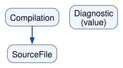

# Chapter 1 — Read the Source Faithfully

<!-- common-diagram:start -->



**New data structures.**

- **Compilation:** Owns the loaded source files and, from Chapter 4 onward, their shared semantic analysis.
- **SourceFile:** Owns the original immutable UTF-8 bytes and their path. Later chapters attach tokens and syntax nodes to this same source.
- **Diagnostic:** A value-like error code, message, byte offset, line and column. It stores a location, not a source-object relationship.

`Diagnostic` is returned as value data, so there is no ownership arrow from a source to its diagnostics.

[Text relationships and source fields](figures/ch01-relationships.md).

<!-- common-diagram:end -->

## Introduction

The character encoding wars took decades to run their course. Microsoft gave us a particularly weird corner of the battlefield: `WCHAR`, `TCHAR`, `wchar_t`, narrow APIs, wide APIs, and macros to pretend we had not just doubled the problem. Those were not three successive spellings of the same solution. They were different pieces of machinery we had to understand before we could get on with our work.

To be fair to Microsoft, Windows committed to Unicode before UTF-8 existed. Sixteen-bit UCS-2 looked like a sensible way to represent the world’s characters. Microsoft got there early, and then had to preserve the APIs it had shipped. The historical choice makes sense. Living with the consequences was still a pain.

Meanwhile, C and C++ could not even promise that a byte had eight bits. Yes, really. `sizeof(char)` is guaranteed to be 1, but that means one *byte*, and the number of bits in that byte is implementation-defined. If you think that sounds nutty, you are in good company. The property we actually want is `CHAR_BIT == 8`.

They also left the signedness of plain `char` up to the implementation. On the familiar eight-bit, signed-`char` machines, a byte with its high bit set becomes a negative `char`. Promote it to an `int`, and it stays negative. That is not what you want to use as an index into a character table. Converting it to `uint8_t` is defined; accidentally promoting it before you do that is the trap.

Unicode arrived slowly, and the early hope that sixteen bits could hold all the world's characters did not last. UTF-16 accommodated the larger repertoire with surrogate pairs: some characters need two sixteen-bit code units. It still works, but “wide character” does not mean “one whole character.” UTF-32 can hold a Unicode scalar in one code unit, but even that does not make one code point equal one character on the screen. The apparently simple problem keeps sprouting qualifications.

Ken Thompson and Rob Pike designed UTF-8 in 1992 and presented it publicly at the Winter USENIX conference in January 1993. It gave us a much better migration path. ASCII kept its old representation. Existing byte-oriented interfaces could carry the new text, and a C `char*` could still point to it. Editors and Unix tools could gain Unicode support without replacing every byte interface with a wide-character interface. That did not make every old text algorithm correct, but it meant we did not have to rewrite the world before using the world's languages.

And if you think all this sounds excessive, IBM kept EBCDIC alive for decades too long. I remember Emilia Käsper, a major OpenSSL contributor, pointing out a spelling error in an English identifier encoded as hexadecimal EBCDIC beside a line of code I was submitting. A spelling error. In hex. In EBCDIC. Apparently being a major OpenSSL contributor requires that sort of superpower. These crazy encodings did not help.

Programming languages can move even more slowly. Python did not support non-ASCII identifiers until Python 3. Plenty of us were still dealing with Python 2 around its retirement in 2020. Supporting Unicode text and letting programmers use their own language to name things turned out to be separate battles.

Then came [Trojan Source](https://trojansource.codes/). Unicode includes bidirectional formatting controls for mixing left-to-right and right-to-left text. Those controls are not Arabic letters, and Arabic and Hebrew text are not the problem. The problem is allowing invisible formatting instructions to make source code appear in a different order from the order the compiler reads. Malicious code can look like a comment, or a security check can appear to exist when it does not. The bytes have not been overwritten. The reviewer's view has been manipulated.

Editors, repository viewers, and compilers have added defenses. I do not want the correctness of our source review to depend on which viewer somebody happens to use. Lyric rejects literal bidi controls and other forbidden invisible characters throughout the source file, including comments and strings. If a program needs such a character as data, it can spell it visibly with an escape. This does not solve every look-alike-character attack, but it closes a door we have no reason to leave open.

Languages still go to great lengths to make UTF-8 just one supported encoding. Get over it. UTF-8 won.

Lyric is all-in on UTF-8 source. Its `string` type is a transparent alias for `[u8]`, an array of unsigned eight-bit integers, not a separate wide-character universe. The compiler rejects malformed UTF-8, including overlong sequences. Those are not legal alternative encodings. Unicode normalization is a different issue: later we require NFC spelling for identifiers, not silently normalize every string and comment.

Runtime strings can contain arbitrary bytes. That is deliberate. A cryptographic key is not text, and binary I/O must not reject it for failing a UTF-8 check. I have seen too much C++ code funnel binary data through something called a string. OpenSSL's byte-oriented key interfaces have the right idea: bytes and lengths. Converting string storage to unsigned bytes is not inherently undefined behavior; confusing text operations, signed characters, embedded zero bytes, and binary data is the practical hazard. Lyric does not need a conversion between `string` and `[u8]` at all. They are the same type.

For Lyric's C backend, we choose targets with eight-bit bytes and the exact-width integer types we need. We are not spending this project accommodating every historical machine the C standard permits.

So we begin with bytes, give them one unambiguous source encoding, and refuse to let invisible text change the program somebody thinks they are reviewing.

## TL;DR

Build the first executable part of the Lyric compiler: a source reader that strictly decodes UTF-8, rejects forbidden literal characters, and reports precise locations. Its inspection mode exposes what the real reader sees. It does not recognize tokens, check identifiers, parse programs, or generate C.

Use C# 14 and .NET 10 for this edition. Establish the Common/functional-module architecture immediately, with a compilation that owns source files through complete two-way relationships. Build against the public grader contract and pass all 82 retained Chapter 1 cases. The exact command-line and output requirements have one authoritative home in [the grader contract](../graders/README.md).

## Start with bytes, not guesses

A compiler must know exactly what the author supplied. If a text-reading API silently replaces a malformed byte sequence, later phases see a different program. If source locations count UTF-8 bytes as characters, a diagnostic after an accented letter points at the wrong column. If a comment scanner skips forbidden text, a hidden direction-control character can escape validation.

Read the file as bytes and retain that buffer as the authoritative source. Decode it deliberately. A successful decode yields a Unicode scalar and the number of original bytes consumed. A failed decode yields a source diagnostic, not a replacement character.

Three quantities must remain distinct:

- A **byte offset** identifies a position in the original file.
- A **Unicode scalar** is a code point excluding the surrogate range U+D800–U+DFFF. UTF-8 encodes one scalar in one to four bytes.
- A **displayed character** may combine several scalars, and its width depends on rendering. The source reader does not attempt to measure terminal cells or grapheme clusters.

Our diagnostic columns count scalars. For example, `é` encoded as U+00E9 occupies two bytes but advances one column; `😀` occupies four bytes and also advances one column. A tab advances one column, regardless of how a terminal displays it. Byte offsets start at zero; lines and columns start at one.

C#'s `char` is a UTF-16 code unit, not a general Unicode scalar. Use a strict scalar decoder such as `Rune.DecodeFromUtf8`, and examine its status. Do not accept the replacement rune it may supply on a failed decode. Both incomplete and invalid sequences are errors when scanning a complete source file.

### Non-canonical UTF-8 is not non-NFC text

An overlong UTF-8 sequence uses more bytes than necessary to encode a value. For example, `C0 AF` is not an alternative legal spelling of `/`. It is malformed UTF-8 and must be rejected. Encoded surrogates, values above U+10FFFF, stray continuation bytes, invalid continuation bytes, and truncated sequences are also malformed.

By contrast, `e` followed by U+0301 COMBINING ACUTE ACCENT is valid UTF-8. This reader accepts it. Later identifier recognition will enforce Lyric's NFC spelling requirement for identifiers; ordinary string and comment contents are not normalized by that rule. Applying NFC to the whole file would silently change text that the language requires us to preserve.

## Construct a small, complete object model

Do not invent the eventual AST or a universal compiler-pass framework. This chapter needs one strong ownership relationship and a few value-like facts.

A **Compilation** owns the source files loaded for its work. Each **SourceFile** retains a reference to that compilation, its supplied path, its original byte buffer, and its logical destruction state. The compilation retains its source collection and its own destruction state. A **Diagnostic** is value-like: an error code, message, byte offset, line, and column. It need not retain a source object or track holders. The driver already knows which source it is reporting on.

Place shared type declarations, persistent fields, and callable signatures in **Common**. Supply matching partial bodies in functional directories. Compile all parts into one assembly. Useful responsibility boundaries are:

- **Model:** construction, attachment, removal, and logical destruction.
- **Source:** decoding, source-wide character classification, position tracking, and inspection events.
- **Driver:** arguments, file I/O, console output, and the compilation lifetime.

Functional implementations use Common's declared vocabulary, not another module's implementation-only helpers. The driver is the top-level orchestrator. A generated immutable Unicode table is value data in Common, not a registry of live objects or a substitute for model relationships.

### Make ownership true at both ends

A source constructor takes its strong owning compilation and establishes the relationship through that parent's add operation. Prepare the source's fields before registering it. The add operation refuses a destroyed parent, destroyed source, or existing membership before changing either end. Add to the collection before setting the backlink: a failed collection allocation must not leave a backlink to a membership that never existed.

Removal validates the relationship, removes the collection entry, and clears the source's parent reference before returning. It does not destroy the source. A wrong-parent or duplicate attachment attempt must not quietly reparent an object or leave half a relationship.

Destroying a source calls its parent's remove operation, if attached, and marks its logical lifetime ended. Destroying the compilation closes further attachment and repeatedly destroys a remaining source. Do not pre-remove each source: its destruction owns the complete detach. Make repeated destruction harmless, and refuse scanning a destroyed source.

The driver encloses its work in cleanup that destroys the compilation on success and ordinary errors. .NET garbage collection eventually reclaims memory, but it does not maintain these logical relationships for us. The source buffer is owned by the source and is not mutated after loading; short-lived local references used to transfer or scan it are not additional persistent model relationships.

## Scan in source order

Maintain a byte offset, line, and column as local scan state. At each position:

1. Strictly decode the next scalar from the remaining bytes. If decoding fails, diagnose the starting position of that sequence and stop.
2. If it is CR, require an immediately following LF byte. Otherwise diagnose lone CR. For CRLF, expose one LF event whose original byte span has length two.
3. Check the scalar against the source-wide forbidden properties. If forbidden, diagnose it at the current position and stop.
4. If producing inspection output, emit the accepted scalar with its starting location and original byte length.
5. Advance the byte offset by the consumed width. LF advances to the next line and resets the column to one; any other accepted scalar advances the column by one.

At the end, emit an end-of-file event with the resulting position. Empty input therefore has an end event at byte zero, line one, column one. A file ending in a newline has its end event at column one of the following line.

CRLF handling is a view of the source, not a buffer rewrite. Keeping its two-byte span means later source ranges can still refer to the original file exactly. LF and CRLF are accepted; lone CR is not.

The first error in byte order wins. In particular, an earlier forbidden scalar is reported before malformed bytes later in the file. Do not pre-decode the entire file through a different mechanism that changes this ordering.

## Pin the character policy

The initial toolchain uses **Unicode 16.0.0**. Classification must not change when the operating system or .NET host updates its Unicode tables.

The public [Unicode data directory](../unicode/README.md) supplies the official files, license, source URLs, and hashes. It is input data students may read, not a reference compiler. Use `DerivedCoreProperties.txt` for Default_Ignorable_Code_Point, `PropList.txt` for Bidi_Control, and `UnicodeData.txt` for General_Category Cc. HT and LF are permitted controls; CR is permitted only within CRLF.

To construct a compact table, read the relevant property records, parse single code points and inclusive `first..last` ranges, and collect the forbidden intervals. Add the control-character entries except HT/LF/CR. Sort intervals by their lower endpoint and merge overlapping or adjacent intervals. The demonstrated Unicode 16.0.0 union has 21 intervals. This count is useful evidence, not a substitute for correct membership or a hidden requirement to use this representation.

A linear search through a small sorted range table is sufficient: stop with no match when the scalar is below the next lower bound; otherwise return a match if it is no greater than that interval's upper bound. A binary search or larger lookup structure is unnecessary here. A checked-in generated table lets ordinary builds work offline without reading the Unicode files at runtime. Keep the provenance and license with the project.

All Unicode 16.0.0 Bidi_Control scalars are also default-ignorable; verify this inclusion when generating a combined table rather than assuming it will hold for every future Unicode release. The diagnostic contract labels controls as `General_Category=Cc` and the other forbidden characters as `Default_Ignorable_Code_Point`.

### Validate before skipping anything

These bans apply everywhere: comments, raw strings, ordinary strings, backtick symbols, and any future syntax. A literal BOM is forbidden even at the start of the file. Do not silently strip it. The source reader does not need to recognize those contexts to enforce the rule; it checks every scalar before later phases can skip text.

Do not broaden the bans to all combining marks, all non-ASCII text, all right-to-left letters, or every unusual code point. Arabic and Hebrew letters remain valid at this layer. Adjacent legal scalars must remain accepted. The public graders test those boundaries as well as rejection.

Visible escape spelling is ordinary source text here. The bytes spelling `\u{202E}` do not contain a literal bidi control. Later string processing may turn that escape into runtime data; the reader must not recursively interpret it as hidden source.

## Make the first errors useful

Inspection is an explicitly bounded operation, not ordinary compilation. `--inspect-source FILE` exposes scalar events and EOF as JSON lines. An unfinished string may pass this mode because its source characters are legal; it must still fail when a later parser checks the program. Keep the mode working as the compiler grows so these tests continue to exercise the real source reader.

Separate success data and diagnostics. Valid inspection writes events to stdout, nothing to stderr, and exits zero. A source error writes no stdout, emits its specified diagnostic on stderr, and exits one. Incorrect invocation exits two. Use the [public contract](../graders/README.md) for exact fields, error codes, messages, and comparison rules; do not infer them from examples alone.

A late source error must not leave earlier scalar events on stdout. Our simple solution is to validate silently, then scan the same immutable bytes again to emit events. Both passes use the same scanner, so validation and inspection cannot drift into separate algorithms. This costs a second linear pass but avoids buffering every event or duplicating normalized source text. There is no demonstrated performance need for more machinery yet.

Diagnostic messages show a visible code point and property, never the forbidden character itself. Quote the supplied filename as a JSON string before placing it in a diagnostic, so an unusual filename cannot inject unescaped controls. Do not echo uncontrolled operating-system error text for file-read failures. An explicitly supplied empty or invalid filename is also a controlled file-read error, not an unhandled host exception. Catch the relevant path and I/O exceptions at the read operation, not every exception in the compiler.

The walkthrough found a small distinction between machine correctness and human readability: .NET's default JSON serializer escaped the plus sign in `U+00E9`. The parsed value was correct, but the output was awkward to inspect. Use readable JSON for scanner-generated keys, numbers, and code-point strings. This does not justify weakening escaping for filenames or dumping raw source text into the output.

## Exercises

Implement this chapter in your assigned solution workspace. Use only this teaching, the language specification, readable graders/Unicode fixtures, and your own work. Do not inspect the reference compiler, its table generator, or private authoring notes. You own implementation changes; report suspected grader defects to the orchestrator rather than editing expected results.

### 1. Build the source reader and command-line interface

Create a C# 14/.NET 10 executable with the architecture, relationships, scanner behavior, and diagnostics described above. A convenient layout is `compiler/` with a single project and Common, Model, Source, and Driver directories. The exact internal type names are not graded output, but the ownership and module rules are requirements.

Support `--unicode-version` and `--inspect-source FILE` exactly as specified in the grader contract. Use actual decoding and property classification, not fixture-specific answers. Do not add tokenization, an AST, code generation, or a general testing framework to this chapter.

### 2. Run the retained graders

Prerequisites are a .NET 10 SDK supporting C# 14, Python 3.10 or newer, the public graders, and their adjacent `unicode/` data directory. The demonstrated environment is SDK 10.0.403 on macOS ARM64. The bootstrap requires no NuGet packages. Use an offline NuGet configuration with cleared package sources; an SDK-only build does not need a network feed.

From your solution workspace, with the project at `compiler/Lyric.csproj`:

```sh
dotnet build compiler/Lyric.csproj --nologo --tl:off
python3 "$GRADERS/ch01/grade.py" -- dotnet compiler/bin/Debug/net10.0/Lyric.dll
```

Set `GRADERS` to the absolute path of the supplied read-only graders directory before running the command. Replace `dotnet` with the installed host's absolute path if necessary. If your project/output path differs, supply the actual executable command after `--`; the grader appends operation arguments. The public grader README documents the complete invocation boundary.

Repeat for Release:

```sh
dotnet build compiler/Lyric.csproj -c Release --nologo --tl:off
python3 "$GRADERS/ch01/grade.py" -- dotnet compiler/bin/Release/net10.0/Lyric.dll
```

Both builds and both grader runs are required. Each grader run must exit zero and report **82 passed; 0 failed**. All Chapter 1 cases are retained; there are no chapter-only tests. Chapter 0 has no executable grader to replay. Future chapters must continue passing these cases through the real inspection mode.

The cases cover accepted output, locations, line endings, malformed encodings, forbidden-property boundaries, source contexts, first-error ordering, and invocation errors. Expected rejection means the correct diagnostic and exit status, not a crash or arbitrary failure. These are representative regression checks, not exhaustive enumeration of every UTF-8 byte sequence.

### 3. Check the model, not just its output

Read your Common declarations and trace construction, refused attachment, removal, source destruction, and compilation destruction. Verify that both relationship ends agree, refused operations leave them unchanged, destroyed objects cannot be reattached, and repeated destruction is harmless. Explain why partial constructors and methods compile into the same objects rather than runtime wrappers.

You may write extra tests for your own confidence. They do not replace the graders or automatically carry forward across executions. Report actual checks and any assistance accurately. Passing CLI tests alone does not establish structural compliance.

## Take it for a Spin

From the repository root, run:

```sh
make release
make spin01
```

You need Make, the .NET 10 SDK, and Python 3.10+ installed. `make release`
builds the compiler; `make spin01` also ensures Release is built, then runs the
[small walkthrough script](../tools/spin01.py). It creates local disposable files,
shows source positions and an expected rejection, then removes the files. No
credentials, paid calls, or network services are involved. No tools are installed.
If `dotnet` is not on PATH, use `make spin01 DOTNET=/absolute/path/to/dotnet`.

To build both Debug and Release and run **all current retained automated tests**:

```sh
make test
```

This runs the public graders for every implemented chapter, plus their comparison
self-check, and stops on the first failure. It is separate from this short
walkthrough. The chapter exercises retain the explicit grader commands for
independent implementations and read-only grader workspaces.

The first file produces five scalar events, then EOF. The accented letter begins at byte zero and spans two bytes. CRLF begins at byte two and spans two bytes. The CJK letter begins at byte four, the tab at byte seven, and the emoji at byte eight. EOF is byte twelve, line two, column four. The second file produces `LYC002` for U+202E at byte three, line one, column four, with no scalar events. The temporary directory is removed automatically; no server or background process remains to stop.

Your human collaborator should try this walkthrough before accepting the chapter. An agent demonstration and passing graders are evidence, not a substitute for that use.


## Sources for the opening

- [Rob Pike's UTF-8 history](https://www.cl.cam.ac.uk/~mgk25/ucs/utf-8-history.txt), including the September 1992 correspondence.
- [Winter 1993 USENIX proceedings](https://www.usenix.org/conference/usenixwinter1993conference), listing Pike and Thompson's “Hello World” presentation.
- Raymond Chen, [“The sad history of Unicode printf-style format specifiers in Visual C++”](https://devblogs.microsoft.com/oldnewthing/20190830-00/?p=102823), explains Windows' early UCS-2 commitment and its first-mover disadvantage.
- [RFC 2044](https://www.rfc-editor.org/info/rfc2044/) documented UTF-8 in 1996; [RFC 2277](https://www.rfc-editor.org/info/rfc2277/) established the January 1998 IETF policy requiring UTF-8 support for text in protocols entering its standards process. Documentation, public presentation, and protocol policy are distinct milestones.
- C++ working draft: [`sizeof`](https://eel.is/c++draft/expr.sizeof), [byte definition](https://eel.is/c++draft/intro.memory), and [plain character types](https://eel.is/c++draft/basic.fundamental).
- Microsoft: [character types](https://learn.microsoft.com/en-us/cpp/cpp/char-wchar-t-char16-t-char32-t) and [surrogates and supplementary characters](https://learn.microsoft.com/en-us/windows/win32/intl/surrogates-and-supplementary-characters).
- [PEP 3131: Supporting Non-ASCII Identifiers](https://peps.python.org/pep-3131/), adopted for Python 3.0.
- [Trojan Source](https://trojansource.codes/), Nicholas Boucher and Ross Anderson's attack description and defenses.

The OpenSSL/EBCDIC story is the author's recollection.
