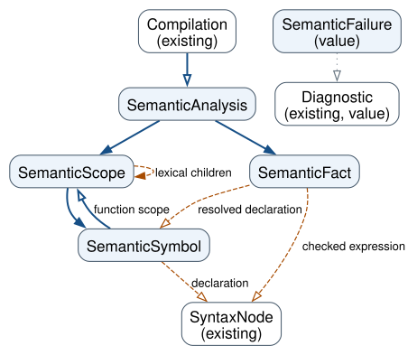

# Chapter 4 — Give the Program Meaning

<!-- common-diagram:start -->



**New data structures.**

- **SemanticAnalysis:** The compilation-owned analysis of all source trees. Owns every scope and checked fact, including incomplete construction.
- **SemanticScope:** A lexical namespace that owns declaration symbols. Analysis owns every scope; a function also owns its function scope. Lexical parent/child links are non-owning.
- **SemanticSymbol:** The identity of a declaration, owned by its scope. User declarations link to syntax; builtins need no invented syntax node. Function symbols also own their function scope.
- **SemanticFact:** A checked expression: its type, optional constant and resolved declaration. Analysis owns it; syntax and declaration links let checking and emission share the same result.
- **SemanticFailure:** A value-like exception carrying a Diagnostic to unwind semantic checking. It does not own semantic model objects.

Types are scalar/byte-array enum values at this stage. The structured type descriptor arrives in Chapter 7. Non-owning semantic dependencies still participate in invalidation: deleting a declaration retires facts that depended on it.

[Text relationships and source fields](figures/ch04-relationships.md).

<!-- common-diagram:end -->

## TL;DR

A syntax tree tells us how source is structured. It does not tell us whether a name exists, whether a call supplies the right arguments, or whether a local has a value when we read it. Add a semantic analysis that answers those questions and retains its answers for later compilation.

Build the shared model first: compilation-owned analysis, lexical scopes, declaration symbols, and checked expression facts. Maintain every relationship in both directions. Then collect function declarations, construct signatures, and check bodies. Resolve standard functions through the same symbols as user functions. Check a bounded set of types, calls, local bindings, integer arithmetic, returns, and statement conditionals. Reject parsed but unsupported constructs explicitly.

This chapter checks hello world; it does not run it or emit C. A successful check is silent. The useful result inside the compiler is a graph of resolved declarations and typed expressions, not another printed tree.

## From grammatical to meaningful

Chapter 3 can parse this:

```lyric
func main() {
    println("Hello, world!")
}
```

The parser recognizes a function containing a call. The checker must establish that `println` names a function, that its one argument has type `string`, and that `main` is a valid executable entry point. Changing the call to `missing()` remains grammatical but must fail name resolution. Passing `true` to `println` must fail type checking.

Our first semantic increment supports nongeneric top-level functions; explicit parameter types; unit, boolean, integer, floating-point, and byte-array type identities; string, boolean, unit, and decimal integer expressions; direct calls; local bindings and assignment; checked integer `+`, `-`, and `*`; explicit returns; and statement-position `if`/`else`/`else if`. Floating-point type identities are useful in signatures, but floating literals and operations are not implemented here.

Classes, interfaces, generic checking, loops, references, value-producing conditionals, other operators, and many other parsed forms remain unsupported. Do not ignore those nodes. Produce the explicit unsupported diagnostic. Parsing the full grammar was not permission to accept unchecked programs.

The [language specification](../lyric-language-spec.md) remains the language contract. This chapter defines a bounded implementation milestone, not a smaller replacement language. In particular, rejecting statements after an unconditional return is a temporary checker boundary, not a new Lyric prohibition on unreachable code.

## Build the semantic model before traversing bodies

Keep shared declarations and persistent state in Common, with matching partial implementations in Semantics. The parser and model invoke operations declared in Common; they do not reach into semantic implementation helpers. The driver connects parsing and checking.

### One analysis belongs to the compilation

An analysis belongs to `Compilation`, not to one `SourceFile`. Function declarations can eventually span multiple files, and a compilation needs one global namespace. Attaching an analysis to each source would duplicate standard declarations and make cross-file references awkward.

A compilation owns at most one `SemanticAnalysis`. The analysis owns all semantic scopes and all checked expression facts. Each owned object retains its owner backlink. The current command-line interface reads one file, but that does not change the correct owner of the model.

A lexical scope has a weak parent relationship and a collection of weak lexical children. These edges describe lookup, not recursive ownership. The analysis owns even a scope whose construction or checking has not finished. This makes cleanup possible without requiring a completed lexical tree.

A scope strongly owns its declaration symbols. A function symbol additionally owns its function scope; that scope also remains registered with the analysis. Preserve both relationships and their reverse links. Multiple real owners are permitted: destruction must remove each membership, not pretend the graph is a tree.

Each supported function-body or conditional-arm block gets a distinct scope below the function scope. Sibling blocks may use the same local name. A nested block may not shadow a name visible through its parent chain.

### Symbols identify declarations

A symbol records its name, declaration role, type, mutability, owning scope, and optional syntax declaration. Start with the roles Function, Parameter, Local, and Type. A function symbol's type is its result type; a local or parameter symbol's type is its value type. An unfinished type is not a dynamic type.

A user declaration has a weak link to its syntax node, and that node has the reverse declared-symbol link. Standard declarations have no source node. Do not invent source positions for them.

Function signatures have one authoritative representation: the function's ordered parameter symbols in its function scope, plus the function symbol's result type. Parameter count and indexed parameter access traverse those symbols. Do not copy the types into a second signature array that can drift out of sync.

Lookup searches the current scope and then lexical parents, never siblings. Adding a symbol refuses an already-visible name before changing either membership. This enforces no-shadowing through the actual scope structure. Collection order matters too: register all top-level names before introducing parameters or locals, so later top-level declarations cannot evade a no-shadowing check performed earlier.

### Facts identify checked expressions

A `SemanticFact` records a checked type, its syntax node, an optional resolved symbol, and an optional exact integer constant. The analysis owns it. Syntax has a reverse fact link; each symbol retains its uses. These are persistent relationships, not temporary traversal references.

For a variable expression, the fact identifies the variable's symbol. For a call, the call fact identifies the function symbol and records the result type. Do not attach a misleading fact that treats the bare function name as a value of its result type. Later code generation can follow the call fact directly rather than repeat name lookup.

Type identities are value-like enum values. Use one byte-array identity for both `string` and `[u8]`: the alias must not become a nominally distinct type. An exact integer constant is also value-like; `BigInteger` is useful in the C# bootstrap because it represents every Lyric integer boundary without host overflow. A missing constant means unknown, not zero. No holder backlinks are needed for these values.

### Invalidate and destroy deliberately

Source or syntax mutation can invalidate resolutions across the compilation. Retire analysis before removing or changing referenced input structure. Adding a source clears analysis after its successful attachment. Validate relationship changes first: refusing an invalid insertion must not destroy an otherwise valid analysis. Adding semantic annotations is not a syntax mutation and must not invalidate the analysis being built.

Every constructor registers through the appropriate relationship methods. If a later attachment fails, unwind the completed memberships through normal destruction. For example, a fact attaches to analysis, syntax, and optionally symbol; failure at any later step must leave no escaped earlier link. Each add/remove operation updates both ends before returning.

Destroy analysis facts before scopes. A fact detaches from its symbol uses and syntax backlink, then leaves its analysis. Destroying a symbol retires its function scope, declaration link, and dependent facts before removing scope ownership. Destroying a scope detaches its function and lexical links, detaches weak children without destroying them, destroys owned symbols, and removes analysis ownership. Re-read maintained collections during cleanup so multiply owned scopes are not destroyed twice.

Backlinks make dependencies reachable; ownership determines lifetime. Neither substitutes for the other, and C# garbage collection does not repair a stale semantic graph. Keep destruction idempotent. Check failed construction, refused attachment, and destruction from each owning direction with your own focused model tests as well as reading the code.

## Resolve declarations before checking uses

Start each check by retiring the previous analysis and constructing a fresh analysis and global scope. Register supported standard types and the ordinary function declarations:

```text
print(text: string) -> unit
println(text: string) -> unit
assert(condition: bool) -> unit
```

All three have real parameter symbols and function scopes. Call checking must not contain a special branch for those spellings. The language makes public standard exports automatically visible in the global namespace; this increment implements the supported declarations, not the entire standard library. Printing eventually writes bytes, with `println` adding LF. This chapter establishes signatures only, not output execution or I/O-failure behavior.

These string-only signatures are the output primitives, not the whole long-term convenience interface. Callers should not have to manually convert and concatenate every value. The planned everyday interface is string interpolation, for example `println(f"Count: {count}, total: {total}")`. Formatting produces a string independently of output, so that same text can be sent to a file, diagnostic, or test; plain printing never interprets formatting directives in its input. Interpolation is not supported by this chapter’s semantic increment. A later increment must establish formatting rules for numbers and user-defined values before implementing it. Direct generic printing such as `println(count)` remains a possible convenience, not a requirement here. For this chapter, passing a non-string argument still correctly fails type checking.

`assert` is an ordinary standard function, not new statement grammar. Require exactly one `bool` argument and a unit result through the same call checker. Both `assert(true)` and `assert(false)` are semantically valid: the false case is a runtime assertion failure, not a constant-expression rejection. No implicit integer-to-bool conversion or optional message is provided. The next chapter implements its execution; later optimized and unsafe builds must preserve it.

Use three passes over user functions:

1. Collect every top-level function name, refusing duplicates and unsupported declaration forms.
2. Construct every function scope and parameter list, and resolve its result annotation. An omitted result is unit. Refuse unsupported generic or other signature constructs.
3. Check every function body against its completed signature.

A call to a later function now works without a special forward-reference mechanism. Parameters are immutable and begin initialized. Locals are different: introduce them in statement order, not in the collection pass.

Executable checking requires exactly one nongeneric top-level `main`, with no parameters and unit result. Duplicate-name checking prevents multiple declarations. Library checking performs the same semantic work without requiring an entry point. Neither mode executes a function.

## Type values, not their convenient current contents

For an unsigned integer of width `w`, the range is zero through `2^w - 1`. For a signed integer it is `-2^(w-1)` through `2^(w-1) - 1`. Define range membership using exact integers.

Implicit conversion permits identity, whole-range integer widening, and `f32` to `f64`. Integer widening is a range-inclusion question, not a signedness shortcut: `u32` fits `i64`; `i32` does not fit `u32`. Do not inspect the current value of an already-typed variable to permit narrowing.

For arithmetic, select an existing operand type that contains the other operand's entire range. If neither can contain the other, reject; do not invent a third type. The destination does not alter an already-typed operation's width.

### Give unsuffixed literals their context

The lexer recognized the spelling but deliberately did not convert it to a machine integer. Accumulate decimal digits into an exact magnitude, skipping already-validated underscores. Then choose the type and check its range.

An explicit suffix fixes the literal type. Otherwise, use an expected integer type when available, or default to `i32`. For a directly negated integer token, apply the sign before checking range: `-128i8` is valid even though positive `128i8` is not. General unary negation is outside this increment.

For a binary operation, an already-typed neighboring operand supplies literal context first. When neither operand supplies a type, use the surrounding return, binding, assignment, or parameter expectation. Propagate that context through groups and literal-only arithmetic. Without any such context, use `i32`.

```lyric
func increment(x: u8) -> u8 {
    return x + 1
}

func seven() -> u8 {
    return 1 + 2 * 3
}
```

The first calculation uses the neighbor's `u8` type. The second obtains `u8` from the return contract. By contrast, a wider return type does not rescue `127i8 + 1i8`: the operation itself overflows `i8`.

Implement a read-only type-hint walk over suffixes, resolved names, direct-call result types, groups, and supported arithmetic shapes. An unsuffixed literal alone supplies no hint. Combining typed hints uses the same operand-type selection rule. This walk neither evaluates operands nor creates semantic facts. Actual expression checking still visits left before right and creates each fact once. Discovering the right operand's declared type is not permission to evaluate it early.

Do not implement those walks with unbounded recursion. Precedence climbing builds a long left-associated chain with shallow parser recursion, but its tree still has a deep left spine. Repeatedly scanning each left subtree for hints also makes a chain quadratic. The parser's recursion guard cannot protect this later pass.

For each expression entry, build a temporary node-to-hint map bottom-up with an explicit stack of `(node, ready)` frames. On first visiting a supported binary or group/unary hint node, push its completion frame and then its children. On completion, combine the already-computed child hints. Names, suffixes, and direct-call results are leaves of this discovery walk; call arguments are checked separately against their parameter expectations. Each discovery node is visited a bounded number of times. Discard the map after checking the expression; it is algorithm storage, not another persistent semantic model.

Use a second stack of `(node, expected type, ready)` frames for actual checking. For a binary node, push parent completion, then right, then left. Supply each child with its sibling's hint, falling back to the incoming expectation. This LIFO order preserves left-before-right checking. Group frames pass the expectation inward. Parent completion reads the checked types and constants from child facts and creates its own fact once. Direct signed literals remain one check, so their positive magnitude is not separately rejected. Calls resolve their signature and check arguments in source order using the same expression entry point. Parser-bounded nested calls do not require recursively walking the unbounded arithmetic spine.

The retained `long-context` and `long-neighbor` cases each contain 4,000 terms. They require silent success, not a timing threshold; existing negative arithmetic cases still require each intermediate overflow to be diagnosed.

After checking the operands of `+`, `-`, or `*`, determine the operation type. If both facts have exact integer constants, calculate the result exactly and reject it if outside that type's range. Check at every operation: a later subtraction or wider destination cannot conceal an overflowing intermediate. Do not propagate a local's initializer constant as though it changed the local's declared range. Dynamic arithmetic is typed here; runtime overflow enforcement belongs to later executable lowering.

## Bindings, assignments, and reads are different events

A binding contains a name pattern, optional type annotation, and optional initializer. This increment supports only simple names. Resolve the annotation and check the initializer before registering the new local. That prevents accidental forward or self-reference. Infer an omitted type from the initializer; a declaration without an initializer needs its annotation under the syntax contract.

Maintain two temporary sets of symbol identities while checking a function:

- **Definitely assigned:** initialized on every path that reaches this point. Reading a local or parameter requires membership.
- **Possibly assigned:** initialized on at least one reaching path. Assigning immutable storage requires absence from this set.

An initialized binding enters both sets. An uninitialized binding enters neither. A successful assignment enters both. Parameters start in both and are immutable. Thus an uninitialized `let` may receive its value once, whereas a `var` may be reassigned.

An assignment target is not a read. Resolve its symbol, check mutability and the right-hand expression against its declared type, then record a target fact and mark assignment. This permits first initialization without allowing `x = x` to read an uninitialized value. Only simple-name `=` assignment is supported here.

These sets are algorithm state, not extra persistent fields on every symbol. Assignment depends on the path being checked; a single mutable `Assigned` flag on a declaration would confuse alternatives.

## Join only paths that reach the next statement

Have block checking return a boolean meaning **control can continue past this block**. This is more useful than remembering that some return appeared somewhere.

For a return, check its expression against the function result type, or use unit when absent, then mark the path noncontinuing. A nonunit function is valid only when its complete body cannot continue to the end. Merely ending a nonunit body with an expression is not an explicit return.

For statement-position `if`:

1. Check that the condition is boolean.
2. Save the incoming definite and possible sets.
3. Check the then-block in its own lexical scope and save its outgoing sets and continuation result.
4. Restore the same incoming state before checking the alternative. An absent else is an unchanged continuing path. An else-if recursively uses the same procedure.
5. If both paths continue, intersect definite assignment and union possible assignment.
6. If exactly one continues, use only its state. If neither continues, there is no outgoing execution path.

Do not prune alternatives just because the condition is a literal. This increment checks both branches conservatively.

```lyric
func show(flag: bool) {
    let text: string
    if flag {
        return
    } else {
        text = "ready"
    }
    println(text)
}
```

Every path reaching the call initialized `text`; the returning path does not weaken that conclusion. Conversely, assigning an uninitialized `let` in only one continuing arm does not permit a read afterward, and it prevents a second assignment afterward: that assignment could occur twice on one path. This is why intersection alone is insufficient; possible assignment needs union.

On block exit, remove flow-set entries for locals owned by that block scope. Do not destroy their symbols. Semantic facts still reference them, and the analysis must preserve them for later passes. Outer assignments remain in the sets for the join.

Semicolon discard markers are structural and can be skipped, including after return. Other following statements currently receive the unsupported diagnostic rather than being silently left unchecked. Standalone block statements and value-producing `if` remain explicitly unsupported; do not treat a statement conditional's unit fact as an implementation of branch-result typing.

## Diagnostics and the command-line boundary

Add `--check FILE` and `--check-library FILE` to the real driver. Both read, validate, lex, and parse before semantic checking. On success, exit zero with empty stdout and stderr. Do not print a success banner from the compiler. On semantic failure, retire incomplete analysis, preserve the diagnostic as a value, and return it to the driver. The driver's ordinary cleanup destroys the compilation.

Use the existing filename-safe diagnostic format, zero-based byte offsets, one-based scalar columns, and CRLF handling. Syntax nodes retain source-byte anchors. A structural node may have no anchor: search its descendants in source order for one, falling back to the source beginning when none exists. A bare return has no value child to locate; the missing-return-value diagnostic deliberately uses its function declaration rather than inventing a span.

The [Chapter 4 grader contract](../graders/ch04/README.md) publishes exact diagnostics and comparison rules. Codes LYC301–LYC312 distinguish unknown names, duplicate names, call arity, incompatible types, entry-point errors, unsupported constructs, unassigned reads, repeated immutable assignment, missing returns, literal range, constant overflow, and incompatible arithmetic. The public fixtures specify exact messages and anchors. Equivalent JSON filename escaping is allowed; arbitrary diagnostic text or an unrelated failure is not.

Keep all earlier inspection modes and their contracts. Source inspection may still accept text that fails parsing, and syntax inspection may still accept a program that fails checking. Those are intentional pipeline boundaries, not inconsistent answers.

## Exercises and completion

Start from your accepted Chapter 3 implementation. Do not inspect this chapter's reference compiler or private construction notes. You may read all public chapters, language contracts, graders, and fixtures. Keep graders read-only; your own diagnostic tests do not replace them.

1. Declare and implement the semantic graph and complete relationship operations. Exercise refusal, failed-constructor unwind, analysis invalidation, and cleanup from both owning directions. Review declarations and destruction as well as behavior.
2. Add range-based type operations and one byte-array identity. Implement ordinary builtin signatures, top-level collection, signature construction, entry checks, and direct-call resolution.
3. Add source-ordered locals, assignment facts, initialized-read checking, and typed returns. Add contextual integer literals and checked constant `+`, `-`, and `*` without changing evaluation order.
4. Add block scopes and statement conditionals using continuing-path joins. Reject unsupported nodes explicitly. Preserve semantic facts for later compilation and retire them before source mutation.
5. Connect both checking modes, then run the cumulative suite below in Debug and Release. Every required case must pass; a timeout, crash, or arbitrary nonzero exit is not the expected rejection.

Prerequisites are Make, Python 3.10+, and the .NET 10 SDK with C# 14. The retained separate PEG comparison also needs Node 22+ and the pinned Peggy dependency from Chapter 3. The tested bootstrap SDK is 10.0.403. No new package, credential, network access, or installation is required. From your solution's repository root:

```sh
make test
```

If the SDK is not on PATH, preserve your chosen absolute override:

```sh
make test DOTNET=/absolute/path/to/dotnet
```

With public graders mounted outside your solution, supply their root with `GRADERS=/absolute/path/to/graders`. The target builds both configurations before grading, runs the comparison-helper self-check, and fails on any build or grader failure. It includes the retained compiler checks from Chapters 1–3 plus the 79 named Chapter 4 cases; the required PEG comparison is invoked separately below. There are no Chapter 4-only cases. Unsupported-boundary cases remain retained until an agreed later increment revises their contract.

To invoke only this chapter's grader against an independently supplied executable:

```sh
python3 /absolute/path/to/graders/ch04/check.py /absolute/path/to/dotnet /absolute/path/to/Lyric.dll
```

Unlike the earlier graders, this entry point takes the command directly, without a `--` separator. Each invocation has a 15-second limit. Success is `79/79 semantic cases passed` and exit zero. This isolated command is useful during construction but is not cumulative completion.

The retained earlier checks include 82 source cases, 58 token cases, 99,826 NFC vectors, XID classification across all 1,112,064 scalars, seven malformed Unicode requests, 66 exact syntax trees, 143 parser recognition cases, and seven parser boundary/resource cases in each configuration. The independent PEG comparison remains a required retained check, separate from `make test`. After the Release build, run it against your own compiler from the solution root:

```sh
DOTNET=dotnet node tools/peg/test.mjs graders/ch03/cases.json
```

Substitute your absolute SDK and Node paths when needed. Use Chapter 3's pinned dependency setup only if it is absent; a prepared offline student bundle needs no download. Require exit zero and all 143 authored expectations to pass. Prior Chapter 3 success does not substitute for this run against the current implementation. The checker shares your lexer and independently recognizes syntax; it is not a semantic oracle.

Passing source graders does not prove every ownership invariant or every possible program. Your structural self-review and focused lifecycle tests matter too. The human walkthrough below is a separate acceptance activity, not an automated result you can claim on the human's behalf.

## Take it for a Spin

From the repository root, run:

```sh
make spin04
```

Or use the same SDK override as your grader run:

```sh
make spin04 DOTNET=/absolute/path/to/dotnet
```

This builds Release, writes disposable examples in a temporary directory, checks them with the real compiler, and removes the files afterward. It uses no network, credentials, or paid service. The helper displays each example and labels a silent successful check; the compiler itself remains silent on success.

Expect four demonstrations: hello world resolves without executing; a `u8` return provides context to `1 + 2 * 3`; a returning branch is excluded from the assignment join; and a read after only one assigning branch fails with LYC307. The last rejection is intentional and the helper verifies its status and output. You should not see the source program print “Hello, world!” as executed output.

For your own `.ly` file after building, the underlying command is:

```sh
dotnet compiler/bin/Release/net10.0/Lyric.dll --check path/to/example.ly
```

Replace `dotnet` with your SDK path when needed. Use `--check-library` to omit the entry-point requirement. A zero exit with no output means this supported subset passed checking—not that it ran, that every Lyric feature exists, or that runtime safety has been demonstrated.
