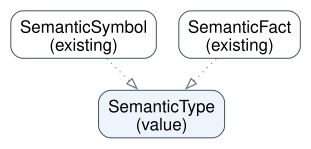

# Chapter 7 — Arrays, Ownership, and Stable References

<!-- common-diagram:start -->



**New data structures.**

- **SemanticType:** An immutable value describing a scalar kind and array nesting depth. It replaces the earlier scalar-only enum; Chapter 8 adds an optional nominal class identity.

`SemanticSymbol` and `SemanticFact` now store this descriptor. Type equality compares scalar kind and nesting depth; there is no recursive hierarchy or intern table in this chapter.

[Text relationships and source fields](figures/ch07-relationships.md).

<!-- common-diagram:end -->

<!-- canonical-forward-link -->
**Later revision:** Chapter 10 replaces the flat type descriptor and class-only type-user links with canonical identities, and extends scopes and body identities. [See the explicitly revised model](chapter-10.md). This figure describes the model at this chapter.


## TL;DR

Extend your Chapter 6 compiler with dynamic arrays of integers, booleans, and nested arrays. Treat `string` as `[u8]`, not as a separate immutable runtime object. Array assignment, ordinary arguments, and value returns preserve recursively independent values. Add checked indexing, `len` returning `u64`, and writable `push`, `reserve`, `resize`, and `truncate` methods.

Then add explicit reference parameters and fixed local aliases. A reference selects existing storage; it does not own that storage. Prove that selected storage remains valid through its last possible use, including uses after branches, loop back edges, and helper calls. References are not exclusive: overlapping scalar writes are allowed. Relocating an array and then using an old element reference is not.

Keep the existing compiler architecture. Common declares the shared type vocabulary, checked operation facts, and symbol storage mode. Semantics checks programs and derives temporary borrow summaries. Emission consumes those checked facts and produces ordinary C allocation, copying, cleanup, and pointer operations. The driver still does not invoke the C compiler.

Start from your Chapter 6 solution. The [public grader contract](../graders/ch07/README.md) and its fixtures are readable requirements. This increment does not implement classes, floating expressions, borrowed ranges, reference returns, escaping closures, or a general ownership system for future language features. Unsupported constructs must still reject explicitly.

## An array value is not its allocation

Consider a program that builds numbers, copies them, and changes the copy. If both variables contain the same data pointer, changing one changes the other. That violates Lyric's value semantics even if the program never accesses invalid memory.

The same rule applies at every nested level. Copying `[[1], [2]]` must produce independent outer slots and independent inner arrays. Copying only the outer descriptor buffer is insufficient. An ordinary function parameter receives an independent value too. A reference parameter is the explicit way to modify caller storage.

Use one generated C descriptor for all supported arrays:

- a pointer to allocated element storage;
- a `uint64_t` live length;
- a `uint64_t` capacity.

Maintain `0 <= length <= capacity`. Only slots below length contain initialized live values. Spare capacity is raw storage, not a collection of default elements. Index checks use length, never capacity. The descriptor can stay in one stack slot while its payload moves during growth.

The empty descriptor has a null pointer and zero length and capacity. It is safe to release and to move from. An empty array may also retain previously allocated capacity after shrinking. Neither case permits indexing element zero.

This storage policy is for ordinary dynamic arrays. Later class storage uses indexed object handles: class backing growth may move field descriptors, while separately allocated array payload has its own lifetime. A stable descriptor does not make its backing allocation stable, and a stable object handle does not make its field addresses stable.

## Represent the type without a registry

The earlier scalar enum and special byte-array entry cannot express `[i32]` and `[[bool]]`. Replace that representation with an explicitly value-like immutable type consisting of a scalar kind and a nonnegative array nesting depth. Depth zero means the scalar itself. Adding an array layer increments depth; selecting an element decrements it, and requires a positive depth.

Audit every consumer of the old enum, including switches, constant patterns,
helper enumeration, and default-value assumptions. A successful declaration
change does not establish that checking and emission use the new type consistently.
Keep kind and depth authoritative in this one value rather than maintaining an
old enum-based classification beside it.

Structural equality is sufficient for this vocabulary. `string` and `[u8]` are the same type value. There is no mutable type registry, identity ownership, or holder backlink to maintain for these values. Continue declaring shared fields and callable signatures in Common and implementing operations in Semantics. Enumerate the predefined types deliberately rather than attempting enum enumeration on the new type representation.

Numeric predicates must require depth zero before examining the scalar kind. Otherwise an array of signed integers could accidentally satisfy an integer operation. Integer width and range operations continue to reject noninteger types. Arrays convert only to the identical array type; do not silently introduce recursive element conversion for an already existing array value.

Read array type syntax recursively. Preserve ordinary lexical type lookup at its leaves. The parser already supplies array literals with their element expressions as children, and index expressions with container and index children. Extend the existing expression traversal and hint discovery rather than building a second expression checker.

An expected array type supplies its element type as context to each literal element. A contextual empty literal is valid. An empty literal without an array context is rejected. For the bounded uncontextualized construction here, the first element supplies the candidate element type, and every later element must safely convert to it. Use homogeneous or explicitly contextualized examples; this implementation strategy is not a settled general mixed-literal inference policy for the full language.

An index must have an integer type, signed or unsigned. Its result type is the container's element type. A writable indexed destination must ultimately belong to an initialized writable binding. `let` arrays and ordinary parameters remain immutable storage; introducing a reference must not bypass that restriction.

## Resolve length and mutations once

Register `len` in the standard scope as an ordinary resolved function symbol with result `u64`. Its one parameter has an explicit bounded contract accepting any array. Do not invent a concrete `unit` or `[u8]` parameter as a placeholder, and do not interpret any function spelled `len` specially in the backend. This bounded builtin contract does not implement general user-defined generics. Existing no-shadowing rules still apply.

Record each accepted array method as a checked operation on its call fact. The backend consumes that operation; it does not redo method-name resolution. All four methods require writable array storage and return unit:

- `a.push(value)` adds one element, safely converting the supplied value to the element type.
- `a.reserve(n)` accepts a `u64` size and ensures at least that capacity without changing length or shrinking.
- `a.resize(n)` accepts a `u64` size, releases removed elements when shrinking, and initializes new elements when growing.
- `a.truncate(n)` accepts a `u64` size and only shrinks. If `n` is at least the current length, it does nothing.

Integer defaults are zero, boolean defaults are false, and nested arrays, including strings, default to empty arrays. Emit initialization of the selected C type, not a blanket byte-clearing assumption. Floats and object-reference defaultability belong to later implementation work; do not infer permission to create invalid non-null references from this chapter's resize helper.

The receiver is selected before the argument is evaluated. This is observable when the argument has effects. A nested receiver can itself live in a parent's relocatable backing, so saving its address already creates a temporary borrow. Named reference variables are not the first place where invalidation matters.

### Observe capacity without copying

Declare the ordinary standard builtin `capacity(array) -> u64` with the same any-array parameter contract as `len`. Resolve its builtin identity through the semantic symbol, not its source spelling. It accepts immutable arrays too: observing capacity does not grant writes.

Ordinary array copies allocate exactly the live length, recursively for nested arrays. They do not preserve spare reservation. This is now observable, so copy-elision must preserve it: after `a.reserve(100u64); let b = a`, `capacity(b)` equals `len(b)`, while `capacity(a)` still reports the reservation. References observe the original descriptor.

A capacity query is not an ordinary copying array read. For names and field selections, read the selected descriptor; unwrap groups without copying. For indexing, select the containing descriptor, evaluate the index once, bounds-check against length, and observe the selected child descriptor. For computed arrays, evaluate the expression normally once and observe its resulting descriptor. Snapshot each indexed descriptor selection before evaluating a later nested index. Record these selections in the existing temporary-borrow graph: a later index may call a helper that invalidates the earlier selection. Computed arrays remain owned temporaries. Save the capacity in a u64 temporary immediately, preserving left-to-right evaluation. Do not retain a new borrow or introduce another owner just to inspect metadata.

Use the retained capacity fixtures to distinguish reserve at length zero, tight copies, nested descriptors, reference aliases, value parameters, truncate retaining storage, and resize(0) releasing it. Assertions from Chapter 5 can express these expectations directly.

## Allocate without arithmetic surprises

`u64` is the language's length type, not a promise that every such length fits the target address space. Before allocating, require the requested count to fit `SIZE_MAX / element_stride`. Only then convert and multiply to obtain a `size_t` byte count. Distinguish allocation-size overflow (`LYR007`) from allocator refusal (`LYR008`). Both are fatal, located failures with the existing best-effort Lyric call trace and nonzero process exit. Fatal termination promises no normal cleanup or finalization.

Do not treat a zero-sized allocation returning null as out-of-memory. The initial helper can avoid allocating for zero elements entirely. Failure reporting must not require a new application heap allocation to construct its message.

For growth, use a simple geometric preference: current capacity plus half its capacity, with an increment of at least one, and at least the requested count. Check the legal allocation limit first and clamp the preferred extra capacity to it. A legal request should not fail just because optional spare capacity would overflow. The growth ratio is an implementation choice, not an observable language guarantee.

Store `realloc`'s result in a temporary. On failure, the original pointer still describes the old allocation until fatal termination. Update the descriptor only after success. Never overwrite the original pointer with an unchecked null result.

For push, check length-plus-one before addition, reserve sufficient storage, install the evaluated element, and only then increment length. For shrinking, decrement length and release each removed nested child. Nonzero resize and truncate retain capacity. For resize(0), then release the backing block and reset the entire descriptor, even if its length was already zero but capacity was reserved. Regrowth initializes new live slots afresh; old contents beyond length are never resurrected.

## Copy, move, and release have different jobs

Use a recursive copy helper parameterized by the checked nesting depth and scalar size. At depth one, allocate enough storage for the live scalar elements and copy their bytes. At greater depth, allocate child descriptor slots and recursively copy each child. Advance the destination's live length only after installing each child.

Release traverses only live children, recursively drops them, frees the outer allocation, and resets the descriptor to empty. Spare slots own nothing and must not be traversed. Copying preserves values; releasing ends ownership; moving transfers an already independent value without copying it again.

The simplest initial emitter makes array-valued reads into independent owned temporaries. A literal installs its evaluated children into a new parent array, moving nested temporary descriptors and resetting their sources. A string literal may have static source bytes, but the expression result is an owned array copy. There is no shared-static-string ownership exception. Keep the static template readable, for example `static const uint8_t bytes[] = "Hello, World!";`, with an explicit Lyric length excluding C’s terminator. The copy creates the ordinary independently owned `[u8]` value that can be transferred and released; it is not a conversion to a null-terminated string. Avoiding this allocation for a print-only literal is a possible later optimization, not a different string ownership rule.

An ordinary call evaluates arguments left to right into temporaries. Array value arguments transfer their independent values to the callee's parameter owners; reset the caller's moved temporaries. Reference arguments do not transfer or reset caller storage. Printing borrows its evaluated text for output while the caller retains responsibility for the temporary's cleanup.

This baseline copies more than necessary: even ordinary reads used only for `len` or scalar indexing can copy arrays. Preserve correct semantics first. Copy elimination is permitted only when lifetime, evaluation order, and independence remain equivalent; the current implementation is not evidence of optimized array traversal.

### Put cleanup on every exit

Maintain temporary emitter bookkeeping: a stack of emitted scopes, each listing its owned array descriptors. This is compiler work, not another persistent semantic ownership model. Register owned locals, ordinary array parameters, and array temporaries. Do not register reference parameters or reference locals as owners of their referents.

A normal scope exit releases registered values in reverse order. Moved descriptors remain on the cleanup list but have been reset to empty. Assignment evaluates its RHS before releasing the old array destination, then transfers the new value. This ordering makes self-assignment through an independent value read safe.

Returning an array first produces the independent return value. Clean the function's owned scopes while excluding that result, unlink the activation frame, and return it to its new owner. Returning a reference binding in a value-returning function copies the referent; reference returns themselves remain unsupported.

A value-producing conditional owns its result outside the C branches. Only the chosen branch computes and transfers its value. Branch cleanup must not release the transferred result. A short-circuit RHS has its own cleanup scope inside the conditional C block; skipped branches must never mention uncreated temporary storage.

A while loop needs an emitted scope for each iteration's condition temporaries as well as its body scope. False-condition exit, break, and continue release every scope being left, but not enclosing owners. Return releases the whole function. Keep the existing nearest-loop control targets.

Ownership bookkeeping must follow emitted evaluation, not assume every syntax child produced a temporary. Constant-folded scalar groups skip child emission. Only array-valued groups require ownership transfer from their child; an unconditional lookup of a nonexistent scalar child temporary is a compiler bug.

## Select storage without copying it

Separate C declaration names from accesses to stored values. A reference parameter or local is declared as a pointer to its referent's C type. Reading or assigning the binding dereferences that pointer. The symbol's value type remains the referent type; an explicit immutable storage-mode flag distinguishes reference bindings from owners.

Accept a local alias such as:

```lyric
var count = 1
let slot = ref count
slot += 1
```

Direct indexed assignment supports `=` in this increment. The retained compound operators still target named scalar storage, including fixed aliases: use `let slot = ref a[0]` followed by `slot += 1`. Direct `a[0] += 1` remains unsupported; writable indexing does not silently expand the Chapter 6 compound-target contract.

The `let` fixes the selected storage identity. Assignment through `slot` changes `count`; it does not retarget `slot`. Require `let`, a reference initializer, and an exact referent type for an explicit reference annotation. A `var` alias is not a second spelling for a rebindable reference.

Type preview inside value-producing blocks must preserve the referent's read type for both annotated and inferred aliases. Unwrap a `ref T` annotation, and traverse an inferred `ref storage` initializer to obtain the selected storage's type, including indexed storage. Do not default an unresolved reference initializer to i32. This preview acquires no storage and creates no semantic facts; the real checker still enforces acquisition and permissions. A redundant annotation must not change arithmetic width: a conditional tail reading an inferred alias to u8 remains u8 just like an explicitly annotated alias. Adding one to 255u8 must overflow before its result could widen to an i64 or u16 destination. Otherwise preview has changed language semantics, not merely missed an optimization.

Reference parameters require explicit `ref` at each call. An existing alias forwarded with `ref slot` selects the same storage, not a reference-to-reference. There is no widening conversion when selecting existing storage: `ref i32` cannot stand in for `ref i64`. Require initialized writable storage and reject addresses of value temporaries.

Provide a storage-selection path separate from ordinary value-expression emission. For a name, obtain its actual local storage or dereferenced alias. For indexing, select the containing storage, evaluate the index once, check bounds, and materialize the selected element pointer. Continue left to right through nested indexing. An ordinary value read may copy; a storage selection must not borrow that copy by accident.

For signed indices, reject negative values before comparing their unsigned magnitude with the `u64` length. Perform this check before pointer arithmetic or dereference. Clang cannot infer Lyric's initialized length from a raw allocation pointer, and allocation capacity is not the correct bound. Emit explicit checks and leave proven redundancy elimination to later optimization. A sanitizer is useful evidence about the implementation, not a replacement for language bounds checks.

## Stable through the last possible use

A reference to an array descriptor differs from a reference into its backing:

```lyric
var a = [1]
let descriptor = ref a
let element = ref a[0]
element = 7
descriptor.push(2)
```

The descriptor storage remains valid across its payload growth. The old element pointer may not. The program above can be accepted because `element` has no later use. Adding a later write through `element` must reject. Acquiring a fresh element reference after growth is valid; recreating an index or allocation never revives the old reference.

Keep definite-assignment checking and borrow invalidation analysis separate. The former asks whether storage was initialized; the latter asks whether selected storage may have ceased to be valid before a use. Both consume the same resolved symbols and checked syntax.

Build a temporary control-flow graph with events for acquisition, use, and backing invalidation, plus control joins and call obligations. A selected path consists of its authoritative root symbol and nesting depth. A root descriptor is depth zero; each indexing step increases depth. Aliases resolve to the original selected path, not to a new owning root.

Preserve the earlier expression-depth guarantees in this new pass too. Walk long
expression spines, including nested short-circuit operators, with staged explicit
work stacks rather than adding recursive traversal hidden inside the graph builder.
Parsing and ordinary checking can both succeed while a later recursive pass still
overflows. Executing a few pointer examples successfully also does not establish
borrow safety: rejection and control-flow checks must exercise invalidation paths.

This first abstraction deliberately does not distinguish sibling indices. Paths at the same root and depth may overlap. It can reject safe operations on distinct nested children. State that precision limit honestly rather than turn it into a language-level ban or claim complete acceptance of all safe programs.

### Propagate invalidation, not lexical expiration

Give each acquired borrow a handle. The dataflow state records pairs of a borrow handle and a possible invalidation cause. A mutation at depth `d` invalidates selected backing beneath that depth, not the descriptor at depth `d` itself. Scalar writes do not invalidate storage. This implementation conservatively treats the growth and shrink methods as possible backing invalidations, independent of current spare capacity or runtime no-op arguments.

Array-valued assignment also emits a backing-invalidation event: select the destination, evaluate the RHS, use the selected destination, then invalidate backing below that destination depth as its old value is released and replaced. This applies to an owning binding, an array reference alias, and a nested array slot. For example, after `let element = ref a[0][0]`, replacing `a[0]` invalidates a later use of `element`. A descriptor alias to `a[0]` itself survives replacement because its slot stays in place. Scalar assignment does not invalidate storage. Replacement mutations enter helper summaries exactly as growth-method mutations do.

At an acquisition, clear only that handle's previous invalidation history. At a use, test its possible causes. Deriving a new alias first uses the old alias, so it cannot launder invalid storage. A mutation with no subsequent use does not itself produce a stale-use error; this is how last-use behavior is obtained without forcing aliases to remain live until lexical scope exit.

Branch joins union possible invalidations from continuing paths. A returning branch has no successor. Short-circuit evaluation includes both the skipped path and the evaluated-RHS path. Create and register loop header and exit targets before traversing the condition, not merely before the body: a value-producing condition can itself contain `break`. Loop edges return to the condition, and break and continue target the correct nearest loop exit or header. A worklist propagates states until no edge adds information. An outer alias can therefore become invalid on the next iteration, while a loop-local acquisition clears its own history each time it is executed.

Include temporary selections. Indexed assignment selects its destination before RHS effects and uses it afterward. A nested method selects its receiver before its argument. A call selects each reference argument in order and must keep earlier selections valid while later arguments run. The earlier direct nested-selection guard can conservatively reject root mutation during that interval; the graph also covers invalidation arriving through helper effects.

## Helpers need ordering, not just a mutation flag

These two bodies have the same set of operations but different safety when their arguments overlap:

- write through an element reference, then grow its containing array;
- grow the array, then write through the old element reference.

Do not summarize both as merely “may resize.” Collect every function signature, check all bodies to produce authoritative facts, and only then derive interprocedural summaries. Initialize reference formals as acquired aliases at function entry; otherwise later reads through them would be invisible to the graph.

For each function retain two temporary summary sets:

1. Possible backing mutations, expressed as reference-formal roots and relative depths.
2. Ordered obligations saying a mutation through one formal may precede a use through another already selected formal.

Inside a body, distinct reference formals might overlap at a caller. Preserve the mutation cause rather than prematurely treating different names as independent owners. If a later use has a different formal root, export an obligation. If paths already share a root and the used path lies deeper than the mutation, the use is unsafe.

At a call, map reference formals to the actual selected paths in parameter order. Substitute roots and add relative depths. Check the callee's ordered obligations using those actual paths. Then propagate its possible mutations into the caller's state for later caller uses. Do not invent a use of every argument after every mutation: that would incorrectly reject a valid write-before-grow helper.

If substitution still leaves two distinct caller formals, propagate the obligation to that caller's summary. If it establishes overlapping storage, report the call as unsafe. Independent local owners do not acquire artificial overlap merely because they have the same array type.

Iterate mutation and obligation sets monotonically across all functions until no summary changes. The supported type nesting bounds the paths, and the summaries add facts rather than retract them. This handles forward calls, forwarding helpers, and recursive call groups. After convergence, run the diagnostic pass with the complete summaries. Do not accept a body using only whatever effects happened to be known when its declaration was visited.

These are synchronous, nonescaping references in the current subset. They do not establish safety for classes, destruction effects, threads, foreign calls, reference returns, or captured escaping storage. Extend the contracts before accepting those features.

## Diagnostics and evidence

Preserve the existing silent-success and empty-stdout-on-rejection contracts. Bounds failures use `LYR006`; allocation-size overflow uses `LYR007`; allocator refusal uses `LYR008`. Continue the established quoted filename, source location, and quoted function trace format. Index diagnostics use the existing first anchored child location, not a newly guessed bracket span.

The public negative fixtures distinguish invalid index types, immutable destinations, bad method arguments, malformed reference bindings, missing explicit `ref`, and invalidated borrows. `LYC326: Borrowed storage may have been invalidated.` identifies a later unsafe use, or the call where actual overlap establishes a helper violation. An unrelated unsupported-feature rejection does not satisfy a lifetime fixture. `LYC324` remains the earlier temporary nested-selection rejection.

Testing successful output alone cannot establish ownership. During development, real-allocator probes checked allocation balance and sanitizer behavior for the initial value and growth slices; a bounded injected `realloc` refusal checked fatal OOM handling without exhausting the host. The earlier 90-case suite also passed AddressSanitizer and UndefinedBehaviorSanitizer at both optimization levels, before the twelve alias-preview regressions were added. The current 102-case suite passed ordinary cumulative checks in Debug and Release; those twelve cases were not rerun under sanitizers. The earlier sanitizer run was not a fresh allocation-balance proof. Verified host behavior is Apple Clang on ARM64 macOS, not a general portability or complete memory-safety proof.

## Exercises and completion

Starting from your Chapter 6 implementation, construct this increment in the order taught: type vocabulary and checking, independent owned storage and cleanup, growth operations, scalar storage aliases, local array invalidation, and parameter-specific helper effects. Preserve the real lexer, parser, facts, scopes, symbols, diagnostics, and emission pipeline. No fixture-shaped alternate implementation or bypass of earlier checks is acceptable.

Use your own prerequisite implementation and the public chapters, grader code, flags, fixtures, and expected results. Do not read a Chapter 7 target solution or private author repair history. The grader files are read-only requirements. Diagnostic tests you write for your own understanding do not replace or silently become retained requirements.

Prerequisites are Python 3, Make, .NET 10/C# 14, the existing local Node/Peggy setup, and an installed C compiler supporting the Chapter 6 exact-width checked-arithmetic builtins. `CC` selects the C compiler and optional flags. Work from the repository root. None of these commands installs tools or downloads packages.

Required cumulative checks:

```sh
make test
DOTNET=dotnet node tools/peg/test.mjs graders/ch03/cases.json
```

With an SDK outside PATH:

```sh
make test DOTNET=/absolute/path/to/dotnet
DOTNET=/absolute/path/to/dotnet node tools/peg/test.mjs graders/ch03/cases.json
```

The Make target builds Debug and Release before grading and runs all retained suites through Chapter 7. The separate PEG command must report all 143 cases; the smaller default run is not this required comparison. The Chapter 4 semantic suite continues to use `--chapter=6`, preserving its approved value-if transition.

To supply an independently built compiler directly to the newest grader:

```sh
python3 graders/ch07/run.py dotnet compiler/bin/Debug/net10.0/Lyric.dll
python3 graders/ch07/run.py dotnet compiler/bin/Release/net10.0/Lyric.dll
```

Replace `dotnet` with your selected SDK executable if needed. All 112 named Chapter 7 cases are retained; there are no Chapter 7-only cases. Successful emission requires exit 0, nonempty C, and empty stderr. Executables compile and run at both `-O0` and `-O2` with exact output bytes and exit status. Negative cases require their specified diagnostics, locations, and traces. A crash, timeout, or arbitrary nonzero exit is not an expected rejection. Each subprocess has the shared harness's 20-second limit. Generated C formatting and temporary identifier spelling are not grading requirements.

An optional supporting-toolchain diagnostic run is:

```sh
CC='cc -fsanitize=address,undefined -fno-sanitize-recover=all' \
  python3 graders/ch07/run.py dotnet compiler/bin/Debug/net10.0/Lyric.dll
```

Completion requires the cumulative checks, separate PEG comparison, and structural adherence. Read your declarations and principal execution paths as a new student: where is each authoritative fact, which values own allocations, when does ownership transfer, and which control edges release storage? Passing examples do not substitute for those answers. Human use remains a separate acceptance step.

## Take it for a Spin

From the repository root, run:

```sh
make spin07
```

Or select the SDK explicitly:

```sh
make spin07 DOTNET=/absolute/path/to/dotnet
```

This builds Release first, prints the Lyric examples, emits C, invokes your installed `CC`, and runs disposable local executables. It requires the same tools as the exercises. There are no credentials, network requests, or service costs. Temporary Lyric sources, generated C, and executables are removed automatically.

The first example grows an array from one through five and prints `Sum is 15`. It makes an ordinary copy and passes only that copy to a reference helper, which changes its first element and pushes another element. You should see `Original unchanged` and `Copy changed`.

The second example uses an element alias for the last time, grows the array, and acquires a fresh alias. It prints `Fresh reference works`. The third attempts to use the old alias after growth and must produce the exact `LYC326` rejection. The walkthrough treats that intended rejection as success, not as an executable to run.

Read the printed programs. In a disposable copy, compare a helper that writes the selected element before growth with one that grows first and writes afterward. Explain why overlapping scalar references are allowed but a reference into moved backing is not. The automated walkthrough has been exercised; the human's own walkthrough and acceptance are still separate. This chapter does not authorize installation, publication, or advancement to another increment.
