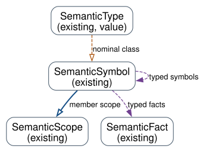

# Chapter 8 — Classes, Lifetimes, and Two Storage Layouts

<!-- common-diagram:start -->



**Changed classes.** No new class-definition object is introduced: a class is a `SemanticSymbol`.

- **SemanticSymbol:** now owns a member scope and records reverse dependencies from symbols and facts that use its class identity.
- **SemanticScope:** a member scope has both analysis and class owners; it retains both back-references.
- **SemanticType:** now carries an optional class declaration identity. Equality compares that identity, scalar kind and array depth, not the class name or a recursive type tree.
- **SemanticFact:** registers its nominal type dependency with the class. Removing the class invalidates dependent semantic objects.

[Text relationships and source fields](figures/ch08-relationships.md).

<!-- common-diagram:end -->

<!-- canonical-forward-link -->
**Later revision:** Chapter 10 replaces the flat type descriptor and class-only type-user links with canonical identities, and extends scopes and body identities. [See the explicitly revised model](chapter-10.md). This figure describes the model at this chapter.


## Introduction

This chapter introduces some of the secret sauce I expect Lyric to use to win application-level benchmarks. Not a clever expression optimization. Not a benchmark trick. We are going to change how ordinary programs store and allocate their objects.

C++ lets you customize memory allocation. In my experience, most application code does not. The facility exists, but getting the benefit requires somebody to design the allocator, integrate it, and keep using it correctly. I want that work built into Lyric's normal class storage, not reserved for the programmer who has time to replace the defaults.

Lyric keeps storage for each class together and reuses freed object slots through a per-class free list. In this chapter, the array-of-structures layout uses slab-like chunks; the structure-of-arrays layout uses separate field buffers. Both reuse slots rather than send every object creation and destruction through the general-purpose allocator. The layouts differ, but the policy is deliberate: class storage is the default, not an optional optimization project for every application.

In theory, retaining freed slots could waste memory. In practice, I have yet to run into an application where these free lists increased memory consumption—and I have been using this approach since 1990, across roughly two million lines of code I have written. Memory grows over time. It is what I keep seeing in real systems. Storage released by one object is useful for the next object of that class.

That experience does not make retained memory free. A class's high-water allocation can outlive the workload that needed it. An especially clear case is when we no longer need any instances of that class. Returning that storage is a separate lifecycle problem; reusing individual slots does not solve it.

There is another capability I want later: dynamic class extensions. Being able to extend every existing object of a given type on the fly is tremendously useful. Trust me, I want it. We do not need it for self-hosting, and it is not yet part of the language specification. We will not quietly turn that future idea into a requirement for this chapter.

SoA has an apparent disadvantage beside our chunked AoS allocator: its field arrays need room to grow. For these class backing arrays, our growth policy is simple: double the capacity, subject to checked allocation limits. That is not a change to the growth policy of ordinary Lyric arrays. But does reserving twice the space mean using twice the physical memory? Not necessarily. Virtual memory gives us an important advantage here.

Large allocations can reserve address space without immediately acquiring a private physical page for every page in that range. Linux's glibc allocator uses anonymous mappings for sufficiently large allocations; Apple's allocator and virtual-memory system also support demand-zero allocation. The exact allocator policy and page-fault mechanism differ. The useful principle is the same: untouched spare pages need not consume their full capacity in resident physical memory. We must preserve that advantage by not eagerly initializing spare slots or copying unused capacity during growth. Initialize objects when they become live, not merely because we reserved room for them.

That is why I do not regard doubling capacity as automatically doubling the memory bill. It is not a claim that SoA has zero overhead: page rounding, allocator metadata, previously touched storage, and moving a growing buffer still matter. Our earlier macOS sparse-mapping experiment demonstrated virtual reservation and selective access, not the resident-memory cost of this class allocator. We need to measure the allocator we actually ship.

The other half of the story is what each cache line contains. AoS puts one object's fields together. SoA puts the same field from successive objects together. Accessing two fields of a 1 KiB object does not load the whole object, but it can fetch cache lines containing mostly fields we do not need. Repeat that across many objects and we spend bandwidth carrying the wrong data. With SoA, those lines can instead contain the field values we are about to process. When we need most fields of one object together, AoS can be the better fit. This is why we build both layouts.

Compact object references are another opportunity. When a class's population fits, a 32-bit slot index can replace a 64-bit pointer, letting more references fit in memory and cache. That saving is available to either indexed layout; it complements SoA rather than defining it. Configurable compact reference widths are planned work, not a feature implemented by this chapter.

The allocation strategy goes beyond object slots. Our planned performance storage also keeps dynamic-array payloads for a particular field of a particular class together in a field-specific heap. If we are working through those arrays, why scatter them among allocations belonging to unrelated classes? Group the related data and give the cache a better chance of carrying what the program will use next, rather than unrelated junk. Access patterns and packing still determine the benefit, but this is exactly the sort of application-level locality I want the language to provide without hand-tuning every program.

Those field-specific payload heaps come after bootstrap; this chapter still uses separate C allocations for array payloads. Here we build the class storage, SoA layout, reusable slots, and lifetime rules that make the next steps possible. Object identity must survive backing-storage growth. A pointer into storage that moves must not. Fast allocation is not much use if we cannot tell the difference.

I want Lyric to become the world's fastest language for most complex applications. These are some of the design choices behind that ambition. We still have to earn the result on real programs, but we are not leaving their memory layout to chance.

## TL;DR

Extend your Chapter 7 compiler with standalone ordinary classes and counted `value class` objects. Add constructors, explicitly qualified fields and methods, ordinary destruction, destructor-only final hooks, and arrays containing object handles. Generate both chunked array-of-structures storage (AoS) and growable structure-of-arrays storage (SoA). The choice changes representation, not source acceptance or object identity.

An object reference is an index identifying a slot, not a pointer into a movable field buffer. Copying a reference shares the object. Copying an array creates independent array slots, but its object elements still refer to the same objects. Ordinary references do not prevent explicit destruction. Counted references keep their object alive until their owning holders are released.

Extend the existing semantic model, ownership emission, and temporary lifetime graph. Do not create an alternate class checker, runtime type registry, or generated-allocator AST that must be checked a second time. Common declares the authoritative vocabulary and relationships; Semantics checks them; Emission implements the checked storage contracts; the driver selects the layout.

Start from Chapter 7, including its updated assertion and capacity prerequisites. If your preserved Chapter 7 endpoint predates those updates, first implement the revised Chapter 4/5 assertion contract, Chapter 6 unsafe contract, and Chapter 7 capacity/resize-zero contract from their public teaching and graders. This is an explicit prerequisite refresh, not permission to copy a newer target solution or claim an old student tested new requirements. The [public grader contract](../graders/ch08/README.md) is readable alongside this chapter. This chapter does not add object-to-object fields, relationship graphs, fallible constructors, nullable references, user generics, escaping references, concurrency, or complete structural destruction. Unsupported features must reject explicitly rather than acquire accidental semantics.

## Separate identity, ownership, and storage

A small ordinary class makes the source contract concrete:

```lyric
class Counter {
    count: i32
    func Counter(self, n: i32) { self.count = n }
    func add(self, n: i32) { self.count = self.count + n }
}
func main() {
    let original = Counter(1)
    let alias = original
    alias.add(4)
    assert(original.count == 5)
    original.destroy()
}
```

`let` fixes the handle binding; it does not freeze the object's fields. The class-named function initializes the new object and returns unit, while `Counter(1)` produces the handle. Destroying through one alias ends the object, not just that variable's association. A later use through the other alias is invalid. For counted ownership, declare `value class Counter` instead and omit explicit destruction: its holders determine when destruction occurs.

An integer value tells us what it is. Two class declarations with the same spelling in separate compilations do not denote the same type. A class type therefore carries the actual declaration identity. At runtime, two copied handles can denote one mutable object even when they are stored in independent variables or arrays.

Ownership answers a different question: does removing this holder release an object? For an ordinary class, dropping a local handle does not destroy its object. The program explicitly calls `object.destroy()`. For a counted value class, copying a holder retains the object and removing that holder releases it. A value class is not necessarily immutable, stack allocated, or cloned on assignment.

Storage lifetime is different again. A handle can survive class allocation while a pointer to one of its fields becomes invalid. An array field's descriptor and its separately allocated payload can have different invalidation events. Do not use one undifferentiated “reference is alive” flag for these facts.

This increment uses conservative class-wide destruction analysis. Destroying an ordinary instance may invalidate existing references of its class, including references contained in arrays. This deliberately sacrifices instance precision. Fresh construction establishes a new value; it does not revive older aliases, even if the allocator reuses their slot number.

## Extend the shared model with nominal identity

Extend the immutable semantic type value with an optional class symbol, retaining the existing array depth. Scalar predicates must require a scalar leaf, not merely inspect the old scalar enum. Array nesting preserves the nominal leaf: `[Counter]` and `[[Counter]]` are distinct types containing the same class identity. Equality compares that identity, not just its spelling.

A class declaration is already a semantic symbol. Give it a member scope rather than introduce a redundant class-definition object. The class and analysis both strongly own that scope; the scope retains its class and analysis backlinks. A method reaches its declaring class through its member-scope parent. Do not copy a second owner field into every method.

A type value containing a class identity creates dependencies wherever it is stored in the persistent model. Maintain reverse lists from the class to typed symbols and expression facts. Constructors register both directions. Type replacement validates the new analysis and class before mutation, reserves any needed reverse-list capacity, then detaches the old dependency and installs the new one. A refused replacement must preserve the old type and both lists.

When a class symbol is destroyed, retire dependent facts and symbols through their declared destruction operations and destroy its member scope. Scope removal must clear both owners' links. Analysis teardown still destroys facts before scopes; repeated destruction paths must remain harmless without leaving dangling model relationships. These are compiler-model requirements, separate from generated Lyric object destruction.

Keep authoritative source relationships too. A field selection fact refers to the actual field symbol. A destruction call carries a checked class-operation tag. Counted policy and the final hook are derived from class/member declarations through declared queries, not copied into another registry. Functional implementations must use Common's declared operations rather than reach into a sibling module's private helpers.

## Collect names before checking bodies

Continue the multipass checker:

1. Register builtins and collect every top-level function and class name.
2. Create each class's member scope and collect fields and methods after all nominal identities exist.
3. Resolve function and method signatures.
4. Check bodies and constructor initialization.
5. Derive interprocedural lifetime effects to a fixed point, then diagnose unsafe uses with complete summaries.

Class members form a qualified namespace. Direct member lookup searches that namespace; ordinary lexical lookup skips it. A constructor can therefore have the class's name without weakening the language's general no-shadowing rule. Method bodies use `self.field`, not an implicit unqualified search for a field.

Instance methods take untyped `self` as their first parameter. Resolve it to the containing class's actual nominal type. Ordinary typed parameters and explicit `ref` parameters retain the earlier rules. Calls evaluate receiver first, then explicit arguments left to right. Parameter substitution and borrow obligations must account for the implicit receiver offset.

A same-name constructor body returns unit; the construction expression returns the allocated object handle. Do not require or accept a user `return self` as the construction mechanism. Allocate and establish `self`, execute the constructor, then produce the nominal result. An already constructed object cannot have its constructor invoked again as an ordinary method. This increment does not synthesize a default constructor: even an empty class needs an explicitly declared constructor before `C()` is legal.

## Initialization is not zero-filled memory

Fields in this increment have scalar or scalar/nested-array types, including strings. Field initializers and fields whose leaf is a class remain unsupported. Arrays of handles are supported in locals, parameters, results, and nested arrays; that does not silently authorize persistent object graphs.

Reuse branch-aware definite initialization for constructors. Every field must be assigned on each completing path, including explicit return and fallthrough. Only writes to the actual constructor `self` satisfy this obligation; writing another same-class object's field does not. A field read requires initialization. Copying or passing partially initialized `self` is rejected until all required fields have been initialized.

The allocator initializes cleanup-safe field storage, including empty descriptors. That prevents cleanup from interpreting arbitrary bytes as owned arrays, but it does not grant source permission to read an uninitialized field. Runtime defaults and semantic initialization obligations have different purposes.

The constructor's implicit result is a use of `self` after local cleanup. A helper or finalizer triggered during that cleanup must not be allowed to destroy the object and then return its stale bits as a successful construction result.

## Generate one slot model and two payload layouts

Use per-class generated metadata with a high-water slot count, a free-list head, and a movable metadata buffer. Each slot has free/live/destroying state and a next-free index. Counted classes also have a reference count. Metadata is private runtime storage; moving it does not itself move source-visible fields.

For AoS, generate a record type containing all fields and a growable directory of separately allocated fixed chunks. This implementation uses 64 records per chunk. A handle selects `chunk = index / 64` and `position = index % 64`. The directory may move, but existing chunks do not. Never compact live object slots.

For SoA, generate one growable field buffer per field. The same index selects its entry in every buffer. Reallocation may move a field buffer. Owned array fields contain descriptors in this buffer; their element payloads remain separately allocated by the Chapter 7 array machinery.

Class metadata, SoA field buffers, and the AoS chunk directory double their capacity when full, clamping the preferred capacity to the allocation-size limit. Ordinary source-level arrays retain their separate approximately 50% growth policy. Implement the class policy by computing the doubled request and passing it to the existing checked reservation helper; do not duplicate allocation failure handling. A first allocation requests at least the required count. Never initialize spare class slots: initialize only the selected object slot. Growth occurs after the previous buffer capacity has been used, so the allocator is not asked to copy an untouched spare half. This preserves an opportunity for demand paging, not a guaranteed resident-memory bound.

Allocation first pops a free slot. Otherwise it uses the next high-water slot, grows metadata and the required payload storage, and advances the high-water count only after successful allocation. AoS allocates a new chunk only at a chunk boundary. Reused slots do not consume new high-water positions. Preserve allocation-size and out-of-memory checks.

The current backend reserves `UINT64_MAX` for its internal empty-holder/free-list sentinel and permits live slot zero. This is not a source-level null value or a requirement that future compact representations use this encoding. Do not invent nullable object defaults from the allocator's internal sentinel.

Expose `--emit-c --soa FILE` for SoA; ordinary `--emit-c FILE` selects AoS. The layout belongs to emission, not to a second semantic-analysis mode. Reject the layout option for unrelated inspection commands. Both representations must implement the same checked source behavior.

## Save handles across effects, not interior pointers

A direct field assignment evaluates the receiver before its RHS. Save the receiver's index, evaluate the RHS, then resolve the current field storage from that index before storing. This preserves evaluation order without keeping an interior pointer across a possibly growing allocation.

Likewise, generated methods access fields through their current `self` handle. Do not cache a SoA base pointer across arbitrary user calls. AoS metadata can move too, even though its payload chunks remain stable.

A deliberate `ref object.field` is different: it selects existing storage and retains that address. Such a borrow cannot be silently re-resolved after invalidation. The checker must ensure stability through its last possible use.

Owned array fields use Chapter 7's recursive value copies on reads. Assignment computes the new value before dropping the old value, then moves the new descriptor into the field. Self-assignment is safe because the RHS is already an independent value. Destruction drops owned fields after the final hook, resolving their current locations again after the hook's effects.

## Destruction and final hooks

Ordinary `object.destroy()` takes no arguments. Record the resolved operation in its semantic fact; do not infer destruction from source spelling in the backend. Explicit destruction of a counted object is rejected: a live counted holder must not be invalidated by force-destroying its target.

A final hook takes only `self`, returns unit, and is unique per class. It is called only by generated destruction. Source calls are rejected; an application-controlled close operation should be an ordinary method. Finalization cannot cancel destruction or propagate a recoverable result. For example, a class can declare:

```lyric
final func finish(self) { print("released") }
```

The name `finish` is ordinary naming; the `final` modifier identifies the hook. Generated destruction calls it, but source code must not call `object.finish()`.

Generated destruction follows this order:

1. Defensively verify that the index denotes a live slot.
2. Mark the slot destroying before invoking user code.
3. Invoke the checked final hook, if present, while fields remain accessible.
4. Re-resolve metadata and fields from the saved index.
5. Release owned field values.
6. Mark the slot free and link it into the free list.

Never dereference a cached metadata pointer after the hook. Even a hook that merely constructs another same-class object can relocate metadata or SoA fields. A destroying state is necessary to detect reentry; a boolean live flag is insufficient.

A final hook may not transitively destroy or finalize any instance of its own class, including through helpers and counted releases. Compute this prohibition using the same transitive effects used for ordinary safety. Destruction of another class is permitted, but its effects propagate outward and can invalidate caller references. Runtime defensive failure uses the established located fatal reporting; it is not a replacement for static checking.

This is local standalone destruction, not the future relationship teardown algorithm. There are no parent detachments or strongly owned object children in the supported class-field subset. Do not teach a manual structural destructor as a workaround for relationships not yet implemented.

## Counted holders reuse the ownership machinery

A newly allocated counted object starts with one owning holder. A value read retains before making another holder. A move transfers the handle and empties the source. Release first empties the holder, then decrements the count; reaching zero invokes the same generated destructor. Guard count overflow with the distinct `LYR012` fatal diagnostic. Empty internal holders release nothing.

Extend the existing emitted-scope owner list instead of creating a parallel cleanup manager. It now knows both array descriptors and counted handles. Ordinary value parameters own transferred arguments. Ordinary method `self` owns the counted receiver supplied by the caller. Constructor and final-hook `self` are borrowed; neither creates another owner merely to execute that body.

For a named field receiver, borrow the handle to read the field; do not retain solely for that selection. A computed receiver is an owned temporary and must be cleaned at its actual scope boundary. Assignment uses the same rule for computed receivers as reading does.

Preserve ownership on every control edge: normal scope exit, return, break, continue, false loop-condition exit, short-circuit RHS completion, and conditional branch completion. A value-producing tail transfers its value; it is not a discarded expression. A genuine discarded owned result is released. Compute and protect a return value before cleaning the enclosing scopes, then check that cleanup has not invalidated an ordinary returned object.

The backend performs immediate updates at these ownership operations. This provides a useful helper-scope boundary for testing finalization. It does not define a universal ordering of unrelated finalizers for every future backend. Fatal termination still promises no normal cleanup.

## Arrays contain holders, not cloned objects

An ordinary object-array copy duplicates handles into independent slots. Mutating an object through one array is visible through another array's handle; replacing one array slot does not replace the other array's slot. Dropping ordinary elements does not destroy their objects.

For counted leaves, generate class-specific recursive copy/drop helpers. Above the leaf, copy or drop nested descriptors as before. At the leaf, copy retains each handle and drop releases each holder. The class is known at compile time: call its existing retain/release helpers, without a runtime type registry or a second reference-count implementation. Spare capacity owns no elements.

Reading a counted element must retain that selected handle before the temporary parent array is cleaned up. Moving elements into a literal, binding, argument, return, or conditional result empties the moved source. Array replacement computes the independent RHS before releasing the old contents. Keep builtin lowering honest: ordinary calls consume value arguments, but inline `len` leaves its evaluated array temporary owned by the caller. `capacity` observes selected storage without copying; a computed argument still has normal temporary ownership.

Non-nullable object handles have no default value. `reserve` allocates capacity without creating live elements; `push` supplies a valid handle. `resize` may shrink such an array but must fail before increasing its length, with `LYR011: array element has no default value`. This initialization guard remains in unsafe mode. An outer array whose elements are themselves arrays may grow, because those elements default to empty arrays rather than invented objects.

`resize(0)` releases all live elements and backing storage, including a reserved empty array. Truncate retains capacity. Copies remain tight at every nested level, as required by the observable capacity contract.

## Extend the existing lifetime graph

Continue Chapter 7's temporary graph and interprocedural fixed point. Add object acquisitions, object uses, and class effects, including effects on evaluated argument temporaries and saved field receivers. Track class-leaf arrays as well as scalar handles. Reading elements after a class-wide destruction is unsafe even if the array allocation itself still exists.

A whole-array local replacement is not an element read. It can establish a fresh value after the old ordinary objects were destroyed. In contrast, indexing into that old array, copying its handles, or reusing it after a slot is recycled remains invalid. Distinguish descriptor depth zero from contained-object use rather than exempting all array selections.

Class allocation invalidates potentially moving field-descriptor addresses. Apply this conservative acceptance rule in both layouts, even though AoS field addresses are physically stable. Class destruction invalidates every owner-dependent depth. Plain field assignments keep their saved-index exception for address movement, but not for destruction of their receiver.

For an array field, use the actual field symbol as the root and retain nesting depth. Class growth invalidates its descriptor borrow at depth zero, not a separately allocated payload borrow at a deeper depth. Replacing or growing that payload invalidates its interior storage. Destruction invalidates both. This is the same distinction as an inner array descriptor stored in an outer array; it is not a new kind of fat reference.

Export field mutations as well as formal-reference mutations in helper summaries. Ordered obligations must handle a formal that aliases a field: replacing `object.items` and then using a reference into its old payload is unsafe inside the helper. Preserve unrelated-field and last-use controls rather than rejecting every helper involving a field.

Constructor initialization needs a narrow distinction, not a constructor-wide exemption. A store proven to affect only newly allocated `self` storage does not replace an existing caller object's payload; it still invalidates earlier local borrows of that fresh payload. A constructor may also take an existing same-class object as a parameter and mutate its fields. Those effects must reach callers, including mutations through aliases or helpers. Omit an outward mutation only when its fresh-storage provenance is established; the enclosing constructor or matching class name alone is insufficient. Constructor allocation still carries the class-growth effect before its body uses reference arguments.

For example, this library fragment must be rejected at the final use of `element`:

```lyric
class C {
    a: [i32]
    func C(self, others: [C]) {
        self.a = [1]
        if len(others) > 0 { others[0].a = [2] }
    }
}
func use() {
    let c = C([])
    let element = ref c.a[0]
    let other = C([c])
    element = 3
}
```

The first construction initializes only fresh storage. The second also replaces
an existing object's array through `others[0]`. The array parameter copies
handles, not objects, so that replacement releases the payload selected by
`element`. Class allocation alone is not the reason for rejection: the field
descriptor can move without moving its separately allocated element payload.
The constructor's existing-object mutation must reach the caller and invalidate
that payload borrow. Track the same distinction through aliases and helper
arguments. A passing public suite does not replace this source-level reasoning;
this counterexample was found during the student's own review after an earlier
public pass.

## Cleanup effects require possible occupancy

A declared counted type alone does not mean a holder currently owns anything. Reuse the graph's worklist to track possible occupancy separately from definite initialization. Register owned parameters as occupied, borrowed constructor/final receivers as nonowners, and uninitialized locals as empty. Each executed declaration resets its holder state, including on loop iterations.

A conditional value needs one result identity shared by its continuing branches. Transfer the selected tail into that identity before branch cleanup, then check its validity after cleanup and after any enclosing `else if` condition-scope cleanup. Do not acquire a fresh result identity at expression completion: that would revive an ordinary reference invalidated by a final hook. Apply this to class-leaf arrays as well as scalar object results, just as an explicit return preserves and checks its result across cleanup.

At a join, union possible occupancy. A cleanup event applies finalization effects only if its holder may be occupied. Moves empty the source obligation. Replacement releases the old occupant before installing the new one. This does not require proving exact alias counts: any potentially last release conservatively includes the object's final-hook effects, while retained counted aliases are not invalidated as ordinary references would be.

Occupancy belongs to the owner selected by a storage path, not to the symbol spelling an assignment. Writing through `let r=ref a` must update `a`'s cleanup holder. A depth-zero replacement releases and replaces that whole holder; a deeper store may populate its containing owner but cannot declare all sibling elements empty. Chained aliases and aliases of nested descriptors use the same root-and-depth rule.

For a concrete trace, start with `var a: [V] = []`, where `V` is counted, then bind `let r = ref a` and assign `r = [V()]`. Initially `a` owns no elements. The alias owns no array; it selects `a`'s descriptor. The store moves the new array into that descriptor and marks `a`'s holder possibly occupied. When the scope ends, cleaning `a` releases its element and may run `V`'s final hook. Marking only `r` occupied would miss that effect, because references do not own the selected value.

Arrays add partial removal. A shrink can release elements without proving the whole array empty. Known-empty literal trees contain no counted leaves, but later pushes, indexed replacement, or helper mutation may populate them. Update occupancy for those operations; an empty-literal special case alone would be unsound. Unknown calls and array contents remain conservative.

Match cleanup graph scopes to actual emission. Loop condition temporaries survive the body but are released on false exit, backedge, break, and continue as appropriate. Short-circuit RHS temporaries release before the join, while the skipped edge creates no owners. Computed field receivers participate whether selected for reading or writing. Generated cleanup and final hooks cannot be invisible effects simply because their calls are absent from source syntax.

## Exercises and completion

Build the increment in the sequence above, keeping both layouts working together. Extend your own Chapter 7 solution; do not inspect an existing Chapter 8 implementation or private repair history. Read the public graders and fixtures, which are requirements, not hidden tests. Do not modify their expected results to make your implementation pass.

Prerequisites remain Python 3, Make, .NET 10/C# 14, the existing local Node/Peggy setup, and an installed C compiler supporting the earlier checked arithmetic builtins. `CC` selects that compiler and optional flags. These commands perform no installation or download. From the repository root, run the retained cumulative suite and separate PEG comparison:

```sh
make test DOTNET=/absolute/path/to/dotnet
DOTNET=/absolute/path/to/dotnet node tools/peg/test.mjs graders/ch03/cases.json
```

Use `dotnet` instead of the absolute path when it is on PATH. Extend the cumulative Make target to run all five Chapter 8 entry points after Chapter 7, separately against freshly built Debug and Release assemblies:

```sh
python3 graders/ch08/run.py dotnet compiler/bin/Debug/net10.0/Lyric.dll
python3 graders/ch08/check.py dotnet compiler/bin/Debug/net10.0/Lyric.dll
python3 graders/ch08/layout.py dotnet compiler/bin/Debug/net10.0/Lyric.dll
python3 graders/ch08/allocation.py dotnet compiler/bin/Debug/net10.0/Lyric.dll
python3 graders/ch08/ownership.py dotnet compiler/bin/Debug/net10.0/Lyric.dll
```

These commands run the initial runtime grader, static checker, layout grader, free-slot allocator grader, and ownership-balance grader. Run the same commands with `Release` as well. In each Debug and Release cumulative pass, use `graders/ch04/check.py --chapter=8` and `graders/ch06/unsafe.py --chapter=8`, followed by the compiler command. The semantic selector retires only the historical unsupported-empty-class milestone; the unsafe selector adds both layout configurations. Preserve all other retained behavior, including assertions, unsafe mode, capacity, and array references.

All Chapter 8 cases are retained; there are no chapter-only exemptions. The current static inventory is 154 cases. The layout inventory has 49 successful programs plus two default-growth failure programs tested in both safe and unsafe modes, giving 212 executions across both layouts and both optimization levels. See the grader contract for exact exit, output, diagnostic, timeout, and allocation-count comparison rules. A crash or unrelated rejection is not an expected failure.

The allocation grader compares one cycle with 257 cycles to detect failure to reuse slots. The ownership grader compares outstanding allocations for ordinary, counted, and counted-array workloads. These are bounded observations, not proofs of universal leak freedom or class-backing reclamation at shutdown. An optional sanitizer run is:

```sh
CC='cc -fsanitize=address,undefined -fno-sanitize-recover=all' \
  python3 graders/ch08/layout.py dotnet compiler/bin/Debug/net10.0/Lyric.dll
```

Structural review remains necessary: trace nominal backlinks, constructor refusal, complete model destruction, counted transfers, and every cleanup edge. Runtime tests cannot establish that Common owns the declarations or that a hidden duplicate field is absent. Observed C execution so far is on Apple Clang ARM64; do not claim x86 execution or a performance advantage from the layout switch alone.

## Take it for a Spin

From the repository root, run:

```sh
make spin08 DOTNET=/absolute/path/to/dotnet
```

Or use `make spin08` when the SDK is on PATH. This builds Release first, prints the example programs, emits C for both AoS and SoA, compiles with your installed `CC` at `-O2`, and executes disposable local binaries. Python 3 and the exercise toolchain are required. No credentials, network services, installations, or service costs are involved. Temporary source, C, and executable files are removed automatically.

The successful example constructs one counted Counter, copies an array containing its handle, and mutates that object through the second array. Assertions verify that the first array sees the same object mutation, and that releasing its own storage does not destroy the object retained elsewhere. For each layout, expect:

```text
Independent arrays, shared object
Finalized once
Helper returned
```

The single finalization occurs when the helper's remaining holders are released. This illustrates the implemented immediate-release backend, not an ordering guarantee between unrelated objects.

The second example borrows a scalar field, allocates another object of that class, and then attempts to write through the old borrow. It must report `LYC326` at that later write and print `Expected static rejection observed.` Both layouts reject it, even though this AoS allocator happens not to move its chunks. Move the write before the allocation in a disposable copy to explore last-use acceptance.

Read the printed programs and explain which objects are shared, which array slots are independent, and why an index handle survives allocation while a selected field pointer may not. The scripted walkthrough has passed; your own use and acceptance remain separate from that automated evidence.

### Sources for the virtual-memory discussion

- [Linux malloc documentation](https://man7.org/linux/man-pages/man3/malloc.3.html): glibc's large-allocation mapping policy is an allocator implementation detail, not a universal C or Linux guarantee.
- [Apple, Tips for Allocating Memory](https://developer.apple.com/library/archive/documentation/Performance/Conceptual/ManagingMemory/Articles/MemoryAlloc.html): archived explanation of demand-zero large allocations and lazy initialization with `calloc`. Its historical thresholds and page-size examples are not current platform requirements.
