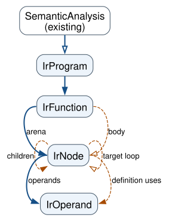
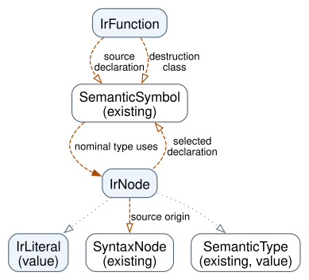

# Chapter 9 — Make Execution Explicit

<!-- common-diagram:start -->





**New data structures.**

- **IrProgram:** The execution representation owned by one semantic analysis. Owns all source-function and generated-destruction bodies.
- **IrFunction:** Owns every node in one function arena, even detached drafts. Its body link selects the root region; its source declaration or destruction-class link identifies what it implements.
- **IrNode:** One typed operation or structured region. The function owns it; ordered child links describe execution, operands provide inputs, and semantic/source links preserve checked meaning.
- **IrOperand:** One ordered input use, owned by the consuming node. It points non-owningly to its defining node, which keeps a reverse list of uses.
- **IrLiteral:** An immutable value-like integer, boolean or byte payload. Byte data is copied at construction; a literal is not a runtime array owner.

The two views separate execution ownership from checked meaning. Nominal type dependencies also maintain reverse links on their class symbol; changing semantic inputs retires the derived IR.

[Text relationships and source fields](figures/ch09-relationships.md).

<!-- common-diagram:end -->

<!-- canonical-forward-link -->
**Later revision:** Chapter 10 replaces the flat type descriptor and class-only type-user links with canonical identities, and extends scopes and body identities. [See the explicitly revised model](chapter-10.md). This figure describes the model at this chapter.


## Introduction

I did not build a low-level intermediate representation for Rune. I regretted that decision when I wrote its LLVM IR generator.

It was horrible.

I printed LLVM IR directly from Rune’s high-level representation. That representation did not describe temporary array allocations, reference-count increments and decrements, or the other housekeeping required to execute the program. The generator had to figure all of that out while printing code.

Its complexity almost broke my resolve to finish the compiler. It remains a hideous piece of code that I am not proud of. It works, mostly. It has bugs. And it is so complicated that I suspect I am the only person who will ever understand it.

I do not want to do that again.

Generating C instead of LLVM IR helps enormously, but it does not remove the need to make execution explicit. If we want to optimize reference counting, temporary allocations, and ownership transfers, we need a representation where those operations exist. We cannot leave them hidden inside the code generator and hope the C compiler sorts them out afterward. By then, the language-level facts needed to justify many of those optimizations are gone.

This chapter builds that representation. It does not implement an optimizer yet. First, we need an execution description we can trust.

This was a difficult chapter. By my estimate, Cadence worked on it for about two and a half hours, spending much of that time building tests to verify that the IR was correct. Getting the right numeric answer was not enough. We needed to know that a temporary survived long enough, that ownership transferred before cleanup, and that destruction happened in the right order.

Then a fresh student agent reconstructed the work from the chapter, the public graders, and the preceding compiler in about fifteen minutes.

That is what I want from an agentic codebook. We do the difficult work of discovering the design, exposing the mistakes, and explaining the reasons. The next agent should not have to repeat that discovery process. It should be able to build from what we learned.

Cadence had already written Chapters 1–7 and the compiler increments they teach. At one point, I asked it how long we had been working on the new Lyric compiler, starting with Chapter 1—the first chapter where it wrote compiler code. It guessed one or two weeks.

We committed that chapter yesterday.

OMG. The efficiency of our work together is off the chart.

## TL;DR

Keep C as our backend. Put a structured intermediate representation between checked source and C emission. Resolve names and types once, then lower their meaning into ordered operations with explicit storage, snapshots, transfers, and cleanup. Validate that representation before publishing inspection JSON or C. The C emitter translates these operations; it no longer decides who owns a value or when to destroy it.

This chapter adds no source-language feature. Start from Chapter 8 and preserve its behavior, diagnostics, unsafe policy, and both object layouts. We are changing where the compiler expresses execution, not what a Lyric program means. There is no optimizer, SSA conversion, general control-flow graph, or generator implementation in this increment. `Yield` means a region result, not suspension.

**Status:** the reference implementation passes the post-code-review cumulative Debug/Release checks and corrected walkthrough. The recorded sanitizer executions precede the review fixes; they were not rerun afterward. One code review and one text review are complete, with their corrections incorporated. A fresh isolated reconstruction passed all current and retained graders, with setup-only assistance and no implementation patches. Bill has accepted the chapter and reports that `spin09` looks good. The detailed public inspection and comparison contract is [the Chapter 9 grader guide](../graders/ch09/README.md).

## Why I want this boundary

Our compiler already emits working C. That is not a reason to discard it. It is a reason to preserve what works while removing a responsibility that has become difficult to see.

Until now, C emission walked syntax and reconstructed execution: which expression must run first, where a value needs a snapshot, which temporary owns an array, and which exits release it. These are Lyric decisions. They should be made before we choose how to spell a C statement.

An intermediate representation gives those decisions a readable home. It also lets us test them independently. We can inspect whether an address was captured before a later effect without hoping a particular allocation happens to expose the mistake. We can remove a release from a test graph and check that an independent evaluator notices the leak.

The goal is not to make the compiler sophisticated for its own sake. I want one explicit execution description and one straightforward C translation. C and its compiler still perform machine-level optimization. We have not measured a speed improvement from this refactor, and speed is not its acceptance criterion.

## 1. Keep meaning attached to the checked program

The checked AST already knows which declaration a call selects, which field a member denotes, and which types and operation tags apply. Lower those facts. Do not parse again, search by method spelling, or ask the emitter to resolve a name.

Place the shared declarations in `compiler/Common/IR.cs`. Put relationship implementations, lowering, validation, and inspection in the responsible implementation modules. Common remains the declaration vocabulary, not a second implementation of the algorithms.

The ownership chain is:

- `SemanticAnalysis` strongly owns one `IrProgram`.
- The program strongly owns its `IrFunction` objects.
- Each function strongly owns every node in its arena, including detached drafts.
- Ordered region nesting is a separate, weak relationship. Detaching a node from a region does not destroy it.

A source function has its actual semantic declaration and a matching reverse `IrBody` link. A generated destruction function instead has a class relationship and a matching `IrDestruction` link. It has no invented source-function declaration. Create all body identities before lowering calls so recursion does not require name-based placeholders.

Operands are relationships too. Each operand knows its consumer and defining node; the definition retains its incoming uses. Nodes also retain actual source, nominal type, selected symbol, and loop-target relationships where applicable. Add and remove operations update both directions. Validate before changing either side: a refused cross-function operand or duplicate function attachment must leave the old graph intact.

Destroying an analysis retires its derived IR before the semantic identities disappear. Destroying a definition disconnects its incoming uses rather than deleting its consumers. That may leave an incomplete draft; publication validation will reject it. Destroying a function destroys every arena node, not only the nodes still reachable from its body.

Literal payloads are the exception: they are explicitly immutable, value-like data. Defensively copy byte payloads. They do not need holder backlinks. Inspection IDs are another kind of value: serialization labels, not authoritative compiler identity.

## 2. Distinguish a value from its storage

Give operations an explicit result category:

- **Value:** an evaluated result, including a scalar snapshot or an owning array holder.
- **Address:** fixed storage captured at a particular execution point.
- **Place:** a logical field location consisting of a saved receiver handle and its actual field declaration.
- **None:** an operation without a result.

`Local` defines storage. `Load` reads a non-owning scalar snapshot. `Store` writes selected storage. An array read instead uses `Copy`, and a counted-object value read uses `Ref`. Do not make one generic load silently decide ownership policy.

This distinction matters even without arrays. Given a read followed by a call that can modify the same variable, the earlier read must remain a snapshot. Emit a load before the call. C argument evaluation order cannot supply Lyric's left-to-right guarantee for us.

Compound assignment similarly reads the old destination value before evaluating its right-hand side. Implicit widening becomes an explicit `Convert` with the `widen` tag. Preserve `as` and `!as` as different tags, just as checked and wrapping arithmetic remain different operations even when their operand and result types match.

### A place is not a delayed reference

Direct field assignment saves its receiver handle before evaluating the right-hand side. If that evaluation grows the class storage, the eventual store resolves the field from the saved handle in the current storage. `SelectField` therefore produces a Place.

A reference promises something else: a particular address acquired now. `AddressOf` resolves a Place once. `Borrow` aliases a fixed address, and `SelectIndex` checks bounds and captures an element address. None may silently re-resolve a borrow after invalidation.

Writable nested indexing traverses the original descriptors without copying them. Capture each selected address before evaluating the next effectful index. Select an assignment destination before evaluating its RHS. Reading an indexed array value, by contrast, makes an independent copy.

A `let ref` fixes its target, not the referent's contents. Passing it to another reference parameter forwards the address. Reading through it still follows ordinary value-copy rules. Replacing an array through it must release the old value in the original slot, but leaving the reference's scope must not release that slot.

## 3. Preserve structure instead of inventing jumps

Use ordered regions and explicit `If` and `While` nodes. `If` has Then and Else regions; only the selected one executes. A continuing branch ends in `Yield`, which supplies the enclosing `If` result. A branch that returns or transfers to a loop does not fabricate a result.

Short-circuit boolean operations lower to this same structure. Do not admit eager binary `&&` or `||` operations: equal result types would not preserve skipped effects. Else-if conditions belong inside the preceding else region, not before the outer condition.

`While` has Condition and Body regions. The condition executes for every test. `Continue` targets a particular loop and repeats that loop's condition; `Break` exits its particular target. `Return` leaves the function, whereas `Yield` leaves a result-producing region.

Use iterative work stacks for lowering and emission. Schedule tasks in reverse execution order when using a LIFO stack, but create operands and append operations in language order. This is not a cosmetic implementation choice: the retained deep-expression case contains 1,500 nonconstant operations, so constant folding cannot hide recursive traversal.

## 4. Make ownership visible before emitting C

Track owning holders while lowering each lifetime region. This bookkeeping is local to construction; the persistent graph contains the resulting actions. The C emitter must not recreate the list.

Arrays have independent recursive value storage. `Copy` duplicates live contents, including nested arrays. It does not preserve spare reservation. A counted scalar `Ref` retains shared identity instead of copying fields. Ordinary object handles neither retain nor acquire automatic destruction.

`Move` takes an owning holder, empties it, and produces a transfer. The transfer is not a second owner to clean up. Its designated consumer is a store value, consuming call argument, array element, push value, return, or yield. `FreeArray` recursively releases and clears an array holder. `Unref` clears a counted holder before decrementing and possibly finalizing. Empty-holder cleanup is harmless.

Replacement is explicit: select the destination, evaluate the new value, release the old contents, then store the transferred new value. Releasing through borrowed storage is valid during replacement; a blanket rule against releasing a Borrow operand would reject real programs. A release target can be storage holding an owner, including a field Place; that does not make it a temporary eligible for Move. Validate those roles separately.

At an ordinary region exit, transfer its result before releasing its other holders in reverse declaration order. Return releases all exited lifetime regions after preserving the outgoing value. Cleanup may occur between a Move and its consumer, so single consumption does not mean adjacent instructions. Emit normal fallthrough cleanup only when the checked block can continue. A Return has already emitted its exiting cleanup; appending another release afterward leaves unreachable residue. Execution evaluators stop at Return and may miss that residue, so inspect ordered operations as well as runtime results.

Register a conditional's result holder in the enclosing scope only after lowering its branches. Otherwise a return inside a branch could attempt to clean a result that was never created.

### Calls have contracts, not one universal ownership rule

Evaluate receiver and arguments left to right. Delay the actual argument transfers until argument evaluation finishes; a return inside a later argument must still be able to clean earlier evaluated owners.

Owning array and counted-scalar value parameters consume transfers; ordinary scalar values need no Move. Reference parameters borrow addresses. Constructor and final-hook self are borrowed handles; an ordinary counted method receiver is an owning value argument.

Output builtins also borrow their evaluated arguments. `print` must not consume an array merely because it appears in a Call node. Keep its temporary owner in the region and release it through explicit cleanup. This distinction must agree in lowering, validation, independent evaluation, and C emission. Assertion-only tests cannot establish output-call correctness; exercise repeated print/println on the same value and check the specified output comparison, including its decoding and newline policy.

### A loop condition has a lifetime

A true condition keeps its temporary owners alive through the selected body. Release them on the normal backedge and before an exiting transfer. A false condition releases its holders inside the false path before yielding false.

Do not place unconditional cleanup after the loop. A break inside the condition can bypass later holder definitions. An empty holder exists and can be released; a holder whose defining instruction never ran does not exist. This difference is why definition-order validation belongs alongside ownership tests.

Loop condition and body regions are structural siblings, but their lifetime contexts overlap. Return from the body must clean both. A nested continue cleans only the regions it exits, not the outer loop's surviving condition owners.

## 5. Arrays and objects keep their existing behavior

Use checker-resolved array operation tags, not method-name dispatch. Capture the receiver descriptor before evaluating an effectful count or pushed value. Reserve changes reservation without adding live elements. Resize initializes new live values with typed defaults; shrinking releases removed owners. Resize to zero releases reservation even if the array was already empty. Truncate to zero retains it.

Capacity observes selected original storage or an evaluated temporary. Copying first would discard the reservation being queried. Length follows its existing evaluated-value contract. Both return u64. Preserve checked allocation-size arithmetic, located runtime failures, and safe-versus-unsafe bounds behavior.

Lower string literals to NewArray with immutable decoded byte payloads. Each execution creates fresh mutable storage. Do not expand a long literal into thousands of scalar IR nodes, reinterpret arbitrary bytes as Unicode, or add a sentinel to its language-visible length.

Constructors evaluate explicit arguments before allocation, then call the actual constructor with the new handle. The constructor body returns unit; the source expression returns the separately allocated handle. Use the checked constructor-self facts without treating partially initialized self as an ordinary escaping value.

### Generate destruction once

Create one generated destruction body per class. Its incoming receiver is an unnamed Local, not a fabricated self declaration. In order, the body:

1. Calls the actual final-hook declaration, if one exists, while storage is live.
2. Selects and releases owned fields in declaration order.
3. Executes ReclaimObject to return the slot to the class allocator.
4. Returns an explicit unit value.

Local cleanup uses reverse declaration order; field cleanup uses declaration order. Do not merge those contracts.

Select fields after the hook using the stable receiver handle. The hook may allocate and relocate storage. Runtime wrappers still check live/destroying states and guard reentry, but they dispatch into this body rather than duplicating hook and field cleanup. Count-zero release dispatches to the same body. Reclamation itself must not secretly free fields, or deleting an IR release would have no observable effect in a test.

Arrays of counted objects retain each copied leaf and release each removed leaf. Arrays of ordinary handles add no lifetime claim. Non-nullable objects have no implicit default: reserve, supplied push, and shrink are valid, but growth of a direct object array fails before mutation. An empty nested array does have a default.

## 6. Validate completed graphs, not drafts

Allow incomplete editing through the model API. Require a complete graph before inspection or emission, and destroy partial lowering results on failure. Revalidate the current graph at publication: a successful lowering does not certify later edits. Refusal must leave the output empty and the editable graph unchanged. Malformed generated IR is an internal compiler defect, not a source diagnostic blaming an already checked program.

Use three bounded passes:

**Structure.** Check complete arena/tree membership, live operands, implemented region shapes, and enclosing target loops. A detached draft is legal during editing but illegal at publication. Do not silently accept unused vocabulary such as For or Clear without an execution contract.

**Operations.** Check arity, categories, exact types, and semantic identities. A field's receiver must match its owning class. Calls use actual parameter scopes and reference roles. Generated receiver types must be nominal instance types, not the class declaration's own type metadata. A graph may execute numerically in a permissive evaluator and still be malformed here. Constants require matching payloads: absent for unit, Boolean for bool, and representable Integer for an integer type. Byte-array payloads belong to NewArray. Give test fixtures real payloads too, so an unrelated malformed constant cannot mask the defect being tested.

Arithmetic uses the existing shared numeric rules. Shifts preserve the left operand type; comparisons allow mixed integer ranges; arithmetic selects its permitted common type. Do not require equal operand types everywhere. Check explicit conversion and wrapping tags rather than inferring them from result types.

Check transfer contracts in both directions: every Move has one consuming use, and every owning consuming operand receives a Move. Borrowed self and nonconsuming builtins are exceptions defined by semantic roles, not parameter-name strings. A Move source must be an owning holder, not a non-owning Load or captured address.

**Execution.** Walk reachable order iteratively. Definitions must execute before uses. Branch-local definitions do not escape except through the If result. Loop-condition definitions can survive into the body, but post-loop availability must intersect false exits with breaks; continue is not an exit. Require reachable function paths to return and result regions to yield. Unreachable suffixes still receive structural and operation checking.

Track pending transfers separately from definition availability. A transfer cannot be abandoned by a return, break, or continue before its designated consumer. Loop backedges preserve entry obligations rather than accumulate new transfers on every iteration. Intervening cleanup remains legal.

These passes do **not** prove full alias-sensitive holder liveness, storage initialization, balanced ownership on every possible path, or eventual termination. State that limit. Independent ownership execution and runtime regressions provide complementary evidence, not a formal proof that the validator rejects every malformed ownership graph.

## 7. Translate the IR, not the source again

Keep the existing C runtime, checked arithmetic helpers, array copy/drop functions, allocation guards, and both object layouts. Replace the syntax-body traversal and its ownership inventory.

Give each IR definition a C spelling. Declare temporaries outside nested C blocks where validated uses require visibility; execute their assignments at the IR position. Locals are actual slots. Fixed addresses are pointer variables whose dereferenced spelling denotes the selected storage. A field Place saves a handle and resolves its field when used.

Translate regions with an iterative action stack. C labels may implement region exits and target-specific loop transfers; they are emission details, not arbitrary jump edges added to our IR. Yield assigns the region result and exits that region. Return follows the already-emitted cleanup and leaves the function. Do not add another scope-cleanup policy.

Reuse numerical helpers rather than relying on C promotions. Preserve negative-versus-unsigned comparison behavior, checked shift counts, wrapping operations, diagnostics, and stack-trace locations. Emit all source and generated body prototypes in an order that supports recursion and destruction dispatch.

Finally remove the old fallback. A passing example is weak evidence if unsupported bodies silently use the old path. During construction, body markers let public tests prove which path ran. At the finished boundary every supported function is emitted from validated IR. Buffer output until successful completion; a failure must not publish half a C translation unit.

## 8. Inspect and test different obligations independently

`--inspect-ir [--unsafe] FILE` checks a library, so main is optional. It writes one `lyric-ir-1` JSON document only after successful lowering and validation. It does not accept a layout option. Inspection exposes flat nodes, ordered children and operands, semantic symbol IDs, loop targets, types, operator tags, byte payloads, and source offsets. IDs identify relationships within the document; display names do not resolve calls.

The Python scalar evaluator checks snapshots, calls, branches, recursion, and loop transfers. The ownership evaluator independently models mutable addresses, heap allocations, reservation, counted identity, and class relocation. It deliberately relocates on every allocation to expose stale addresses. Neither evaluator calls the C runtime.

Test the graders themselves with damaged graphs: replace Copy with a shared read, remove releases, reorder selection past an effect, misbind same-named methods, omit a hook, or reclaim before it. A test that derives its expected hook count from the emitted calls cannot catch an omitted call; expectations must be independent.

The C grader checks generated-body markers, compiles and executes at O0 and O2, then checks stdout under its published text-decoding and newline-normalization rules, exit status, and expected failure diagnostics. Retained Chapter 8 layout and allocation-balance checks exercise the actual runtime. Sanitizers add concrete memory/undefined-behavior checks; they are not a performance measurement or universal safety proof.

## Exercises and completion

Start with your accepted Chapter 8 implementation, not a target Chapter 9 solution. If your snapshot predates the class-capacity doubling update, first bring it into conformance with current Chapter 8: class backing storage doubles within checked limits, ordinary array growth is unchanged, and only live slots are initialized. The retained allocation graders check that prerequisite too. Read the entire public grader guide and fixtures. You may inspect graders and write diagnostic tests, but do not edit grader logic or expected results to obtain a pass. Grading logic is Python, outside both C# and the planned Lyric implementation edition.

1. Build the relationship-bearing IR model and test refusal without mutation, reverse links, invalidation, and complete arena destruction.
2. Lower checked scalar execution and structured control. Add explicit snapshots and conversions before ownership work.
3. Lower ownership, reference selection, arrays, classes, and generated destruction using the contracts above. Test transferring exits and condition lifetimes.
4. Implement structure, operation, and reachable-execution validation. Isolate malformed fixtures so a different defect cannot satisfy the expected refusal.
5. Publish the flat inspection schema and pass both independent evaluators, including their deliberate-defect checks.
6. Translate every supported body from IR to C, retaining runtime helpers but deleting syntax execution and inferred cleanup. Pass current and retained regressions.

Run from the repository root with installed Python 3, .NET 10/C# 14, and the supported C compiler. Set DOTNET to your installed executable. These commands do not contact a model provider. Prepare dependencies beforehand: the Make targets invoke dotnet build with implicit restore, so use a prepared offline NuGet configuration if network access must be excluded. Existing Unicode/grammar fixtures and prerequisite tooling must already be present as described in earlier chapters.

```sh
DOTNET=/path/to/dotnet
"$DOTNET" build compiler/Lyric.csproj -c Debug --no-restore --tl:off
python3 graders/ch09/ir.py "$DOTNET" compiler/bin/Debug/net10.0/Lyric.dll
python3 graders/ch09/ownership.py "$DOTNET" compiler/bin/Debug/net10.0/Lyric.dll
python3 graders/ch09/c_emission.py "$DOTNET" compiler/bin/Debug/net10.0/Lyric.dll
make test DOTNET="$DOTNET"
```

The last command builds and runs the cumulative retained suite in Debug and Release. Require every applicable case, not just the three new graders. All Chapter 9 behavioral cases are retained; C body-marker assertions are chapter-only migration checks. Stable IDs and exact normalization, timeout, failure, and output contracts are in the public grader guide and fixtures. The real-model development probe under `tools/probes/` tests this implementation's internal API; it is supplementary evidence, not a portable substitute for the public behavioral graders.

Optional supported-host memory diagnostics:

```sh
CC='cc -fsanitize=address,undefined -fno-sanitize-recover=all' \
  python3 graders/ch08/layout.py "$DOTNET" compiler/bin/Debug/net10.0/Lyric.dll
CC='cc -fsanitize=address,undefined -fno-sanitize-recover=all' \
  python3 graders/ch09/c_emission.py "$DOTNET" compiler/bin/Debug/net10.0/Lyric.dll
```

Report unavailable sanitizer support as unperformed, not passed. In confined macOS setups, a launcher may remove DYLD_LIBRARY_PATH needed by a supplied Node runtime. If grammar-check fails before Node starts, preserve that setup failure and run the unchanged grammar script directly with the prescribed runtime environment; report the actual command rather than claiming the failed Make invocation passed. Behavioral grading does not replace architectural review. Independent reconstruction and human use are separate completion evidence; do not infer them from reference-implementation results.

## Take it for a Spin

Run from the repository root:

```sh
make spin09 DOTNET=/path/to/dotnet
```

This builds Release first and runs `tools/spin09.py` using installed Python and
`CC` (default `cc`). The Python walkthrough performs no installations or network actions; the preceding build permits implicit restore. Use an already-prepared SDK and offline NuGet configuration to exclude restore network access. The script creates
source, C, and an executable in a disposable temporary directory and removes them
on exit. No credentials or paid services are involved.

The script prints its complete source. The program returns `[3, 7]`, copies it,
changes the first array, and asserts that the copy still contains 3. Inspection
follows the body’s ordered child links—not arena serialization order—and
shows `NewArray -> Move -> FreeArray -> Return` for the helper: the returned value
is transferred before cleanup touches the now-empty temporary. The compiled C
prints exactly `Independent copy survived` followed by a newline.

Finally the script inspects a program calling an unknown name. Expect exit 1,
a located LYC301 diagnostic, and no partial JSON. The temporary path in that
printed diagnostic varies. The script checks exit 1, empty stdout, and the LYC301
code; it does not compare the location or full diagnostic text. It exits nonzero
if its checks fail. We ran this corrected walkthrough successfully on the reference compiler;
your own run and human acceptance are separate evidence.
