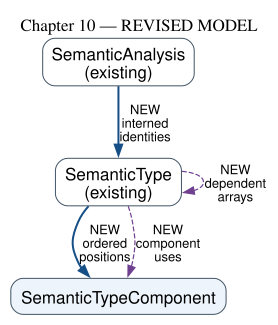
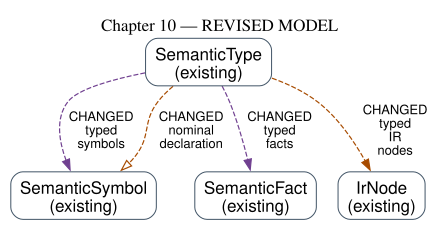
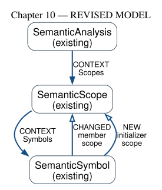
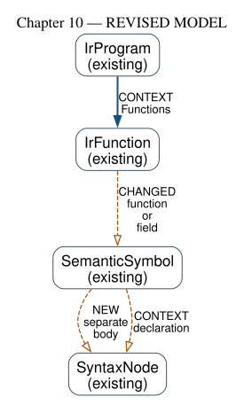

# Chapter 10 — Composite Types and Canonical Type Identity

<!-- common-revisions:start -->

**Revised model — Chapter 10.** Earlier figures describe their historical
construction stages. NEW introduces a relationship here; CHANGED replaces the
cited earlier relationship; CONTEXT repeats an unchanged link for orientation.
Repeated context is not a second introduction. Type identity is now analysis-owned.

**Canonical identity and tuple positions.**



- **SemanticAnalysis:** Owns semantic scopes, facts, and canonical identities in TypeBuckets. It retires derived IR before semantic teardown.
- **SemanticType:** One analysis-owned canonical identity. Immutable keys depend on element, nominal declaration, or ordered tuple components; retirement invalidates users, never shared ingredients.
- **SemanticTypeComponent:** One tuple-owned position, with a non-owning dependency on its shared component type. Repeated component identities still have distinct positions.

[Exact source fields, predecessors, and retirement rules](figures/ch10-relationships.md).

**Canonical type users.**



- **SemanticType:** One analysis-owned canonical identity. Immutable keys depend on element, nominal declaration, or ordered tuple components; retirement invalidates users, never shared ingredients.
- **SemanticSymbol:** A declaration identity: class/struct symbols own member scopes, defaulted fields own initializer scopes, and methods link to separate implementation syntax without duplicating the callable.
- **SemanticFact:** A checked expression: its type, optional constant and resolved declaration. Analysis owns it; syntax and declaration links let checking and emission share the same result.
- **IrNode:** One typed operation or structured region. The function owns it; ordered child links describe execution, operands provide inputs, and semantic/source links preserve checked meaning.

[Exact source fields, predecessors, and retirement rules](figures/ch10-relationships.md).

**Member and initializer scopes.**



- **SemanticAnalysis:** Owns semantic scopes, facts, and canonical identities in TypeBuckets. It retires derived IR before semantic teardown.
- **SemanticScope:** An analysis-owned lexical scope. Member and initializer scopes additionally have their actual declaration owner; both back-references are maintained.
- **SemanticSymbol:** A declaration identity: class/struct symbols own member scopes, defaulted fields own initializer scopes, and methods link to separate implementation syntax without duplicating the callable.

[Exact source fields, predecessors, and retirement rules](figures/ch10-relationships.md).

**Separate syntax and generated bodies.**



- **SemanticSymbol:** A declaration identity: class/struct symbols own member scopes, defaulted fields own initializer scopes, and methods link to separate implementation syntax without duplicating the callable.
- **SyntaxNode:** One parsed construct. Its source owns its lifetime; ordered parent/child links describe syntax without owning neighboring nodes.
- **IrFunction:** A program-owned executable IR body. Source callables and field initializers use Declaration/IrBody; class destruction uses its separate role link. These weak identities do not own the body.
- **IrProgram:** The execution representation owned by one semantic analysis. Owns all source-function, field-initializer, and generated-destruction bodies.

[Exact source fields, predecessors, and retirement rules](figures/ch10-relationships.md).

<!-- common-revisions:end -->

> Author verification and assisted independent reconstruction are complete. The reference and student implementations passed the retained cumulative suite in Debug and Release; the student run included all eighteen canonical corruption controls. The single code and text reviews are complete and their required corrections incorporated. Revised diagrams are source-checked and integrated, and the published walkthrough has passing command-line evidence. Student assistance clarified setup and existing public contracts; it did not supply target code or change graders. Bill has fully approved Chapters 9 and 10 after running `make spin09` and `make spin10`. Human walkthrough acceptance is complete.

## Introduction

An array gives us many values of one type. A tuple or struct lets us put different values together. That sounds like a small extension until the components own storage or borrow it.

Consider a struct containing an array and a reference. Copying the struct must copy the array's owned storage, but it must not copy or acquire ownership of the reference's target. Replacing the struct must release its old owned contents without destroying the borrowed target. A method receiving the struct by value gets its own fields, yet a reference inside those fields can still reach the caller's storage.

We need a model that makes those distinctions explicit. We also need a reliable answer to a simpler question: when do two composite type descriptions name the same type?

This chapter builds both foundations on Chapter 9's execution representation. We retain the C backend and the existing array and object contracts. We do not add enums, general generics, interfaces, or an optimizer.

## TL;DR

Intern types within each semantic analysis. Scalars use their scalar kind; arrays use their canonical element type; tuples use their ordered canonical component types; nominal types use the actual declaration identity. Hashes select candidates, not answers. Published keys do not change.

Construct aggregates in the language's evaluation order, then assemble fields in declaration order. Copy owned components according to their existing ownership rules. Copy reference fields as aliases, never as owners of their referents. Keep a value snapshot distinct from an address that observes live storage.

Allow contained borrows in local values and synchronous calls, with lifetime checking through copies, projections, defaults and caller-visible writes. Do not allow borrow-containing values to escape through returns or array storage, including nested wrappers. Keep recursive analysis finite without discarding potentially stale aliases.

## 1. Give each type one identity

Suppose two expressions independently produce the type `(i32, [u8])`. Their source syntax differs, but their structural type is the same: the same two component types, in the same order. Conversely, two structs with identical fields remain different types when they have different declarations. Shape is not nominal identity.

Put the shared declarations in `Common/SemanticTypes.cs`. A `SemanticType` is an identity-bearing object strongly owned by one `SemanticAnalysis`; it is not a disposable value descriptor. Its live key contains the kind and the applicable scalar tag, element type, nominal declaration, or ordered tuple components. The analysis owns the interning index. Do not add a global table or another mutable descriptor that must be synchronized with the canonical object.

Implement lookup in the semantic module. Validate that every dependency is live and belongs to this analysis before publishing a new type. Compute a hash, select the bucket, then compare every candidate's complete key. For a tuple, compare both component count and each component identity in order. For a nominal type, compare the actual declaration object, not its spelling. Return the existing object on a match; construct and register one new object on a miss.

The hash is only a bucket selector. Different keys may have the same hash. Correctness comes from the complete comparison. Once all types are constructed through this boundary, ordinary object identity answers type equality within the analysis. This is a representation guarantee, not a measured performance claim.

Canonical identity answers exact type equality, not whether a language conversion is permitted. Preserve the existing scalar widening rules at checked conversion boundaries. A scalar value with no address or contained-alias slots carries no alias state to transport; do not make an exact-type assertion in that transport path reject an already-validated scalar conversion. Reference and aggregate occurrence shapes still require their exact contracts.

### Ordered occurrences are relationships too

The type `(i32, i32)` has two component occurrences even though both point to the same canonical scalar type. Represent the positions with distinct ordered `SemanticTypeComponent` links. The tuple owns these links; each component type records its reverse uses. Do not deduplicate the positions merely because their targets are identical.

Array-element and nominal-declaration dependencies also have reverse memberships. Symbols, semantic facts and IR nodes retain their type relationships through declared operations. These links let retirement find dependents directly instead of searching the entire compilation or leaving stale references behind.

Published keys cannot be edited in place. Changing a key would both invalidate the hash index and change the meaning seen by existing users. Request another canonical type instead.

### Retire users, not shared ingredients

`SemanticType.Destroy` first clears derived IR. It marks the type retired and detaches the nominal declaration before walking dependents; that ordering prevents member invalidation from reentering the same nominal dependency through its owner. It retires tuples and arrays that depend on this type, retires attached facts and symbols, destroys its own component links, and removes its remaining element and analysis memberships.

Destroying a tuple does not destroy its component types. Other types and symbols may still use them. Dependency retirement runs toward users, not toward shared ingredients. Each relationship operation updates both ends, and a refused cross-analysis attachment must leave the existing model unchanged.

This gives the student two separate checks to make: equivalent live keys return the same object, and retiring an object leaves no live dependent holding a stale type relationship. An inspection document can expose canonical IDs and ordered dependencies, but serialized IDs alone do not prove the in-memory lifecycle is correct.

## 2. Build tuples without losing evaluation or ownership

A tuple is an ordered collection of values with a statically known type at each position. `(value,)` constructs a one-element tuple; `(value)` groups an expression; `()` remains unit. Keep that distinction in the parser rather than asking the checker to reinterpret parentheses from an expected type.

Use `.0`, `.1`, and subsequent decimal positions for selection. After a member-access dot, consume the digits as one selector, leaving another dot for the next selection. Thus `nested.0.1` selects twice; it is not a floating-point token. Reject a position outside the tuple's known arity during checking. Do not implement tuple selection as runtime array indexing: different positions can have different types.

The receiver is evaluated once. Reading a component follows its ordinary copying rules: arrays get independent owned storage, counted handles retain their object, and ordinary object handles continue to identify the same object. A tuple is not a request to deep-clone every reachable object. Writing an inline component requires writable containing storage; borrowing it requires that storage to remain valid and stable through the borrow's last possible use.

Keep reads and destinations distinct in IR. A selected address identifies the component's storage; obtaining an independent value from it is a separate read or copy operation. Do not move ownership out of a borrowed component merely because the backend can address it. Aggregate construction, selection, and cleanup must exercise the same ownership rules as their scalar, array, and object ingredients.

### Destructuring introduces names

For `let ((x, y), _) = expression`, evaluate and type-check the initializer before introducing any of the new names. Walk the pattern and initializer type together. A tuple pattern requires a tuple of the same arity; push corresponding children in reverse order on a work stack to visit them left to right. A name records a proposed binding and its component type. A wildcard records no binding.

Check every proposed name against the enclosing scope and against the other names in this pattern. Only after the whole pattern is valid should the checker construct the local symbols. This is how `CheckDestructuring` in `Semantics/Check.cs` avoids publishing the first few bindings of an invalid pattern. `let` and `var` choose the new locals' mutability; this syntax never assigns to existing variables.

Lower the initializer once into an aggregate snapshot. Walk the same pattern shape, selecting component addresses from that snapshot. Copy each named leaf according to its type and store it in its newly declared local. A wildcard needs no destination. After all named leaves have their own ownership, release the aggregate snapshot if it owns contents.

That final ordering is essential. Ignoring a component does not suppress its cleanup, and cleanup can run a finalizer. Establish the named owners first; then release the snapshot, including discarded components. The binding branch in `IR/Lowering.cs` uses precisely this ordering rather than dropping each wildcard as soon as the traversal encounters it. Contained aliases require an additional lifetime check across this cleanup; copying an alias does not make its target live longer.

Test nested and singleton patterns, shape mismatches, duplicate names, shadowing, one-time initializer evaluation, and cleanup of discarded owned values. A successful scalar destructuring example alone cannot establish these ownership properties.

## 3. Construct named values without constructing partial instances

A struct is nominal: its identity comes from its declaration, not from a matching set of fields. Resolve a named construction to that declaration and resolve each input name to an actual field symbol. Reject unknown names, duplicates, and omitted fields lacking declaration defaults. Do not silently supply zero or an empty array. A forgotten required input should be an error, not a plausible value.

For example:

```lyric
struct Point {
    x: i32
    y: i32 = 0
}

// Inside a function:
let first = Point { x: 5 }
let second = Point { y: 8, x: 5 }
```

Both constructions supply `x`; only the first evaluates the default for `y`. Named input order is not storage order. The second construction evaluates its `y` expression before its `x` expression even though the declaration lists `x` first. Positional construction is not an alternative spelling: use tuples for unnamed positional values.

### Evaluate first, arrange afterward

Extend the expression-lowering work stack so explicit field expressions evaluate left to right in their written order. Preserve each result before proceeding. A later expression may change storage that an earlier expression read; an earlier value must remain the value it already produced, not a delayed load from that storage.

The `NewStruct` branch in `IR/Lowering.cs` then performs three steps:

1. Associate each saved explicit operand with its resolved field symbol. This map rearranges results; it does not evaluate expressions.
2. Visit fields in declaration order. For each missing field, emit its `CallInitializer` and retain the result. Supplied fields skip their defaults entirely.
3. Visit fields in declaration order again to assemble the operands for `NewStruct`. Ordinary fields use the existing permitted widening and ownership-transfer operations. Reference fields require an exact canonical referent type and an Address result; forward that address unchanged.

Do not transfer the first owned result into the aggregate before evaluating the remaining inputs. Keeping the results as temporary owners through all explicit inputs and defaults preserves cleanup on early exits and allows lifetime checking to account for later effects. Reordering saved operands is harmless; reordering evaluations or changing ownership early is not.

A reference field stores an alias, not a copied referent. Widening its value would lose the required storage identity, while moving its referent would steal ownership from storage the construction merely borrows. The IR validator must enforce this distinction as well as the checker: an ordinary Value operand is not an acceptable substitute for an Address just because their type objects match.

### Defaults belong to declarations, not callers

A default is an expression evaluated once for each construction that omits its field. It is not a value computed once when the declaration is checked. Two constructions with an array-producing default must obtain the ownership required by two separate evaluations; they must not accidentally share one cached array descriptor.

Check every declared default in its declaration scope, even if no construction uses it or every construction overrides it. Overriding a field skips runtime evaluation of its default, not declaration-time validation. For example, an `i32` field defaulted to `false` remains a type error even when a construction supplies an integer.

Resolve the expression in its declaration scope. Caller locals do not become visible, and neither `self` nor sibling fields of the partially built instance are available. Declaration order chooses when defaults run; it does not create a field-dependency language. If values depend on one another, compute them in an ordinary factory function and supply the named fields explicitly.

Represent a default with its own initializer scope and generated IR function role, associated with the actual field. Do not paste the same default syntax into every caller or manufacture a source-level function symbol. Reusing caller checking context would give the expression the wrong lexical environment; reusing syntax-keyed temporary ownership across callers would merge separate evaluations. `CallInitializer` names the field whose initializer it invokes, keeping that relationship explicit.

Most initializers return values. A reference-field initializer instead returns an exact address, without widening or ownership transfer of the referent. This is a narrow generated-initializer role, not permission for ordinary source functions to return references. Cleanup still runs, and the lifetime checker must validate the saved alias after that cleanup. An address into a temporary counted object cannot become valid merely because it is used as a default.

An ordinary value default can also return an aggregate containing aliases. That requires the same post-cleanup safety guarantee even though its IR result is a Value rather than an Address. Retain separate tests for these two result shapes. The current positive controls use an ordinary process-lived object; they establish usable alias transport, not complete object reclamation. The corresponding counted-owner controls require `LYC326` when temporary-owner cleanup invalidates the alias.

Finally, keep three questions separate: was a named field omitted legally, can an array grow by constructing default elements, and can internal empty storage be cleaned up safely? Explicit field defaults answer only the first. Structs do not become implicitly defaultable array elements merely because every field has a default. The array-growth rule is taught separately below.

## 4. Add methods without adding object identity

A struct method is an ordinary callable associated with the struct's declaration. It does not allocate an object or turn every receiver into a shared handle. A first parameter named `self` has the enclosing struct's type and is passed by value. `self: ref Point` instead requires a writable reference receiver. Keep that mode in the signature.

The calls are deliberately different: `point.sum()` supplies a value receiver, while `(ref point).translate(3, 4)` supplies an explicit reference receiver. Do not automatically borrow `point` because a selected method happens to require it. Check the receiver once, preserve its value or address, then evaluate ordinary arguments in order. Later arguments can invalidate a saved reference or change the original value's storage; existing argument lifetime and snapshot rules still apply.

A method without `self` is static and is selected through the type namespace, as in `Point.origin()`. Type-namespace lookup is not a runtime receiver expression. Such a method has no hidden instance and no special construction privilege. A factory still has to supply required fields normally.

### One declaration, one body

Support inline bodies and a semicolon declaration followed by a qualified implementation:

```lyric
struct Pair {
    left: i32
    right: i32
    func sum(self) -> i32;
}

func Pair.sum(self) -> i32 {
    return self.left + self.right
}
```

This is one callable. Preserve the declared member symbol as the authority used by calls, type checking, and IR. Add a separate weak, reciprocal relationship from that symbol to its implementation syntax; do not replace its declaration or register another function under the qualified spelling. `SemanticSymbol.Implementation` and `BodySyntax()` provide that distinction in the reference implementation. Removing either end must detach the relationship and invalidate derived IR rather than leaving a body reachable through stale syntax.

Collect nominal declarations and their members before matching qualified bodies. Resolve the qualifier to the actual struct and the member to its existing callable. Reject an undeclared member, a second body, or a missing required body. Match parameter count, canonical parameter types, reference modes, receiver status, and result type. The checker uses `LYC342` for these separate-body contract failures.

Ordinary parameter names need not match. The declaration supplies the callable's type contract; the implementation supplies the names used inside its body. Resolve signature types outside those body-local names so renaming a parameter cannot change the meaning of a type. Check duplicate and shadowing rules on the declaration independently, then create the implementation's local parameter symbols with the matched contract types. `self` is not an arbitrary ordinary parameter rename: whether a parameter is the receiver must agree.

Checking and lowering select the actual body through the relationship, but call operands still name the original member. Lower that callable once. A wrapper function would duplicate identity and introduce an unnecessary second call boundary; replacing the declaration would lose the contract being checked.

The language specification permits declaration and implementation files in different directories of one explicitly configured package. This chapter's verified CLI increment exercises the syntax and matching within a single source file. Directory layout is not package identity, and these tests do not establish a multi-file package loader. Preserve that distinction when extending the driver later.

## 5. Ask separate questions about layout, ownership, and defaults

A canonical type graph supports several queries, but those queries do not follow the same edges. Keep their contracts explicit in `Common/SemanticTypes.cs` and implement them in the semantic module. Compute these properties from the authoritative type and field relationships rather than introducing mutable cached flags that must be repaired when declarations change.

### Can this value fit in finite inline storage?

`HasFiniteLayout` follows tuple components and ordinary inline struct fields. It stops at array descriptors, object handles, and reference fields: those representations have fixed size without embedding their targets. Consequently, a struct containing an array of its own type can have finite layout; a struct containing itself directly cannot.

Use an explicit depth-first work stack with entry and exit records, an active-path set, and a completed set. On entry, skip a completed type. Encountering an already-active type proves an inline cycle and rejects the layout. Otherwise mark it active, schedule its exit, and visit its inline dependencies. On exit, move it from active to complete. Reusing a completed dependency is legal sharing, not recursion along the current path.

Collect field types before performing the complete layout check. Checking a declaration before a forward-declared dependency's fields are known could miss the cycle. Do not follow every reachable type indiscriminately: that would incorrectly turn an array's element type or a reference's referent into an inline field.

### Does copying or discarding this value manage owned contents?

`HasOwnedContents` answers a different question. An array owns backing storage, so encountering an array is sufficient without expanding its element type. A counted class handle participates in retain/release ownership. A tuple or struct inherits owned contents from ordinary components; a reference field contributes no ownership of its referent. Ordinary object handles do not acquire counted ownership just because they appear inside an aggregate.

Use this classification to select the existing recursive copy and cleanup operations. Copy arrays according to their independent-storage contract, retain counted handles, and copy borrowed pointers without retaining or destroying their targets. Cleanup mirrors ownership, not arbitrary reachability. Replacing one selected field releases that field's previous owned value, not its siblings. A partial-field update must never be recorded as proof that the whole holder is empty.

### Can array growth create a valid new element?

`HasDefaultValue` is deliberately stricter than cleanup-safe initialization. Scalars have their typed zero or unit defaults. An array has an empty descriptor default without constructing any elements. A tuple defaults if and only if all its components default. Nominal structs and class handles do not implicitly default.

Thus `([Point], i32)` can default: its first component is an empty array, not a constructed `Point`. `(Point, i32)` cannot. A struct remains nondefaultable for growth even when all its fields have declaration defaults. Array resizing must not silently become a loop of arbitrary struct initializer calls.

For a nondefaultable element type, reserving capacity, appending explicitly supplied values, and shrinking remain legal. Growth that would expose unspecified new values fails with `LYR011` before mutation. Unsafe mode does not waive this initialization rule. For defaultable elements, initialize every newly live slot, including previously used slots exposed again after shrinkage; stale bytes are not a default value.

### Does a value contain a forbidden escaping borrow?

`HasContainedBorrows` follows array element types as well as tuple components and ordinary struct fields, and succeeds on a reference field. It stops at object handles rather than treating every object they reach as inline contents. A visited set terminates recursive type graphs.

Unlike layout checking, this query cannot stop at an array descriptor: hiding a borrowed aggregate behind an array type must not bypass the storage prohibition. Unlike lifetime analysis, it may deduplicate canonical types, because it asks only whether any forbidden contained reference exists. Tracking which of two fields refers to which storage requires distinct occurrence identities, even when both fields have the same canonical type. That is the next section's job.

## 6. Preserve aliases without pretending to own their targets

A contained reference is a fixed, nonowning alias. Copying its struct copies that alias; it neither copies the referent nor extends the referent's lifetime. Reading a reference field reads through the alias. Assigning through that field changes the referent, whereas replacing the whole struct can replace the aliases stored in its fields. An immutable wrapper does not make its already-writable referenced storage immutable; ordinary inline fields still inherit their holder's mutation restrictions.

Keep these rules inside the existing borrow-flow analysis. A second checker with its own approximation of calls, cleanup, and branches would create competing authorities for the same lifetime facts. Extend the existing flow events and worklist states instead. The new facts must participate in the same invalidation, last-use, and scope-expiry checks as direct references.

Preserve the earlier storage distinctions when extending invalidation. Class-table growth can relocate field descriptors without moving an array field's separately allocated payload; destruction is a different event and invalidates the object itself. A direct class-field assignment saves an object index and reselects its destination after the right-hand side, whereas a saved pointer must remain stable. Check the saved object destination after right-hand-side effects and before publishing contained-alias writes, retaining the existing diagnostic contract. Do not exempt genuine reference or aggregate addresses from pointer checks merely because index-based stores can survive table growth. The retained earlier-chapter suites exercise these boundaries; focused composite tests alone do not establish compatibility.

### Give occurrences identities, not just types

Enumerate reference occurrences in declaration order through ordinary inline struct fields and tuple components. Stop at a reference field: its referent is not embedded storage. Do not deduplicate equal component types. Two fields of type `ref i32` can refer to different arrays or objects and can become invalid for different reasons.

A value holder has an ordered slot for each such occurrence. A saved expression value has its own ordered snapshot handles. Each handle's flow state records possible target paths, invalidation causes, and scope expiry. Addresses additionally carry ordered sets of possible live referent-slot identities. These are analysis facts, not runtime ownership of the referents and not a new canonical type cache.

There are two questions to answer separately: **which address does this alias designate?** and **which aliases are currently stored at that address?** A reference to a holder keeps following that holder after its contents change. An earlier value copy of the holder keeps the aliases it copied before that change.

### Snapshot values; read referenced storage when it is used

For an ordinary value read, copy the current occurrence states into expression snapshot handles. Preserve their target paths, invalidation causes, expiry, and reachable-storage identities. Never acquire a fresh valid borrow merely because an existing alias was copied. A stale alias copied into another aggregate remains stale.

For a read through a reference, first check the address itself. At the flow event for the read, resolve its possible live slots for each occurrence and collect their current states into a new value snapshot. This is what `SnapshotReferent` and `ReadReferentOccurrence` arrange in `Semantics/Check.cs`; `SnapshotContained` handles ordinary value snapshots. Resolving storage only while walking syntax would freeze an earlier relationship and miss later assignments or branch-dependent targets.

For an ordinary inline projection, select the appropriate contiguous occurrence range. For a reference field, select its stored alias and then follow its live referent storage if the referent itself contains aliases. Preserve occurrence order throughout. A missing slot or mismatched occurrence count is an internal invariant failure, not permission to silently omit a lifetime obligation.

### Apply writes to the selected storage, conservatively where necessary

Capture the assignment destination before evaluating the right-hand side, just as lowering captures ordinary destinations. Save the right-hand value's aliases at their evaluation points. When the assignment event executes, resolve the captured address's possible destination slots and copy those saved states into them. Do not reevaluate the source expression or reconstruct an address from its spelling.

A single definite concrete destination permits replacement of its previous state. If an address may designate either of two destinations, each destination must retain its old state as an alternative: the runtime write changes one, not necessarily both. The same rule applies when a single abstract slot summarizes multiple concrete locations. Union the new source with the untouched possibility instead of claiming that every represented location was overwritten.

At control-flow joins, union possible targets and invalidation facts position by position; do not merge distinct occurrences into one unordered collection. Branch-result snapshots must be captured before branch-local cleanup, then checked after that cleanup. Otherwise the analysis can lose the fact that a branch produced an alias to expired storage. Destructuring similarly creates independent named slots from the initializer snapshot; a wildcard still advances the occurrence position and does not erase cleanup effects on other aliases.

These rules explain why local copying is permitted without making contained borrows unrestricted. Last possible uses still have to precede invalidation or scope expiry. Replacing a holder with a valid alias may make its later uses valid; copying an invalid alias, restoring an old address, or reusing storage must not revive the old borrow.

### Bound recursive reachability without an arbitrary depth limit

A helper can follow references inside a parameter, including a reference back to the same nominal type. Enumerating textual paths such as `next`, `next.next`, and `next.next.next` cannot provide a finite summary. Stopping after a chosen depth would instead omit obligations beyond that depth. Build a finite symbolic storage graph for each parameter.

Begin with a root node and its ordered inline reference occurrences. For each occurrence, consider its referent type. Walk the current node's ancestry: if that type already occurs on this same path, link to the matching ancestor; otherwise create a new node with that type and its own ordered occurrences. Continue until every slot has a referent edge. Equal types in sibling branches do not merge merely because their canonical identities agree. Different parameters also retain distinct graphs.

There is one essential root exception. A by-value parameter's root is a private copy, not external storage reached through its references. Exclude that root from back-edge candidates even when its type matches the referent. A reference parameter's root denotes external storage and may participate in folding. Passing a wrapper by value isolates its own fields, not the caller storage those fields reference.

Mark a folded node as potentially representing multiple concrete locations, and propagate that mark through its reachable descendants. Writes to those slots preserve untouched alternatives even when the analysis names only one slot. Allocate all slot identities before connecting referent edges so cycles need no partially initialized lookup or recursive construction.

This is a deliberately conservative analysis policy, not a new source-language recursion limit. It preserves stale-alias possibilities at the cost of potentially rejecting safe recursive programs. A finite graph alone does not require this particular loss of precision; ancestry folding and conservative updates are the chosen implementation. Keep that limitation visible instead of presenting successful nonrecursive tests as proof of exact recursive behavior.

The implementation's `FormalStorage` routine returns deterministic node and slot order. Summaries identify a formal occurrence by its actual parameter and stable component number, not by a local worklist handle. Canonical type identity helps terminate graph construction; it must not replace the distinct lifetime identities of parameters and field occurrences.

### Substitute real arguments, then apply caller-visible replacements

A call needs both saved input values and writable caller destinations. Evaluate arguments in source order. A value argument retains the alias snapshot taken when it was evaluated. A reference argument retains its selected address, but the aliases stored at that address are read after all arguments have been evaluated: a later argument may have replaced the holder. References carried inside a saved value still lead to live nested storage; saving the wrapper value does not snapshot the entire reachable world.

Map the finite formal graph to the actual graph with a queue of `(formal slot, actual handle)` pairs and a visited-pair set. Seed it with the root inputs. At each pair, collect the actual source state, then follow corresponding ordered referent occurrences and collect writable destinations separately. Finish traversal before publishing mapped snapshot handles. Visiting the product of the two finite graphs terminates even when both have cycles; following unbounded source-level paths does not.

Keep the input snapshots separate from destination handles. The former preserve values and history for substitution; the latter identify storage that the callee may replace. A missing actual mapping is an internal error, not an invitation to leave a callee-local formal identity in the caller's state. Check argument aliases at call entry before applying callee effects. Constructor allocation can itself invalidate storage, so retain the existing post-allocation validity check as well.

Export replacement summaries from reachable successful exits after cleanup. Include target paths, invalidation causes, and expiry, not just the final target spelling. Export nested reachable storage for both value and reference parameters, but never replacement of a value parameter's private root. A helper receiving a wrapper by value can still write through a reference in that wrapper into caller storage.

At the caller, substitute formal occurrences with mapped actual states and capture all replacement sources before writing any destination. Resolve all destination sets and merge outputs that target the same caller slot. Then apply the replacements. Preserve untouched alternatives for ambiguous or summarized destinations just as for local assignment. This batch ordering is required for swaps and aliased arguments: updating one output must not change the input used to compute another output.

The interprocedural fixed point also needs a returning-path fact. Initially, an unanalyzed callee has no established returning path; this is the bottom of the summary computation, not a promise that it returns with unchanged aliases. Do not propagate caller continuation through that unknown result yet. Once a reachable exit is established, its summary contributes to subsequent iterations. Otherwise an early unchanged-alias guess can survive monotonically beside a later definite replacement and falsely reject a safe caller. This is summary construction, not a general proof that a source function terminates.

### Defaults transport results, not fresh borrows

An omitted field calls its declaration-scoped initializer. There are two result shapes to handle. A reference field produces one address, possibly leading to storage that itself contains aliases. An ordinary value field can produce an aggregate containing several aliases. Supporting the first shape does not establish that the second works; retain positive and negative cases for both.

Build the initializer's lifetime events in this order:

1. Evaluate once. For a reference default, select and save the address. For a value default, evaluate the value and arrange its ownership transfer, saving its contained-alias handles.
2. Run initializer cleanup. This can destroy a temporary counted owner and invalidate an address into it.
3. Check the saved handles after cleanup. Do not select the expression again or acquire a new borrow: either action would lose the history we need to test.
4. Export the result at the reachable successful exit. Carry target paths, invalidation causes, storage expiry, possible referent relationships, and whether a location represents multiple concrete destinations.

A summary cannot contain flow handles from the initializer's private analysis graph. Give its finite result graph a deterministic ordered set of slots and express referent edges as indices into that set. A direct address occupies its own result position; aggregate value roots use the ordered contained occurrences. Preserve overlap: if two result paths can reach the same storage, importing them as unrelated copies would make a write through one invisible through the other.

At omitted-field construction, allocate the result slots before reconnecting their edges. Restore the exported state directly, including invalidation and expiry, then translate each indexed edge into the corresponding imported slot. Preserve the conservative-write marker for folded or multiply represented storage. Reject an internally missing graph or out-of-range edge rather than silently treating the result as alias-free. As with ordinary calls, an initializer with no established returning path contributes no returning continuation yet; unknown is not a successful empty result.

Finally, protect earlier inputs through later defaults. A later initializer may invalidate an alias saved by an explicit field expression or an earlier default. The result is not safe merely because each input was safe immediately after its own evaluation.

The retained controls distinguish an ordinary object that remains alive from a temporary counted owner destroyed during initializer cleanup. The former can supply a usable field address; the latter must be rejected with `LYC326`. The ordinary-object controls intentionally leave that object process-lived. They establish result transport and use, not complete object reclamation.

### Enforce the escape boundary separately

This chapter permits local copies and synchronous helper calls, not borrow-containing function results or array elements. Use `HasContainedBorrows` to enforce that structural restriction with `LYC343`, independently of the flow analysis that diagnoses invalid use with `LYC326`. A valid address does not grant permission to store it in a forbidden place.

Check both declared function result types and explicit return expressions. Checking only executed return expressions would miss a declaration without a body. Check array literal element types, but also walk declared types: an empty array can have a forbidden element type without containing any element expression to inspect. Walk tuple components and actual struct fields, and inspect every array's element type. A visited set of canonical types bounds recursive declarations; here we are asking a structural yes-or-no question, not identifying distinct lifetime occurrences.

Run the declaration-level array check after struct fields are collected as well as during relevant type reads. Otherwise a forward-declared wrapper can appear harmless before its fields reveal a contained reference. Wrapping a borrow-containing value in another tuple or struct does not remove the restriction. Existing object-field admission remains separate; this chapter does not introduce global storage or broaden object fields to create another escape route.

## 7. Carry aggregates through the IR-backed C emitter

Keep the Chapter 9 pipeline: checked source lowers into the actual IR, and validated IR drives C emission. Do not introduce a second source-tree emitter for tuples, structs, or defaults. `NewTuple` and `NewStruct` assemble saved operands; selectors produce addresses; copy, move, and drop retain their explicit ownership meanings. Struct selection names the actual field declaration, not a string that the backend resolves again.

### Discover broadly, order narrowly

Generate a named C record for each canonical aggregate type needed by the program. Discovery must follow array elements and reference referents as well as inline fields: those types can require emitted operations or pointer declarations even though they do not contribute inline bytes to the containing record.

Definition order answers a narrower question. Order records by inline aggregate dependencies only. An array field is a descriptor, and a reference field is a pointer; neither requires its element or referent record to be complete at that point. Publish every record's `typedef struct` name first, then emit record definitions in inline dependency order. This supports recursive references without admitting infinitely large inline values. Semantic layout validation has already rejected the latter.

Represent tuple components and struct fields in their established order. Reference fields use pointers to their exact referent C type. An empty Lyric struct needs a private byte because C11 forbids empty records; that byte is not a language field and cannot become selectable or affect semantic field counts.

### Copy ownership, preserve aliases

Generate aggregate empty, copy, and drop helpers from the same component descriptions:

- Empty produces cleanup-safe storage. Zero suffices for scalar slots and empty array descriptors, but counted handles need their empty sentinel, including inside nested aggregates. This helper is not permission to default-construct a source value.
- Copy applies the existing type-directed copy to each ordinary component. Arrays receive independent backing storage, counted handles retain their sharing semantics, and nested aggregates recurse. A reference component copies only its pointer.
- Drop applies type-directed cleanup to ordinary components in order, skips reference referents, then empties the aggregate holder. Dropping an alias never destroys the storage it designates.

Do not replace those operations with a shallow byte copy for aggregates that own arrays. Conversely, do not deep-copy a reference referent: copying the containing value preserves the alias, not a new object or a longer lifetime. Array helpers retain descriptor recursion and use aggregate copy/drop at the element leaf; this composes existing array ownership with the new value types.

Selection must match this representation. Selecting an inline field takes the address of its slot. Selecting a reference field reads its stored pointer, yielding the referent's address rather than the address of the pointer slot. That distinction is also why assigning through a reference field writes the referent, while replacing the whole containing value can replace its aliases.

### Keep address-valued initializers narrow

An ordinary function still returns a value. Only a generated initializer for a reference field returns an address. Carry that distinction through lowering, IR validation, C prototypes, definitions, returns, and call destinations. Require exact type and address category; bypass value widening and ownership transfer. A reference to an owned type is not itself an owner.

The emitter normally represents an address operand as a dereferenced C lvalue. Returning that address therefore takes the lvalue's address. Receiving an address-valued initializer result instead assigns the pointer temporary itself, not the dereferenced destination. Updating the signature alone would leave an uninitialized-pointer write at the call site. Cleanup still occurs in the lowering-defined order, and semantic lifetime analysis must already have checked that the returned address survives it.

## 8. Exercises and completion checks

Start from your accepted Chapter 9 implementation in your assigned solution workspace. Extend that compiler; do not inspect or copy an existing Chapter 10 solution. You may read the public graders, fixtures, expected outputs, and comparison rules. Keep them outside your writable solution authority. Report a suspected grader error rather than changing an expectation to fit your output. The graders are Python, independent of both the C# implementation and the planned Lyric implementation.

Implement the increment in checked stages:

1. Replace reconstructed type descriptions with analysis-owned canonical identities. Preserve complete keys, collision checks, two-way dependency relationships, refusal without mutation, and retirement. Extend `--inspect-ir` with the documented type table without breaking older inspection fields.
2. Add ordered tuple types and values, numeric selection, and nested declaration destructuring. Preserve one evaluation, exact shape checks, no shadowing, and named ownership before discard cleanup.
3. Add nominal struct declarations, finite-layout validation, named construction, fresh declaration-scoped defaults, and independent value copies. Keep written evaluation order separate from declaration storage order.
4. Implement value and explicit-reference receivers and separate qualified bodies on the original callable identity. Match complete signatures while allowing different ordinary parameter spellings. Retain the existing CLI scope; these checks do not require inventing a package loader.
5. Carry aggregates through the real IR and C backend, including recursive owned contents and nonowning reference fields. Implement the approved array-growth default query rather than treating cleanup-safe storage as a public value.
6. Extend the existing lifetime analysis with contained occurrences, live referent storage, finite recursive summaries, caller-visible replacement, and initializer result graphs. Connect forbidden escape checks before admitting source reference fields. Test invalidation and cleanup failures as well as successful use.

### Run the public checks

Work from the solution repository root. Prerequisites are the established .NET 10 SDK, Python 3, a C11 compiler (`CC`, default `clang`), Make, and the earlier chapters' already-provisioned build dependencies. Use the environment recipe supplied for your workspace; do not silently download missing dependencies. The following focused commands assume restored build assets already exist. Replace the SDK path with your authorized installation:

```sh
DOTNET=/absolute/path/to/dotnet
(
    set -eu
    "$DOTNET" build compiler/Lyric.csproj -c Debug --no-restore -tl:off
    python3 graders/ch10/canonical.py --selfcheck
    for grader in canonical tuples structs struct_values array_defaults borrowed_structs; do
        python3 "graders/ch10/$grader.py" "$DOTNET" compiler/bin/Debug/net10.0/Lyric.dll
    done
)
```

Each grader accepts the compiler command and its arguments after the grader pathname. To grade an independently supplied compiler, substitute that command rather than modifying the grader. If the assigned read-only grader tree lives elsewhere, substitute its absolute path for `graders`. A stopped loop is not a passing suite: every command must finish successfully, with all its cases passing. Repeat the focused checks against Release when diagnosing configuration-specific behavior.

For cumulative completion, run the actual repository target, not just the newest fixtures:

```sh
make test DOTNET="$DOTNET"
```

If the assigned graders are in an external read-only tree, pass that same tree to Make explicitly:

```sh
make test DOTNET="$DOTNET" GRADERS=/absolute/path/to/read-only/graders
```

This target builds Debug and Release and runs the retained checks through Chapter 10 in both configurations. Its normal build commands may restore; an offline workspace must use its supplied no-restore SDK wrapper or approved environment recipe. The standalone canonical corruption selfcheck above is useful for checking the grader without a compiler; normal canonical grader invocations, including those in this Make target, run the same selfcheck automatically. The reference cumulative run used an explicit temporary no-restore wrapper; that did not change the repository's normal build policy.

All named Chapter 10 fixtures are **retained**; there are no Chapter-10-only behavioral exceptions. Their stable identifiers and full inputs live in the public Python files. `graders/ch10/README.md` gives the exact inspection schema and comparison contracts. Canonical inspection compares JSON structure and links, not record order or formatting. Struct declaration checks exercise `--check-library`. Runtime suites require successful C emission and C compilation, then the expected exit code, exact stdout bytes, and required stderr at both `-O0` and `-O2`. Intended compiler rejections require exit 1 and the specified located diagnostic, not merely any nonzero exit. Array-default runtime rejections require the exact `LYR011` diagnostic contract in the guide; they also run in unsafe mode. Crashes, timeouts, and unrelated errors fail.

Passing these commands establishes the tested behavior, not all architectural properties. Review actual Common declarations, ownership links, refusal paths, destruction, and the main execution paths against this chapter. Public identity output cannot prove collision handling or internal pointer identity; execution success cannot establish complete reclamation or sanitizer safety. The practical walkthrough and human acceptance remain distinct from automated checks.

## 9. Take it for a Spin

For the build-and-run shortcut, run from the repository root:

```sh
make spin10 DOTNET=/path/to/dotnet
```

This builds Release and runs `tools/spin10.py`, which displays the source below, checks its exact output, and removes its temporary files. It requires Python 3 and an installed C11 compiler; set `PYTHON` or `CC` when their defaults need overriding. `make spin09` similarly runs the preceding IR walkthrough. Neither target installs tools or uses network services beyond any dependency restore performed by the normal SDK build.

Use your built Debug compiler from the repository root and the same `DOTNET` setting as above. This walkthrough needs `clang` on `PATH`; substitute your installed C11 compiler if necessary. It uses no credentials, network services, or persistent objects. It creates source, generated C, and an executable in a fresh temporary directory and removes that directory on exit. These local compilation and execution steps are separate from installing the compiler.

```sh
(
    set -eu
    spin=$(mktemp -d "${TMPDIR:-/tmp}/lyric-spin10.XXXXXX")
    trap 'rm -rf "$spin"' EXIT
    cat > "$spin/composites.ly" <<'LYRIC'
struct Point { x:i32; y:i32=4 }
struct Borrowed { target:ref i32 }
func main() {
    var point=Point { x:3 }
    let saved=point
    point.x=8
    assert(saved.x==3)
    assert(saved.y==4)
    assert(point.x==8)
    print("value copy stays independent\n")

    var number=7
    let holder=Borrowed { target:ref number }
    let copied=holder
    copied.target=9
    assert(number==9)
    assert(holder.target==9)
    print("alias copy reaches the same storage\n")

    var pairs:[(i32,i32)]=[]
    pairs.resize(2)
    let (first,second)=pairs[1]
    assert(first==0)
    assert(second==0)
    print("tuple growth constructs defaults\n")
}
LYRIC
    "$DOTNET" compiler/bin/Debug/net10.0/Lyric.dll \
        --emit-c "$spin/composites.ly" > "$spin/composites.c"
    clang -std=c11 -O2 "$spin/composites.c" -o "$spin/composites"
    "$spin/composites"
)
```

Expected output, with exit status zero:

```text
value copy stays independent
alias copy reaches the same storage
tuple growth constructs defaults
```

`Point`'s omitted `y` runs its explicit default. Changing `point.x` does not change `saved`. In contrast, copying `Borrowed` copies its address: assigning through `copied.target` changes `number`, which `holder.target` also reads. Neither holder owns `number`. The tuple array can grow because both scalar components have defaults; this does not grant `Point` an implicit array-growth default merely because one of its fields has an explicit initializer.

After trying it, explain which assignments change independent value storage and which write through an alias. Automated assertions check the example, but your use and understanding of it remain the human acceptance step.
