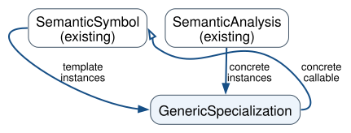
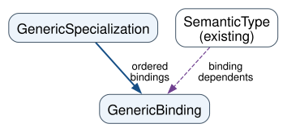
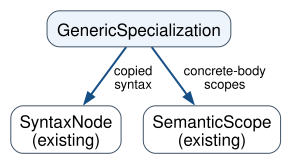

# Chapter 11 — Generic Functions and Compile-Time Type Selection

<!-- ch11-model:start -->

These views introduce only Chapter 11 relationships. Earlier source, scope,
and analysis ownership remains in force; the companion links to those figures.

**Template and concrete callable ownership.**



- **SemanticAnalysis:** Owns all specializations, scopes, facts, and canonical types; retires derived IR before semantic teardown.
- **SemanticSymbol:** A declaration identity. Templates remain lookup-visible and own their instances; a separate concrete callable is co-owned by its specialization and lexical scope.
- **GenericSpecialization:** A concrete callable keyed by its template and ordered canonical bindings. Analysis and template co-own it; it owns its callable, binding occurrences, copied syntax, and concrete-body scopes.

**Ordered bindings and canonical dependencies.**



- **GenericSpecialization:** A concrete callable keyed by its template and ordered canonical bindings. Analysis and template co-own it; it owns its callable, binding occurrences, copied syntax, and concrete-body scopes.
- **GenericBinding:** One ordered type-argument occurrence, owned by its specialization. Its canonical type retains the reverse dependency; retiring that type retires the specialization without retiring other argument types.
- **SemanticType:** One analysis-owned canonical identity. Immutable keys depend on element, nominal declaration, or ordered tuple components; retirement invalidates users, never shared ingredients.

**Independent checked bodies and scope lifetimes.**



- **GenericSpecialization:** A concrete callable keyed by its template and ordered canonical bindings. Analysis and template co-own it; it owns its callable, binding occurrences, copied syntax, and concrete-body scopes.
- **SyntaxNode:** Source-owned syntax with original byte offsets. A specialization additionally owns each copied node; its facts are private to that instance, and it never becomes a parsed root.
- **SemanticScope:** An analysis-owned lexical environment. A specialization additionally owns every concrete-body scope; lexical child links remain non-owning.

**SemanticFact** also gains a selected-arm child index. It is value data, not another object relationship.

[Exact fields, reverse links, co-owners, and retirement](figures/ch11-relationships.md).

<!-- ch11-model:end -->

## Introduction

We can now write functions for arrays, tuples, and structs. But a function that merely returns its argument should not need a separate handwritten version for every type. Nor should a generic function need a runtime type tag to choose an operation already determined by the compiler.

This chapter adds ordinary generic functions, argument-based type inference, `typeof`, and `matchtype`. We specialize functions into concrete checked bodies, then use the existing borrow analysis, execution IR, and C emitter. This increment supports unconstrained ordinary generic functions. Generic classes, generic methods, overload sets, and optional named capability constraints remain later work; we do not add a second execution pipeline.

The difficult part is not substituting the spelling `i32` for `T`. It is preserving identity, independent checked facts, discovery order, and cleanup while the compiler creates new functions during checking.

## TL;DR

Keep the generic template as the one declaration found by name lookup. Identify each specialization by that actual declaration and its complete ordered list of canonical type bindings. Reuse an existing specialization before allocating anything. New concrete callables receive signatures before their bodies enter a growing work queue.

Give each specialization its own copied syntax and semantic facts, retaining original source offsets. Do not check one mutable syntax tree repeatedly under different bindings. Explicitly own every derived node and scope, and retire IR before destroying the semantic objects it uses.

Infer types by matching declared parameter shapes against once-checked argument types. This is bounded structural matching, not a search for a common type. Repeated variables require exact canonical identity; explicit arguments retain ordinary contextual conversions.

Check `typeof` operands and `matchtype` subjects for their static types without executing them or leaking their flow-state changes. A type query may inspect a declared but uninitialized variable. It does not initialize that variable or make a later read safe.

For `matchtype<U>`, validate every pattern, then select the first match with a fresh binding map per arm. Check only that arm's body. Feed the selected block through ordinary flow and lifetime checking. Lower it directly, without a runtime condition, while preserving its lexical cleanup boundary.

## 1. Give each concrete function a stable identity

Start with:

```lyric
func identity<T>(value:T)->T {
    return value
}

func main() {
    assert(identity<i32>(7)==7)
    assert(identity<bool>(true))
    assert(identity<i32>(9)==9)
}
```

There are two concrete functions here, not three. The third call reuses the first specialization. Their keys are the original `identity` symbol paired with `[i32]` or `[bool]`. The key uses actual canonical objects, not names, hashes alone, generated C labels, or the address of the calling syntax.

Put the new declarations and persistent fields in `Common/GenericSpecialization.cs`; implement their operations in the semantic module. Extend existing Common declarations for the reciprocal links. A specialization owns ordered binding occurrences. Two positions may point to the same type: `<i32,i32>` still has two positions, just as a tuple has two component occurrences. Never collapse them into a set.

Before attachment, validate that the template is live, is an ordinary generic function, belongs to a live analysis, and has the right number of parameters. Every concrete type must be live and belong to that same analysis. Refuse a duplicate complete key without modifying the existing specialization or its IR. The lookup operation compares template identity, binding count, and every ordered binding.

### One public name, several callable identities

Ordinary scope registration rejects an already-visible name. Adding a second global symbol called `identity` would conflict with that rule. Renaming the specialization and recovering its meaning from the new spelling would merely hide the identity problem.

Keep the template lookup-visible. A concrete callable remains owned by the template's lexical scope but is excluded from ordinary name lookup and additionally owned by its specialization. Calls resolve the template, obtain the concrete callable, and retain that actual symbol in their semantic facts. The emitter can assign a private C name later.

Before constructing the concrete callable, validate all proposed parents together: its scope must be the template’s scope, its declaration must be the specialization’s copied root, and its type must belong to the same live analysis. Do this before attaching to the specialization. Otherwise a later refusal can enter ordinary destruction through the newly installed back-reference and retire an existing specialization and its IR. Test incompatible scope, type, and declaration inputs directly, asserting unchanged memberships and IR.

Concrete type bindings become ordinary type symbols in the callable's private scope. The existing type resolver can then resolve `T`, `[T]`, and `(T,bool)` through its normal scope path. Those type symbols retain normal canonical-type backlinks; no copied type table or alternate resolver is needed.

Deferring body checking does not defer declaration admission. Before setting a template aside, require an ordinary generic function without a separate implementation or named constraints. Validate type-parameter and value-parameter names using the existing duplicate and no-shadowing rules, including collisions between the two parameter groups. The parser can recognize constraint syntax for the eventual language without this increment admitting constrained declarations.

An unused template body may contain operations that only make sense for some types. Do not check it as though its type parameters were concrete. Check the body when an actual call supplies complete bindings. A selected specialization still receives all ordinary type and safety checks; generic syntax is not permission to postpone an invalid operation until runtime.

## 2. Copy syntax without destroying the analysis

Each syntax node has one semantic fact and declaration links. Checking the same node first as `i32` and then as `bool` would overwrite the first result. The two specializations therefore need separate checked syntax.

Copy the template's callable declaration subtree, including its signature and body, with an explicit traversal stack, preserving kind, original source, byte offset, child order, and token span. Do not copy facts, resolved symbols, or scope state. Omit the root's generic-parameter list in the concrete copy; its bindings now live in the private scope. Retain the template relationship on the specialization instead of reconstructing it from source text.

There is a trap here. Ordinary syntax construction and mutation clear the source's semantic analysis. That is correct for editing parsed source, but doing it while creating a specialization would destroy the analysis performing the copy.

Introduce an explicit derived-node construction path with the specialization as a parent. The source still owns the node and supplies byte provenance; the specialization co-owns its derived lifetime. Derived nodes never join the parsed-root list or change the original syntax tree. Keep their construction controlled: once the concrete callable is attached, its copied structure is fixed. Do not introduce a general-purpose flag that lets arbitrary source edits bypass invalidation.

The derived-node add operation must itself enforce admission, not rely only on its constructor’s checks. Pass the intended source to that operation; require a fresh node with no source membership, tree links, facts, or symbols, and a live source in the specialization’s compilation. Never adopt an already-parsed node, even from the same compilation. A reciprocal backlink would make such adoption internally consistent but still give the specialization authority to destroy unrelated source syntax.

### Lexical ancestry is not ownership

The first lifecycle probe found a defect that successful execution did not reveal: copied nodes retained semantic relationships after retirement. Ordinary source-node destruction had relied on clearing the whole analysis. Derived-node destruction could not make that assumption.

Nested scopes exposed the same distinction. A lexical parent lets lookup reach outer declarations; its child links are nonowning. Destroying a function scope does not automatically destroy every nested block scope. The specialization must explicitly co-own those scopes with the analysis. Scope construction propagates that owner into nested blocks and selected type arms.

Teach and implement retirement in dependency order:

1. Clear derived IR while its semantic dependencies still exist.
2. Mark the specialization retired before cascading, because another owner can lead back to it.
3. Destroy its concrete callable and all owned concrete-body scopes.
4. Destroy every derived syntax node, including its attached facts and declaration links; remove source memberships through the source's operations.
5. Destroy binding occurrences, detaching their canonical-type reverse memberships without destroying shared types.
6. Detach the specialization from its template and analysis through their complete remove operations.

A binding cannot be removed from a live specialization while leaving an incomplete key. Retiring a binding's type retires the dependent specialization. Retiring one specialization must not retire the other canonical types in its key. Failed construction must run the same cleanup for memberships already established.

Check these paths directly in your own model tests. Preserve parsed-tree serialization while constructing specializations; try retirement through the analysis, template, type, specialization, copied node, and concrete scope. Assert complete detachment, not just that garbage collection can eventually reclaim memory. The public execution graders establish observable language behavior; they do not inspect every in-memory backlink.

## 3. Discover signatures before bodies

A fixed loop over parsed functions is no longer enough. Checking one concrete body can discover another:

```lyric
func identity<T>(value:T)->T { return value }
func forward<T>(value:T)->T { return identity(value) }
```

Keep a growing list of concrete bodies to check. Register a new callable before completing its signature, finish the signature before admitting ordinary calls against it, and enqueue its body once. Drain the list by index so additions during checking are included. Field defaults can discover generic calls too; include their discoveries before finishing this drain.

Same-key recursion must find the existing callable instead of constructing another. Once all concrete bodies are checked, run the existing borrow/effect fixed point over the complete body set. Do not run safety analysis on an early prefix and silently omit later discoveries.

### Explicit signatures can depend on other signatures

Explicit results avoid inference from function bodies, but `typeof` can still introduce a signature dependency:

```lyric
func answer()->typeof(later()) { return 9 }
func later()->i32 { return 7 }
```

Make signature completion demand-driven and idempotent. Track active and completed function identities in temporary checker state. Before checking a call's arguments, ensure the target's signature is complete. A request for a completed signature is harmless; a request for one already active indicates a signature dependency cycle and produces `LYC345`.

Parameter type annotations retain Chapter 10’s outer-scope resolution. Register parameters before resolving the result annotation so `typeof(parameter)` has a declaration type to inspect. Save and restore the current checking-function context when completing another signature. This context also identifies the requester for specialization-depth accounting.

A separately implemented method has two parameter-name environments. For `func f(x:i32)->typeof(x)` implemented as `func S.f(y:i32)->typeof(y)`, resolve the declaration result with `x` and the implementation result with `y`, then compare their canonical types. Keep the body’s function scope populated with implementation parameters. An analysis-owned sibling lexical scope holds declaration parameters and their syntax backlinks; it does not introduce another callable or make declaration names visible in the body. Retain it with the analysis so query facts keep valid symbol dependencies.

Every signature traversal that can resolve a query must admit discovery, including validation of separate implementation results. Iterate the growing function list by index and complete each newly encountered signature before validating its result contract. Fixing only the initial signature loop leaves the later loop vulnerable to the same collection-growth failure.

Two integration failures justified this design: signature-time generic discovery modified a collection being enumerated, and a forward call reached a missing parameter scope. A growing indexed work list and explicit signature states solve different problems; neither substitutes for the other.

### Bound discovery depth, not program breadth

A function can request endlessly new types: `grow<T>` can call `grow<[T]>`, which requests another array layer each time. Reusing identical keys does not stop that chain.

Allow discovery depth through 1,024, with an ordinary root request at zero. A newly discovered specialization requested from a specialized function has the requester's depth plus one. Keep this temporary accounting keyed by actual specialization identity. Reuse an existing key before applying the bound. Reject a new request beyond the bound at its call site with `LYC344`, before constructing another specialization.

This is not a total monomorphized-function cap: thousands of independent roots are permitted. It is a first-discovery resource bound, not a proof of termination or a complete memory budget. The retained cases distinguish broad roots, an exact-depth finite chain, reuse at the boundary, and unbounded growth.

## 4. Infer bindings from arguments once

For an inferred call, walk each declared parameter pattern against the corresponding actual argument type:

- `T` binds an unbound variable or checks an existing binding for exact identity.
- `[T]` requires an array and descends into its canonical element type.
- `(T,U)` requires a tuple of matching arity and visits corresponding positions.
- `(T,)` is a singleton tuple; `(T)` is grouping.
- Concrete portions do not create bindings. Validate the completed concrete signature with the ordinary argument-compatibility rules.

Use a work stack for composite matching. The parser already distinguishes grouping from a singleton tuple by its comma. A grouping node may have no text anchor; test its shape and anchor before reading token text. A retained case caught a crash caused by treating every structural node as a token-bearing node.

Check actual arguments once, left to right, without using unresolved parameter variables as contextual hints. Value arguments use the normal expression checker; explicit reference parameters use the normal reference acquisition and writability checker. Retain the resulting actual types, infer the bindings, obtain the concrete signature, and validate compatibility using those recorded results. Do not acquire a reference or perform semantic flow effects again merely to check the completed signature.

Repeated variables do not negotiate widening. If `T` is inferred as `i32` from one argument and `i64` from another, reject the conflict. An explicit type argument can instead request a concrete parameter type and its ordinary permitted conversions. Do not infer missing variables from the destination or expected return type. If arguments cannot determine every binding, require explicit arguments.

Nondiagnostic hints are not checked facts. They neither establish all expression errors nor acquire storage for a reference. Reusing a preview pass as the inference authority would skip necessary checking. Conversely, checking an expression twice can duplicate facts or flow changes. Keep preview, actual checking, matching, and completed-signature validation distinct.

## 5. Ask for a type without reading a value

Add `typeof(expression)` to the canonical PEG and the handwritten type parser, with a dedicated syntax kind and keyword classification. Parse its operand as an ordinary parenthesized expression. A type query is permitted wherever the supported type grammar permits a type, including annotations, composites, casts, and explicit generic arguments.

```lyric
var source:i32
let value:typeof(source)=7
```

This is valid because querying the declared type does not read uninitialized storage. A later evaluated read of `source` still fails definite-assignment checking. Similarly, asking for an expired reference's type does not access its target or make the reference valid again.

Use the real expression checker in an explicit unevaluated context. Save and restore definite/possible assignment sets, loop state, and protected-storage context in `finally`. Suppress runtime initialized-read checks there, not name resolution, operand type checking, or writable-storage requirements. Temporary assignments inside a queried conditional must not initialize outer variables or change the evaluated path's state.

Cache the resulting canonical type in a fact on the query node. Preview remains a separate nondiagnostic operation that may return an available hint without attaching facts. A cast or branch preview must not accidentally perform the real operand check twice.

Borrow traversal must stop at the query before registering runtime temporaries or visiting the operand. IR lowering emits the actual initializer or cast operation, not the expression queried for its type. A call inside a query can require signature completion and discover a specialization, but it must not execute at runtime. Validate unknown names and invalid arithmetic normally; do not replace an intended type rejection with an arbitrary unsupported-feature diagnostic.

## 6. Select a type arm before execution

The syntax declares bindable names once:

```lyric
func describe<T>(value:T) {
    matchtype<U> value {
        (U,) => { println("singleton tuple") }
        [U] => { println("array") }
        _ => { println("other type") }
    }
}
```

Use the existing header-expression parsing boundary so the following brace begins the arm list rather than a record expression. The optional header is a name-only declaration list, not the function type-parameter helper's constraint grammar. Each arm contains a type pattern or whole-pattern `_`, an arrow, and a block. Ordinary newlines or semicolons separate arms. Parse every block, even when it will not be selected.

First validate duplicate and shadowing header names and resolve every concrete name in every pattern. A misspelled concrete type is an error even after an earlier matching arm. Only declared header variables may bind; unknown names never silently become variables.

Then match in source order with a fresh map for each arm. Concrete leaves require exact canonical identity, not argument conversions: an `i32` subject does not match an `i64` pattern. A repeated variable requires equal canonical types. `(U,U)` matches `(i32,i32)`, not `(i32,bool)`. A failed arm's partial bindings must not contaminate the next arm. `_` matches without binding anything. No selected arm produces `LYC346`.

Create a normal lexical scope for the selected arm and install only the type variables acquired by its pattern. In `matchtype<U> value { i32 => {...} }`, that body's pattern did not bind `U`; using `U` there is an unknown-type error. Bindings do not escape the arm, and independent sibling arms can use the same header names.

Store the selected arm's immutable child position in the match node's fact. Validate the position and node kinds before attaching the fact. The syntax already owns its children; a redundant stored arm pointer would need another relationship without adding meaning. Syntax changes invalidate the fact and its selection.

### A selected block is still a block

Check the subject through the same unevaluated operation as `typeof`. Check only the selected body, using the ordinary block checker. A statement arm can initialize a variable, return, break, or continue. Since selection is already known, there is no runtime branch-state intersection with the other arms. An unselected assignment must not initialize anything.

In a value position, require a value-producing selected block under the existing block rules. Do not infer function return signatures from that value or expand the language's treatment of noncontinuing value expressions as an incidental part of this feature.

Borrow analysis must visit only the selected block. Reuse its outgoing-result snapshot and post-cleanup validation. An unselected array resize cannot invalidate a live reference, but a selected resize still can. A struct carrying a reference to an arm-local variable cannot escape through the arm's result merely because its type was selected statically.

## 7. Lower the selection without losing cleanup

Do not manufacture a boolean condition and lower `matchtype` as an `If`. Neither the subject nor the unselected blocks belong in executable IR.

Lower the selected block directly into the enclosing execution region. Save the current boundary of that region's owner list. While lowering the arm, register locals and temporaries normally. This allows ordinary `return`, `break`, and `continue` cleanup to see all currently live holders.

On normal completion, preserve the outgoing result holder before dropping the other arm-local holders. Preserve the stable holder itself; do not replace it with a transient `Move` consumed more than once. A transfer and the storage holding its result have different ownership contracts. Remove the arm's ownership suffix and retain the surviving result in the enclosing region. Apply any already-validated widening at the ordinary result boundary. Unit selection still executes selected statements and cleans up their values.

On a noncontinuing path, use the existing transfer cleanup; do not fabricate a result or append unreachable cleanup. Remove the temporary bookkeeping after the transfer has been scheduled. An owned array or tuple result must survive its arm; a counted local that is not returned must finalize before the following statement.

Generic lowering also needs a complete callable inventory. Skip unresolved templates; register concrete functions before lowering calls. Have C emission enumerate actual source-kind IR functions instead of independently rebuilding its callable list from parsed declarations. Keep generated destructors and field-initializer bodies in their existing categories. Source traversal may still identify class storage and the entry point, but it must not omit discovered concrete callables or emit unresolved templates.

The retained IR inspection looks at `main` in a small selection example. Its only call must target the selected function, and it must contain no runtime `If`. The subject and unselected function declarations may still exist in the program; the requirement concerns executed operations, not an unrelated dead-code elimination pass.

## Exercises and completion

Start from the accepted Chapter 10 implementation. Keep public graders outside your solution and read-only. Do not inspect another Chapter 11 implementation or private repair history. The public language specification, PEG, fixtures, comparison rules, and earlier chapter teaching are available inputs.

1. Add the specialization vocabulary, ordered dependencies, copied syntax, complete relationship operations, and retirement paths. Test refused attachments and shared-owner teardown directly.
2. Extend signature completion and body discovery without duplicating the checker, borrow engine, or backend. Demonstrate explicit calls, reuse, recursive discovery, and the depth boundary.
3. Implement once-checked structural inference, preserving explicit-call conversions and reference acquisition.
4. Add `typeof` and its isolated semantic context. Test forward signature dependencies, cycles, and non-evaluation.
5. Extend both grammars for `matchtype`, validate all patterns, and check only the selected body. Integrate flow, result ownership, borrows, and selected-only IR.
6. Run every retained check through this chapter in both configurations, the separate PEG checks, and the walkthrough. Review declarations and cleanup paths as well as output.

From the repository root, with an installed .NET 10 SDK, Python 3, a C11 compiler, Node 22 or newer, and the repository's installed pinned Peggy dependencies:

```sh
DOTNET=/path/to/dotnet
make DOTNET="$DOTNET" test
DOTNET="$DOTNET" node tools/peg/test.mjs
DOTNET="$DOTNET" node tools/peg/test.mjs graders/ch03/cases.json
DOTNET="$DOTNET" node tools/peg/test.mjs graders/ch11/type-syntax.json
DOTNET="$DOTNET" node tools/peg/test.mjs graders/ch11/matchtype-syntax.json
make DOTNET="$DOTNET" spin11
```

Replace `/path/to/dotnet` with your installed SDK command. If graders are supplied outside the solution, use `make DOTNET="$DOTNET" GRADERS=/absolute/path/to/graders test` and supply their actual paths to the PEG commands. The PEG harness uses the Release assembly for lexical tokens; run the build/cumulative target first. Missing tooling is a setup issue, not permission to download dependencies automatically. The C harness accepts `CC` for the installed C compiler; Make accepts `PYTHON` and `NODE` where applicable.

For an isolated macOS build using already-installed Command Line Tools, use direct tool paths and an explicit SDK rather than relying on Apple launcher discovery:

```sh
export CC=/Library/Developer/CommandLineTools/usr/bin/clang
export PYTHON=/Library/Developer/CommandLineTools/usr/bin/python3
export SDKROOT=/Library/Developer/CommandLineTools/SDKs/MacOSX.sdk
export DOTNET_GENERATE_ASPNET_CERTIFICATE=false
/Library/Developer/CommandLineTools/usr/bin/make DOTNET="$DOTNET" PYTHON="$PYTHON" test
/Library/Developer/CommandLineTools/usr/bin/make DOTNET="$DOTNET" PYTHON="$PYTHON" spin11
```

Verify those installed paths for your environment; they are not portable requirements. In a confined workspace, also set `DOTNET_CLI_HOME`, `NUGET_PACKAGES`, and `TMPDIR` to writable local directories before the first SDK invocation. `DOTNET_SKIP_FIRST_TIME_EXPERIENCE=1` alone did not suppress the SDK's development-certificate setup message in reconstruction. Set the certificate-generation flag before first use. Direct Clang required the explicit SDK to find system headers; the system Make launcher attempted a sandbox-denied external cache write, whereas direct Make completed the walkthrough without that warning. Preserve setup diagnostics rather than treating them as language failures or attempting host cleanup.

All cases in the three Chapter 11 runners and their syntax fixtures are retained; none is chapter-only. See [the public grader contract](../graders/ch11/README.md) for focused commands and exact comparison rules. Positives require successful C emission and execution at both optimization levels with exact output and no unexpected stderr. Negatives require the intended located diagnostic and exit status, not a crash or arbitrary failure. The IR inspection and its corruption controls are retained too.

The source-linked development model probe is supplementary author evidence, not a hidden student grader or a replacement for public behavior. Your structural self-review must still account for all owners, backlinks, refused mutations, derived syntax, and scope retirement. Passing output tests does not certify those relationships.

## Take it for a Spin

Run `make DOTNET=/path/to/dotnet spin11` from the repository root. It builds Release, displays the source, emits C, builds that C with your installed compiler, and executes it. The script uses disposable local files and deletes them afterward, including on failure. The walkthrough script makes no network calls, needs no credentials, and installs nothing; configure SDK first-use behavior as described above.

The program defines `identity<T>` and `describe<T>` as shown above. It copies `[3]` through an inferred generic call, changes the copy to `[9]`, and asserts that the original remains `[3]`. It then declares `number` using `typeof(noisy())`; `noisy` would print an error marker if executed. Finally it calls `describe` on a singleton tuple, an array, and an integer.

After the displayed source, the execution section must contain exactly:

```text
generic array copy stays independent
type query did not execute
singleton tuple
array
other type
```

There must be no `ERROR: type query executed` line. The script checks the process exit, stdout bytes, and stderr as well as the assertions. Try changing a pattern to an unknown concrete name: it should fail even if an earlier arm matches. Try changing an unselected body to a type-invalid expression while keeping it syntactically valid: it should remain unchecked until a call selects that arm.

These experiments distinguish parsing, pattern validation, selected checking, and execution. The whole chapter is ready for acceptance only after reconstruction and human use, not merely because this demonstration prints five lines.
