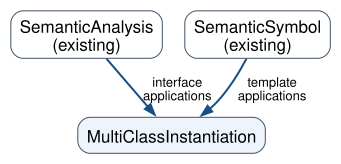
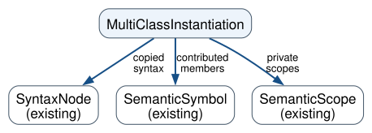
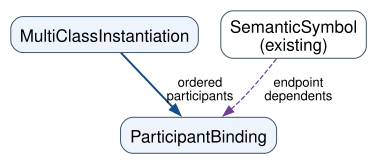
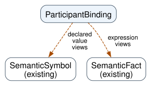
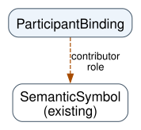
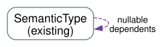

# Chapter 12 — Multi-Class Generics and Explicit Links

<!-- ch12-model:start -->

These views introduce only Chapter 12 relationships. Earlier source, scope,
and analysis ownership remains in force; the companion links to those figures.

**Application ownership.**



- **SemanticAnalysis:** Owns canonical types, scopes, facts, generic specializations and multi-class instantiations. Retires derived IR before semantic teardown.
- **MultiClassInstantiation:** One compile-time interface application, keyed by its template and ordered class/label occurrences. Analysis and template co-own it; it owns contributions, private scopes, copied syntax and participant occurrences.
- **SemanticSymbol:** A declaration identity: interface template, concrete class, contributed member, or lookup-only member namespace. Scope owns each symbol; an instantiation also owns its contributions. A namespace adds no runtime object.

**Generated material.**



- **MultiClassInstantiation:** One compile-time interface application, keyed by its template and ordered class/label occurrences. Analysis and template co-own it; it owns contributions, private scopes, copied syntax and participant occurrences.
- **SyntaxNode:** Source-owned syntax with original byte offsets. A generic specialization or multi-class instantiation co-owns its copied nodes, never both; copied nodes are not parsed roots.
- **SemanticSymbol:** A declaration identity: interface template, concrete class, contributed member, or lookup-only member namespace. Scope owns each symbol; an instantiation also owns its contributions. A namespace adds no runtime object.
- **SemanticScope:** An analysis-owned environment. An instantiation additionally owns its private annotation and method scopes; lexical ancestry remains non-owning.

**Participant occurrences and class dependencies.**



- **MultiClassInstantiation:** One compile-time interface application, keyed by its template and ordered class/label occurrences. Analysis and template co-own it; it owns contributions, private scopes, copied syntax and participant occurrences.
- **ParticipantBinding:** One ordered participant occurrence, owned by its instantiation and dependent on a concrete class. It keeps contributor and lookup-view relationships separate; position and label are value data.
- **SemanticSymbol:** A declaration identity: interface template, concrete class, contributed member, or lookup-only member namespace. Scope owns each symbol; an instantiation also owns its contributions. A namespace adds no runtime object.

**Declared and expression value views.**



- **ParticipantBinding:** One ordered participant occurrence, owned by its instantiation and dependent on a concrete class. It keeps contributor and lookup-view relationships separate; position and label are value data.
- **SemanticSymbol:** A declaration identity: interface template, concrete class, contributed member, or lookup-only member namespace. Scope owns each symbol; an instantiation also owns its contributions. A namespace adds no runtime object.
- **SemanticFact:** An analysis-owned checked expression. Its canonical type and optional participant view describe runtime representation and compile-time lookup separately.

**Member contribution role.**



- **ParticipantBinding:** One ordered participant occurrence, owned by its instantiation and dependent on a concrete class. It keeps contributor and lookup-view relationships separate; position and label are value data.
- **SemanticSymbol:** A declaration identity: interface template, concrete class, contributed member, or lookup-only member namespace. Scope owns each symbol; an instantiation also owns its contributions. A namespace adds no runtime object.

**Nullable type dependencies.**



- **SemanticType:** One analysis-owned canonical identity. Immutable keys depend on element, nominal declaration, or ordered tuple components; retirement invalidates users, never shared ingredients.

[Exact fields, reverse links, co-owners, and retirement](figures/ch12-relationships.md).

<!-- ch12-model:end -->

## Introduction

Multi-class generics are the most exciting language feature I’ve seen since object-oriented programming.

We’ve just built them in Lyric. I expect the result will be a wild increase in code reuse.

Generics gave us reusable containers and algorithms. What I’ve wanted for years is a straightforward way to reuse entire sets of algorithms on *my* classes.

A linked list is a simple example of what I want to change.

The parent needs a first and last child. Each child needs a parent, previous sibling, and next sibling. Append and remove must update both sides consistently.

That’s one reusable idea, but its implementation spans two classes.

In Lyric, I can write that collaboration once, then apply it directly to my domain classes:

```lyric
impl DoublyLinkedList<Graph:nodes, Node:graph> {}
```

That contributes the fields and methods to `Graph` and `Node`. Now I can write:

```lyric
graph.nodes.append(node)
graph.nodes.remove(node)
```

No separate list-node wrapper. The links belong to my actual domain objects.

Want the same node to participate independently in another list?

```lyric
impl DoublyLinkedList<Graph:selected, Node:selection> {}
```

Same classes. Different membership. Separate links.

The unit of reuse is no longer just a class or a function. It’s a cooperating set of classes.

Lyric spells these declarations `interface`, but “multi-class generics” better describes what they do. This is compile-time composition, not dynamic interface dispatch.

Existing libraries already achieve impressive generic reuse. I’m not claiming that became possible for the first time. What excites me is how directly I can express it here.

The larger ambition is graph libraries, trees, and other reusable collaborations that fit the objects in your application instead of forcing your application into someone else’s object model. The linked list is our first working example, not the limit of the idea.

I don’t just want reusable data structures. I want reusable algorithms, applied to *my* data structures.

That’s what we’re building in this chapter.

### What this chapter builds

An explicit `impl` binds ordered participants to concrete classes and requests their declared contributions. Calls use ordinary checked functions and the existing execution IR. The labels organize members at compile time; they do not allocate wrapper objects.

**This is an intentionally incomplete safety milestone.** Ordinary object-reference fields are writable here so we can implement and exercise relationship algorithms directly. Assignment to such a field does not register a relationship, prevent endpoint destruction, or arrange automatic detachment. Our examples remove memberships before destroying endpoints. The later relationship chapter will restrict managed-link mutation and generate relationship-aware teardown. Do not build a new persistent heap-attachment checker as a prerequisite for this chapter.

Existing definite-initialization checks, nullable access checks, counted ownership, and established borrow checks remain required. Counted fields retain their targets and can form cycles. Ordinary fields do not keep their targets alive. Neither rule becomes a different ownership policy merely because the field was contributed by an interface.

## TL;DR

Keep one semantic instantiation for an interface declaration and its complete ordered endpoint bindings. An endpoint records its concrete class, position, and optional placement label. Two roles bound to the same class are still different occurrences. A label selects a member namespace, not a runtime wrapper.

Preflight the complete contribution before changing any class. Copy the interface syntax into instance-owned checking state, bind participant names privately, and register the actual contributed symbols. Preserve those identities through checking and lowering; never reconstruct them from generated C names.

Keep a declaration's contributing participant separate from the participant view of its value or function result. A parent method may return a child-view value. Scalar views survive nullable wrapping and explicit unwrap; they do not propagate into array or tuple elements. A concrete type annotation deliberately selects the concrete class rather than retaining an inferred participant view.

Represent nullable class handles with the existing empty sentinel. An internal empty slot is not an initialized nonnullable language value. Explicit `!` checks for null in normal safe mode; `--unsafe` omits that check. Identity comparison neither unwraps nor narrows its operand.

Implement the list using ordinary fields. Append validates detached membership before its first write. Remove validates the parent before its first write, reconnects neighbors and endpoints, then clears the child's three links. Explicit removal is what breaks counted cycles and makes endpoint teardown appropriate in our examples.

## 1. Bind several classes without inventing a runtime object

The source form is:

```lyric
interface DoublyLinkedList<P, C> {
    class P {
        first:C?
        last:C?
        // append and remove belong to this participant.
    }
    class C {
        parent:P?
        previous:C?
        next:C?
    }
}
```

The participant blocks contribute members to `P` and `C`; they do not declare nested nominal classes. Each participant name must belong to the interface's parameter list. The methods inside a block have ordinary unqualified names. Parse these blocks using the existing aggregate syntax vocabulary rather than creating a second field/method grammar.

An empty implementation requests these contributions:

```lyric
impl DoublyLinkedList<Graph:nodes, Node:graph> {}
```

The parent fields and methods enter `Graph.nodes`, and the child fields enter `Node.graph`. `graph.nodes.append(node)` passes the original `Graph` as receiver. There is no allocated `nodes` object and no additional receiver evaluation. The namespace is semantic placement only; its fields are physical fields of the enclosing class.

Resolve each participant argument to its canonical type and require a nominal class identity. Reject `Graph?` and `[Graph]`: neither is the concrete class itself. A helper that reaches a class through `Element` wrappers is useful for storage and effect queries, but is not this admission test. Check the canonical kind before publishing an endpoint; do not silently discard a nullable wrapper.

Labels are optional independently. `Graph:nodes, Node` places the parent contribution under `nodes` and the child contribution directly in `Node`. Omission means flat placement, not a search across every role. Labels must not collide with ordinary members or another instance's label on the same class. Even disjoint sets of inner member names do not permit two instances to share a class-and-label pair. Flat contributions must have disjoint member names.

This increment accepts field declarations and supplied method bodies through empty implementations. It does not add overrides, mappings onto existing fields, implicit conformance, generic classes, erased dispatch, or a capability-constraint subsystem. Checking a body may discover that a concrete class lacks an operation it needs; that is ordinary specialization checking, not permission to inject unrequested storage.

## 2. Make endpoint occurrences authoritative

Declare `MultiClassInstantiation` and `ParticipantBinding` in Common and implement their operations in the semantic module. The analysis and interface template strongly own an instantiation. It owns its ordered endpoint occurrences, introduced symbols, copied syntax, and checking scopes. Existing source and scope owners remain real co-owners; do not replace them with an artificial ownership tree.

An endpoint's concrete-class link is a reciprocal dependency, not ownership of that class. Retiring the class invalidates its dependent instance. Retiring the instance removes its contributions but does not destroy the other participating classes.

Compare keys using the actual template and each ordered class-and-label pair. Do not key by the receiver alone, by generated names, or by an unordered set of types. A class may occupy both participant positions. The bindings `Graph:nodes, Node:graph` and `Graph:selected, Node:selection` must have separate fields and operations even though their canonical class types are identical.

Validate arity, live parents, analysis identity, labels, duplicate complete bindings, and contribution collisions before publication. Relationship admission must reserve the necessary collection capacity before changing either end. Constructor failure must retire only the candidate's newly attached parts, leaving existing instances and ordinary class members intact. Test refusals by checking unchanged memberships, not merely an exception.

### Derived syntax is owned, not borrowed source

Give each instantiation copied syntax and independent checked facts. Preserve original source offsets for diagnostics. Source and instance jointly own copied nodes, but those nodes never become parsed roots. An ordinary source edit invalidates analysis; the controlled derived-node path must not destroy the analysis that is constructing it.

A copied node may belong to a generic specialization or a multi-class instantiation, never both. Reject adoption of existing parsed nodes. Complete structural copying and seal it before checking bodies. Semantic facts may then be attached, but the copied tree is not a general mutable escape hatch.

Retirement follows dependency order: clear IR, mark the instance retired, destroy contributions, checking scopes, copied nodes, and endpoint occurrences, then detach from template and analysis. Marking first prevents owned-part callbacks from restarting the same cascade. Endpoint cleanup removes both ends of contributor and view relationships. It does not destroy the view's concrete class.

## 3. Resolve participant annotations in a private environment

A contributed `peer:C?` field cannot resolve `C` through the ordinary concrete class namespace: `C` is the interface's private participant name. Create one instance-owned annotation scope whose weak lexical parent is the template's declaring scope. The analysis and instantiation jointly own that scope. Populate it with private role aliases bound to canonical concrete class types and their endpoint views.

Resolve contributed field annotations there, then place each resulting field symbol in its concrete class or chosen member namespace. Contributed field declaration initializers are not admitted in this increment: initialize these fields in concrete constructors. The shared grammar recognizes an initializer such as `count:i32=0`, so syntax acceptance alone does not establish executable support. Methods retain their private binding scopes. Private aliases must not become public members of the concrete class.

This distinction was exposed by an executable field case: method-only contributions worked, but resolving a child-typed field reported an unknown participant name. The missing mechanism was a private binding environment, not a new heap-lifetime analysis.

Constructor completion must inventory every physical field, including fields inside semantic member namespaces. A constructor cannot complete with an uninitialized nonnullable contributed field. Explicitly initialize nullable links to `null` in the examples. An internally cleanup-safe sentinel does not satisfy language initialization.

### Connect registration, checking, and lowering

Extend the existing registration pass rather than checking an interface in a second compiler. Register templates and concrete classes, then ordinary class members. Only then process explicit multi-class implementations. This order makes collisions with ordinary fields and methods visible before contributions are admitted. Validate an unused template's participant names and duplicate declarations, but defer its participant-dependent bodies until an explicit binding supplies concrete classes.

For each implementation, resolve its ordered endpoint arguments and preflight the complete name inventory. Keep a temporary set of reserved names per concrete class: same-class participant occurrences must share this collision check even though their role identities remain distinct. A labeled occurrence reserves the label itself; a flat occurrence reserves each contributed name. Refuse duplicate complete instances before constructing a second owner.

After preflight, construct the instance inside a failure-cleanup boundary. Create its private annotation aliases, then copy the template with an explicit traversal stack, preserving each node's source and byte span. For each endpoint, choose its concrete member scope or create its lookup-only namespace scope. Register copied fields and methods there, attach their contributing role, and attach a separately resolved value view where applicable. Create each method's private role-alias scope and enqueue that actual method symbol in the existing function list. Seal the copied syntax after registration. If any step fails, destroy the candidate instance so its newly introduced symbols, scopes, and nodes cannot survive a failed compilation.

Complete signatures and check bodies through the ordinary function machinery after declarations exist. The implicit receiver is the physical concrete class; its participant view controls role-relative lookup. Use the existing initialization, borrow, ownership, and effect machinery for those bodies. Do not independently check the original template body as though it were another executable function.

For field lookup, an explicit member namespace selects its own scope. Otherwise try the receiver's participant members, then ordinary concrete-class members. This fallback permits participant code to use an ordinary concrete capability without searching unrelated labeled roles. Record the selected symbol and view in the checked fact; the emitter must not repeat name resolution.

Lower a namespace selection by forwarding its underlying receiver, not by constructing or loading a namespace object. The receiver path strips grouping and namespace selections before obtaining the object handle. Preserve once-only evaluation for computed and counted receivers. Inventory contributed physical fields and functions through semantic scopes, including namespace scopes, rather than only the original class's syntax children. Template and `impl` syntax do not independently emit executable bodies. This keeps one checked function identity, one execution IR, and one physical field for each contribution.

During construction, allow `self.label.field` as field selection only after validating the entire namespace path. That path must not let unfinished `self.label` escape as a whole object. Reads still require the selected physical field to be definitely initialized; constructor completion still requires all physical fields.

## 4. Preserve lookup views without changing runtime types

A symbol has two different relationships. `ContributingParticipant` identifies the role that introduced the declaration. `ParticipantView` describes the role through which its value, or function result, is used. Facts also retain a participant view. Keep these relationships reciprocal with the endpoint's user collections.

For example, a method contributed to `P` can return `C`. Its contributing role remains `P`, while its result view is `C`. Collapsing them makes same-class role bindings silently select the wrong methods.

Centralize view compatibility in `ParticipantBinding.AcceptsViewType`. Accept only the endpoint's canonical nominal class type or its canonical nullable wrapper. Reject wrong classes and containers. Use this rule when attaching symbol/fact views and when changing symbol types. Validate the new type before changing the old relationship; preserve a still-compatible view, and detach an incompatible view only after the type change is admitted.

Propagate views through participant annotations, grouping, inferred scalar locals, declared participant parameters/results, field facts, and checked unwrap. The hint pass must preserve the same role information for chained resolution without evaluating expressions, acquiring borrows, or deciding bindings through effects. Attaching views only in the generic expression-completion path is insufficient when field checking creates and returns its fact directly.

An inferred `let x=child` preserves its participant view. An explicit participant annotation selects that role when canonically assignment-compatible. An explicit concrete `Graph?` annotation discards the view. This is compile-time selection, not a runtime conversion and not proof that the class supplies every required operation.

`self.first!.next` illustrates the complete path: the field has nullable child-view type; `!` checks null and produces a nonnullable value with the same child role; member lookup selects that role's `next`. This must still work when both roles bind the same concrete class and when another independently labeled instance contributes identically named members.

## 5. Add nullable handles without inventing default objects

Nullable types in this increment wrap nominal class handles only. `Box?` is a different canonical type from `Box`; `[Box?]` is an array whose element is that wrapper. Do not admit optional integers, tuples, or structs merely because the parser recognizes optional-type syntax.

Use the existing canonical element dependency for the wrapper and maintain its reverse nullable-use collection. Destroying the base type retires dependent wrappers and their users; destroying a wrapper does not destroy the base class. Nullable wrapping does not add array depth or create inline recursive storage.

A nullable class value defaults to null. A nonnullable class value has no language default. Its local or field storage may contain a cleanup-safe empty sentinel before initialization, but that is not a readable object and does not satisfy constructor completion. Neither source `0` nor source `null` initializes a nonnullable handle. In this backend, slot zero can name a real object; null and internal empty handle storage use `UINT64_MAX`.

Context supplies the type of `null`. A nonnullable handle may widen to its nullable wrapper; the reverse requires explicit postfix `!`. Reject member access and destruction through a nullable handle until it is unwrapped. In safe mode, unwrap checks the sentinel and reports `LYR013` before producing the nonnullable result. Unsafe mode omits the check without changing evaluation or ownership transfer. Do not use a source program with a dangling handle to test this check: null is a valid nullable value, whereas an invalidated object is a different safety problem.

### Represent conversions in execution IR

Add `NullHandle`, `WrapNullable`, and `UnwrapNullable`. Null creation has no operands; wrapping and unwrapping each have one operand with the exact canonical base/wrapper relationship. Validate node arity, types, result modes, and ownership transfers independently of source checking.

For counted classes, wrapping and unwrapping consume a `Move` transfer and produce a new cleanup holder. They preserve the count, rather than retaining a second reference or treating the handle as a numeric conversion. Sequence the operand once, transfer it, perform the checked conversion, and register the result for cleanup. Null owns no reference. Preserve the existing rule that moved-from storage is empty and cleanup-safe.

### Typed emptiness must reach containers

Scalar null handling is not enough. A copied array of nullable counted handles may contain both null and live elements. The leaf-copy helper must skip retention only for nullable null entries; nonnullable counted arrays retain their strict invalid-empty check. Determine that policy from the innermost canonical element and carry it through recursive array copies. Array depth alone does not say whether a leaf is nullable.

Growth must write the element's typed empty value before publishing the increased length. Use the handle sentinel for nullable elements, the aggregate empty constructor for tuples, and the appropriate existing empty value for other defaultable elements. Reused storage may contain old bits; neither allocation nor a previous shrink proves it is zeroed. Aggregate empty construction must also recognize ordinary nullable handles, not only counted ones.

Retain the earlier defaultability boundary: nonnullable class elements cannot be invented by growth. Empty arrays, supplied-element append, and shrinking are different operations. Test nested nullable counted copies with both null and live elements, growth and regrowth, and checked unwrap of a newly grown null element. The finalizer count tests retention behavior for those programs, not general leak freedom.

### Equality observes identity, not permission to dereference

Permit `==` and `!=` on handles of the same canonical nominal class, with either operand nullable. Use one declared type query in source checking and IR validation. Different classes, handle ordering, and handle arithmetic remain invalid. A bare `null` needs nullable context; two untyped null literals do not supply a class identity.

Lower both operands through the ordinary once-sequenced evaluation path and compare their handle identities. Comparison must not consume counted holders. `if link != null` does not narrow `link`; accessing a field still requires `link!`. Nullable equality and participant-view selection are separate from lifetime validity.

## 6. Make counted fields visible to ownership and effects

Admit scalar ordinary and counted class fields, nullable or nonnullable, while preserving constructor definite initialization. Class-array fields and unit fields remain outside this slice. Initialize handle storage to its cleanup-safe empty representation before the first assignment could release an old holder.

Ordinary class fields are nonowning. Counted fields use normal retain-on-copy and release-on-replacement behavior. Copying a counted holder keeps the same object alive; it does not deep-copy that object's fields. Explicit destruction of a counted object remains a compile-time error.

Generated destruction calls the finalizer while the object's fields are live. After that call, load the stable object handle again and reselect each owned field, since the call may have grown class storage. Emit explicit `Unref` for scalar counted fields and the existing array release for owned arrays, then reclaim the object. Do not hide a new field-release operation in the C emitter where IR validation and safety effects cannot see it.

Destruction effects must include finalizers reached by releasing owned fields. Close each destruction event over counted field classes and known finalizer effects, using a visited set to terminate cycles in the class graph. The existing outer summary fixed point carries effects between functions. This is a conservative type-level effect closure, not traversal of runtime object relationships. In particular, copying a holder does not release its fields; destroying it may.

## 7. Maintain the list in ordinary source

The algorithm uses five fields: parent `first` and `last`, child `parent`, `previous`, and `next`. Each successful operation must leave both directions consistent. These fields have the ordinary ownership semantics just described; they are not yet compiler-managed relationship slots.

Append first asserts that the child's parent is null. With no writes performed yet, refusal leaves existing membership unchanged. Set the child's previous link to the old tail, its next link to null, and its parent to this parent. If the old tail exists, set its next link to the child; otherwise set first to the child. Finally set last to the child. The empty and nonempty cases share the same child-link initialization.

Remove first asserts that the child's parent equals this parent. If previous exists, set that neighbor's next to the child's next; otherwise replace first. If next exists, set that neighbor's previous to the child's previous; otherwise replace last. Then clear the child's parent, previous, and next. Singleton removal naturally clears both endpoints; head and tail removal each use one empty neighbor case.

The terminating assertion grader checks the intended `LYR010`, source location, method/main stack, empty stdout, and exit status. It cannot inspect the heap after termination. The guarantee that refusal performs no partial mutation also requires reading the method and verifying that its guard precedes every write. Do not report a fatal diagnostic alone as proof of rollback.

Keep endpoints alive while operating on a counted list. Its ordinary counted parent and neighbor fields can form cycles. Explicit removal clears the cycle before local holders are released. The lifecycle fixture checks `liveNGdone`, with one finalizer per endpoint, after all five membership slots become null. This is not the later policy in which only an owning membership retains the child and structural backlinks are nonowning.

Test empty, singleton, three-node middle/head/tail removal, detached state, and reattachment. Then bind another independently labeled list to the same classes. One child can belong to both lists; removing it from one must preserve the other. Test same-class participant roles separately as well. Run the list under both default and SoA layouts: the semantic namespace must not depend on a particular field-storage representation.

## Exercises and completion

Start from the accepted Chapter 11 implementation. Keep the public graders outside your solution and read-only. You may read the specification, grammar, earlier teaching, grader code, fixtures, and comparison rules; do not inspect another Chapter 12 solution or private repair history. The implementation language remains C#; public behavioral graders remain Python and the independent grammar checks use JavaScript, not C# or Lyric.

1. Extend participant-block and endpoint-label parsing in the handwritten parser and PEG. Run the same public syntax fixtures against both. Do not confuse syntactically valid binding syntax with a semantically valid contribution.
2. Implement instantiation and endpoint declarations, reciprocal ownership/dependencies, preflight, copied syntax, and retirement. Check same-class roles, duplicate admissions, refusal without partial contributions, and retirement through each strong owner. Review the opening relationship inventory against your actual declarations and cleanup operations.
3. Integrate private annotation/method environments, physical contributed fields, signatures, member lookup, constructor initialization, and ordinary lowering. Demonstrate flat and labeled placement without introducing runtime wrappers or evaluating a receiver twice.
4. Add scalar participant views independently of contributor identity. Test nullable fields, unwrap, inferred locals, declared participant results, concrete annotations that discard views, same-class roles, and independent labels. Keep arrays and tuples outside view propagation.
5. Implement canonical nullable handles, explicit IR conversions, checked unwrap, typed empty container growth, counted copy/drop, and same-class identity equality. Preserve nonnullable initialization and growth rejection. Validate malformed IR independently; do not execute dangling-handle experiments.
6. Integrate scalar counted-field release with generated IR and transitive destruction effects. Then implement the explicit list as ordinary Lyric source. Check all transitions, independent memberships, counted removal, and guard-before-write refusal. Do not substitute automatic relationship teardown for the manual contract taught here.
7. Run the cumulative public suite, separate grammar checks, structural self-review, and walkthrough below. Explain any setup failure or unperformed check; do not weaken a fixture or count an arbitrary crash as an intended rejection.

From the solution repository root, use an installed .NET 10 SDK, Python 3, a C11 compiler, Node 22 or newer, and the already-installed pinned Peggy dependency. Replace the SDK placeholder and, if needed, the grader directory:

```sh
DOTNET=/path/to/dotnet
GRADERS=/absolute/path/to/graders
make DOTNET="$DOTNET" GRADERS="$GRADERS" test
DOTNET="$DOTNET" node tools/peg/test.mjs
DOTNET="$DOTNET" node tools/peg/test.mjs "$GRADERS/ch03/cases.json"
DOTNET="$DOTNET" node tools/peg/test.mjs "$GRADERS/ch11/type-syntax.json"
DOTNET="$DOTNET" node tools/peg/test.mjs "$GRADERS/ch11/matchtype-syntax.json"
DOTNET="$DOTNET" node tools/peg/test.mjs "$GRADERS/ch12/multi-class-syntax.json"
make DOTNET="$DOTNET" spin12
```

For the author repository, `GRADERS="$PWD/graders"` selects its public suite. The Make target builds Debug and Release and runs all 33 public runners in each configuration, plus its comparison selfcheck. It includes Chapter 12 handwritten syntax recognition and all four behavioral runners. PEG remains separate and uses the Release compiler for lexer tokens; run the build/cumulative target first. Earlier retained checks and their corruption controls remain required, not just the newest cases.

Use `CC` for an alternate installed C compiler and `PYTHON` for the Python executable. Chapter 11's isolated macOS setup explains direct Command Line Tools paths, `SDKROOT`, local writable SDK/cache directories, and `DOTNET_GENERATE_ASPNET_CERTIFICATE=false`; retain those settings when applicable. Missing tools or dependencies are setup failures, not authorization to install or download them. In an isolated macOS workspace, test Node script startup, not only `node --version`: dynamic libraries and OpenSSL configuration may live outside the allowed runtime path. Ask the orchestrator to supply a bounded, verified runtime dependency bundle if necessary. The Chapter 12 student used local byte-identical libraries through a process-local `DYLD_LIBRARY_PATH` and an empty local `OPENSSL_CONF` for offline grammar checks. This did not change system configuration, permit network access, or disable TLS verification.

All Chapter 12 cases are **retained**; none is chapter-only. Stable identifiers are the syntax fixture IDs and named runner cases. The [public grader guide](../graders/ch12/README.md) provides focused commands and comparison contracts. Successful emitted programs require exit zero, exact stdout, and empty stderr at both C optimization levels. Compile-time negatives require their intended located diagnostic and exit one. Checked runtime failures require empty stdout and exit one. List refusals compare the exact assertion line and column, diagnostic, and method/main stack. Nullable unwrap failures compare the exact diagnostic text, source path, and main stack, but accept any positive line and column; their graders do not establish the exact unwrap position. The three invalid unsafe nullable cases are emitted for check-omission inspection only, never executed. The eight valid nullable programs also execute under unsafe mode; the three null-failure programs execute only in safe mode.

Passing behavior does not establish reciprocal model ownership, atomic admission, or guard-before-write ordering. Perform the structural review described above. Source-linked model and IR probes used during development are supplementary author evidence, not hidden student graders or a replacement for these public contracts. The author also exercised list layout variants explicitly; the cumulative target's receipt does not imply every fixture runs under every layout.

Completion requires these applicable retained checks and structural obligations, followed by independent reconstruction and human use under the book's workflow. The author reference passed its full cumulative suite and walkthrough before the narrow nominal-only participant-admission correction; clean Debug/Release builds and focused multi-class and nullable checks passed afterward. The single code and text reviews are incorporated. Independent Chapter 12 reconstruction passed all required automated checks and the walkthrough with runtime setup assistance. Bill has accepted the Chapter 12 text and `spin12` walkthrough. Do not interpret this intermediate chapter as a full ordinary-link memory-safety guarantee.

## Take it for a Spin

From the repository root, with the existing .NET 10 SDK, Python 3, and C11 compiler:

```sh
make spin12 DOTNET=/path/to/dotnet
```

Replace `/path/to/dotnet` with your installed SDK executable. Set `PYTHON` or `CC`
if those tools are not available through their usual names. The target builds
Release first so it cannot silently demonstrate a stale compiler. It installs
nothing and needs no credentials or network service.

The script prints the complete Lyric program before compiling and running its
emitted C. Its counted `Graph` and `Node` participants use ordinary counted link
fields, not automatic relationship ownership. The program appends two nodes,
removes the head, and removes the remaining node before local holders clean up.
Assertions check both directions and empty endpoints. The execution section must
print exactly:

```text
two nodes linked
head removed; second remains
all links detached; list empty
```

The script checks exit 0, exact stdout, and empty stderr. It removes its temporary
source, generated C, and executable even on failure; the normal Release build
products remain. Read `tools/spin12.py` to change the example deliberately. Do not
remove the detach operations and interpret surviving counted cycles as automatic
relationship cleanup.

The author ran this target successfully with a clean Release build. Your human
walkthrough and acceptance remain separate from that result.
